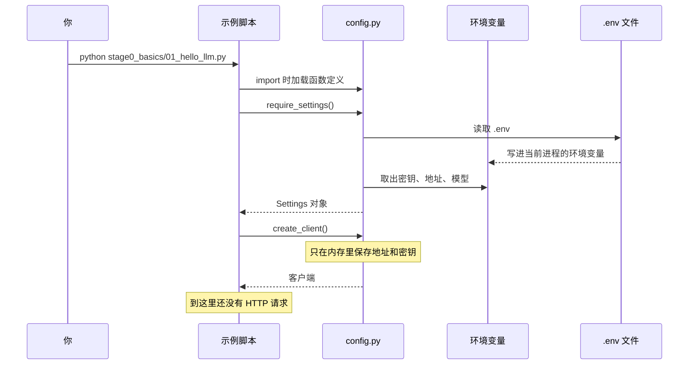

# 课前：配置怎么进程序

对应代码：`stage0_basics/config.py`。四个脚本一运行，最先执行的就是这个文件里的函数。建议先不运行模型，把这一课的「不花钱的实验」做完，再进入第 1 课。

## 这一课要解决什么问题

调用模型之前有三件容易混在一起的事：

1. Python 包装在哪里（虚拟环境）。
2. 密钥放在哪里（环境变量和 `.env`）。
3. 哪一步才真的会联网、才可能花钱（创建客户端不会，`create()` 才会）。

`config.py` 把这三件事收成两个动作：`require_settings()` 检查配置，`create_client()` 准备一个客户端。脚本自己不再各自读一遍密钥。

如果没有这一层，每个脚本都会复制粘贴密钥。你一旦把密钥写进 `.py`，它就会进 Git 历史。就算后来删掉那一行，旧提交里仍然有。

## 它和以后的智能体有什么关系

以后的客服不会只有四个脚本。意图识别、查工单、检索文档都会调用同一个模型。地址、模型名和密钥必须只有一个来源，否则你会遇到「这个脚本已经改成新模型，那个脚本还在用旧名字」。

这一课也定下一条贯穿全项目的规矩：失败时告诉人下一步，不要先丢一串英文追溯。阶段 7 的网页接口同样要把「密钥错了」和「余额不足」说成人话，而不是把内部异常直接显示给顾客。

## 先建立一个脑中的模型

把 DeepSeek 想成另一栋楼里的专家。你的脚本是柜台上的店员。

`config.py` 是店员进门时的前台，不做咨询本身。它做三件事：

- 核对工牌（密钥）是不是真的，而不是说明书上印的样品。
- 记下专家楼的地址和要找的专家姓名（`base_url` 和模型名）。
- 准备一部已经存好号码的电话（客户端）。准备电话不是打电话。

`.env` 是贴在柜台抽屉里的便签，不是 Python 程序的一部分。程序启动时，`python-dotenv` 把便签抄到「这个进程看得到的环境」里。进程结束，抄上去的那份就消失了。抽屉里的文件还在。

虚拟环境是这个项目专用的工具箱，文件夹名叫 `.venv`。系统里可能还有别的 Python。没激活工具箱就执行 `pip install`，包装进了别的箱子，运行时仍会说找不到 `openai`。

## 从你按下回车，到电话还没拨出去



真正的 HTTP 请求发生在下一课的 `chat.completions.create(...)`。如果缺密钥，流程在 `require_settings()` 就结束，专家楼不会收到任何东西。

## 这一课第一次用到的 Python

下面的小例子都可以单独抄进终端。先输入 `python` 进入交互模式，每段贴进去看结果。它们不调用模型，也不需要密钥。退出交互模式输入 `exit()`。

### 虚拟环境不是另一种 Python 语法

虚拟环境是一个目录。激活它，只是让接下来的 `python` 和 `pip` 指向这个目录。

你可以在项目根目录看它在不在：

```bash
ls -d .venv
```

命令行前面出现 `(.venv)` 时，表示当前终端已经在用这个工具箱。新开一个终端要重新激活。`deactivate` 只离开工具箱，不会删掉 `.venv`。

具体创建命令在 [阶段说明的第 1 节](../README.md)。这一课关心的是：为什么脚本报「缺少 Python 库」时，第一步是看有没有 `(.venv)`，而不是把同一条 `pip install` 再执行一遍到系统 Python 上。

### 环境变量不是 Python 变量

Python 变量活在程序里。环境变量活在进程外面，由操作系统交给这个进程。

```python
import os

os.environ["DEMO_NAME"] = "小星"
print(os.environ["DEMO_NAME"])
```

程序结束后，你在别的终端里看不到 `DEMO_NAME`。它没有写进硬盘。

`.env` 文件则写在硬盘上。Python 自己不会读它。是 `load_dotenv()` 打开文件，把里面的 `名字=值` 抄进 `os.environ`。所以：

- 只创建了 `.env`，但代码没调用 `load_dotenv`：程序看不见密钥。
- 只在终端里 `export DEEPSEEK_API_KEY=...`：当前这个终端启动的程序能看见，文件里可以没有。
- 两边都有时，本项目选择系统环境变量优先（`override=False`）。这样你做一次临时实验，不必改文件。

`.env.example` 是可以提交的说明书。`.env` 是你的真便签，不能提交。说明书上的「在这里粘贴你的DeepSeek密钥」不是一把能用的钥匙。

### import 会执行文件的顶层，但不会自动打电话

把下面存成 `demo_import.py` 再运行，和在别的文件里 import 它，结果不同。也可以先只看这个最小例子：

```python
print("文件被加载了")

def greet():
    print("函数被调用了")

greet()
```

加载这个文件时，两句都会出现。因为 `greet()` 写在顶层，加载到那一行就会调用。

`config.py` 故意不在顶层调用 `require_settings()`。顶层只定义函数和常量。`01_hello_llm.py` 写 `from config import require_settings` 时，Python 会把 `config.py` 从上到下执行一遍：常量被建好，函数被记住，但还没有读密钥，更没有联网。

这就是「import 不是把文字贴过来」：它会运行被导入文件的顶层代码。顶层如果有 `print` 或网络请求，import 的瞬间就会发生。

### 函数是起了名字的一套步骤

```python
def full_name(family, given):
    return family + given

print(full_name("星河", "数码"))
```

`return` 把结果交还给调用者。没有 `return` 的函数交出的是 `None`。

`require_settings()` 要么 `return` 一个 `Settings`，要么用 `raise SystemExit(1)` 结束整个程序。它不会返回一个「空密钥」让后面的代码再去碰运气。

### try / except：预计可能失败的步骤

```python
try:
    number = int("abc")
except ValueError:
    print("这不是整数，但程序还活着")
print("这行仍然会执行")
```

`int("abc")` 本来会让程序崩溃。`except ValueError` 接住这一种失败。接住以后，除非你决定退出，否则程序继续。

`config.py` 用它接住两件预计之中的事：没安装 `dotenv`，以及 `.env` 不是 UTF-8。没接住的话，初学者看到的是英文追溯的最后一行，不知道该改文件编码还是该装库。

`print_api_error` 里还有一种和继承有关的判断顺序。先看这个小例子：

```python
class Fruit:
    pass

class Apple(Fruit):
    pass

item = Apple()
print(isinstance(item, Apple))
print(isinstance(item, Fruit))
```

两个都是 `True`。苹果是苹果，也是水果。如果代码先问「是不是水果」，就永远走不到「是苹果时的特殊处理」。

`AuthenticationError`（密钥被拒绝）同时也是更笼统的 `APIStatusError`。所以 `config.py` 先判断密钥错误，最后才判断笼统的状态码错误。顺序写反的话，401 会被说成一句含糊的「服务器返回了 HTTP 401」，你失去「去检查复制是否完整」这条直接建议。

现在只要记住：更具体的失败写在更笼统的前面。继承的细节以后还会再遇到，这一课不展开。

## 带着代码走一遍

### 为什么用文件位置找 `.env`

```python
PROJECT_ROOT = Path(__file__).resolve().parent.parent
ENV_PATH = PROJECT_ROOT / ".env"
```

`__file__` 是 `config.py` 自己的路径。`.parent` 是它所在的 `stage0_basics` 目录，再 `.parent` 才是仓库根目录。

如果改成「在当前目录找 `.env`」，那么你在仓库根目录运行是对的，进入 `stage0_basics` 再运行就找不到。学习时这两种运行方式都很常见，所以路径必须跟文件走，不跟当前目录走。

删掉 `resolve()` 时，有时会留下 `..` 这种相对路径。程序往往仍能读到文件，但报错信息里的路径更难读。留下它，是为了报错时打印一条干净的绝对路径。

### 为什么假密钥要在发出请求前拦住

```python
if not api_key or _is_placeholder(api_key):
    _print_missing_key_help(ENV_PATH.exists(), placeholder=bool(api_key))
    raise SystemExit(1)
```

空密钥和模板文字是两种不同的下一步：一种是去创建 `.env`，一种是把已有文件里的占位文字换掉。混成同一句「没有密钥」，人会去找一个其实已经存在的文件。

`raise SystemExit(1)` 是我们主动结束。退出码 1 表示没成功。如果这里只 `print` 不退出，第 1 课会继续用假密钥请求，你看到的将是 401，而不是这份更早、更具体的说明。

占位符判断写在「文件不存在」之前。假如你在终端里导出的仍是示例那句话，同时又没有 `.env`，真正的问题是「这把钥匙是假的」，不只是「文件没找到」。

### 为什么创建客户端不算调用

```python
return OpenAI(
    api_key=settings.api_key,
    base_url=settings.base_url,
    timeout=60.0,
    max_retries=1,
)
```

这只是把地址、密钥、最长等待和重试次数放进一个对象。没有顾客的问题，也没有 HTTP 请求。

`timeout=60` 是单次尝试最多等一分钟。`max_retries=1` 表示失败后再试一次。网络抖动时这很有用，排错时却会让人觉得程序死了。所以次数只留一次，而不是 SDK 默认的更多次。

如果你把 `base_url` 写成 `https://api.deepseek.com/chat/completions`，客户端仍能创建成功。错误要到真正 `create()` 时才出现，因为 SDK 还会再拼一次路径，最终地址变成错误的双层路径。前台这一步只检查「像不像一个网址」，不检查路径是否多写了。

### 为什么错误翻译不负责退出

`print_api_error` 只打印。第 1 课接到错误后退出；第 4 课接到错误后把那一句从历史里拿掉，继续等你输入。

如果翻译函数自己 `SystemExit`，命令行客服就没法「失败一轮、对话还在」。智能体以后也会这样：一个工具失败，不应该把整个会话进程打死。

## 跑起来，然后观察

这些实验不需要正确密钥。在项目根目录、已激活的虚拟环境里做。

### 实验 A：没有 `.env`

确认当前目录没有 `.env`（不要删掉你已经填好的真文件；可以先把它改名为 `.env.bak`，做完再改回去）。然后：

```bash
python stage0_basics/01_hello_llm.py
```

你应该看到的结构：

```text
还不能调用大模型：没有可用的 DEEPSEEK_API_KEY。

没有找到配置文件：……/ .env
在项目根目录执行：
    cp .env.example .env
```

程序的退出码不是 0。没有「正在请求模型」。这说明流程停在前台，没有拨号。

### 实验 B：文件在，但还是模板

```bash
cp .env.example .env
python stage0_basics/01_hello_llm.py
```

你应该看到「密钥仍是示例里的占位文字」，而不是「没有找到配置文件」。做完如果还没有真密钥，把这个 `.env` 留着即可，不要提交。

### 实验 C：地址不像网址

在已经导出一把任意非占位字符串的终端里（这把钥匙不必真，这一步到不了网络）：

```bash
DEEPSEEK_API_KEY=sk-only-for-local-check DEEPSEEK_BASE_URL=api.deepseek.com python stage0_basics/01_hello_llm.py
```

你应该看到「DEEPSEEK_BASE_URL 看起来不对」，并且仍然没有「正在请求模型」。

Windows PowerShell 要写成：

```powershell
$env:DEEPSEEK_API_KEY="sk-only-for-local-check"
$env:DEEPSEEK_BASE_URL="api.deepseek.com"
python stage0_basics/01_hello_llm.py
```

## 如果改掉它，会发生什么

| 你做的修改 | 你应该注意到 |
| --- | --- |
| 把密钥写进 `OpenAI(api_key="sk-...")` | 程序也许能跑，但密钥进了源码。这是这一课要避免的结局 |
| 删掉 `raise SystemExit(1)` | 缺密钥时仍会继续，接着出现缺少密钥或 401 的另一种报错 |
| 把 `override=False` 改成 `True` | `.env` 会盖过你在终端里临时导出的值，实验时会以为「我明明 export 了」 |
| 在 `describe_settings` 里打印 `settings.api_key` | 密钥出现在屏幕上，也可能进截图和终端记录 |
| 把 `max_retries` 改得很大 | 失败时要等很久，像死机 |

做完实验请把代码改回仓库里的样子。临时导出的环境变量只影响当前终端。

## 常见误解

- **「import openai 以后，模型就下载到我电脑上了。」** 没有。装上的是发请求的库。模型在 DeepSeek 的服务器上。
- **「`.env` 是 Python 的一种语法。」** 不是。它是给 `python-dotenv` 读的文本文件。换一个没调用 `load_dotenv` 的程序，同样的文件不会生效。
- **「`.env.example` 里已经有钥匙，复制完就能跑。」** 那一行是占位文字，用来让你知道变量名叫什么。
- **「创建客户端成功，就说明密钥正确。」** 创建客户端不联网。密钥对不对，要等第一次 `create()`。
- **「环境变量和代码里的 `api_key = ...` 是一回事。」** 环境变量在进程外，不进 Git。写在 `.py` 里的字符串会进 Git。
- **「`except` 写了就等于问题解决了。」** 它只决定失败时不崩溃。密钥该换还是得换。
- **「虚拟环境是把电脑隔离出一台新电脑。」** 它主要隔离的是 Python 包。它不隐藏你的 `.env`，也不代替密钥。

## 小测验

先答完再看后面的对照。每题选一个最合适的。

1. `create_client()` 执行完时，DeepSeek 服务器收到了什么？
2. 为什么假密钥要在 `require_settings()` 里拒绝，而不是等服务器返回 401？
3. 下面哪句是对的？
   - A. `import config` 会立刻向 DeepSeek 发一次请求。
   - B. `import config` 会执行 `config.py` 的顶层代码，但顶层没有调用接口。
   - C. `import` 只是把注释复制过来，什么都不执行。
4. 终端里已经 `export` 了一把密钥，`.env` 里还是占位文字。按现在的代码，实际用哪一把？
5. 把 `AuthenticationError` 的判断放到 `APIStatusError` 后面，学习者会失去什么？

## 对照答案

1. 什么都没收到。客户端只是内存里的配置。第一次 `chat.completions.create()` 才会发 HTTP。
2. 401 的原文是给开发者看的英文，而且已经发生了一次请求。提前拦住可以说明「去复制文件」还是「去换掉占位文字」，这两种下一步不同。
3. B。import 会运行顶层。我们的顶层只定义函数，所以不会拨号。C 错在 import 不是复制文字。
4. 终端里的那把。`override=False` 表示已经存在的环境变量不会被 `.env` 覆盖。
5. 密钥错误仍会被父类接住，但提示会变成笼统的状态码说明，少了「重新粘贴密钥、确认这是 DeepSeek 的钥匙」这条直接建议。

下一课把这部已经准备好的电话真正拨出去，并看懂对方回来的那份 JSON：[第 1 课](01_hello_llm.md)。
