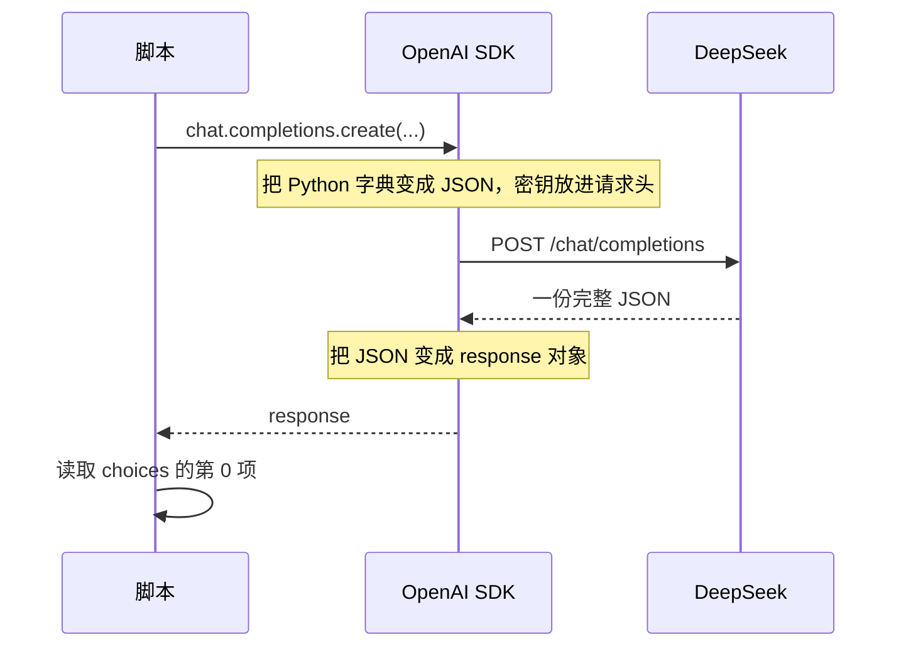

# 第 1 课：一次请求，一次回复

对应代码：`stage0_basics/01_hello_llm.py`。

先在项目根目录运行一遍：

```bash
python stage0_basics/01_hello_llm.py
```

看见一段回复和几行 token 数字之后，再读下面。用词每次可以不同。读的时候对照的是结构，不是背下某一次的句子。

如果还没有密钥，先读 [课前](00_config.md) 的实验。没有密钥时程序会在拨号前停住，你仍然可以读完本课的 JSON，只是做不了要联网的实验。

## 这一课要解决什么问题

「调用大模型」在闲聊里像一个动词。在程序里它是一次具体的 HTTP 请求：你交出一段 JSON，服务器交回一段 JSON。

这一课只做一次。没有循环，没有历史，没有流式。目的是把这次来回看清楚：我们发出去的到底是什么，拿回来的每个字段是什么，哪一个字段才是要打印的那句话。

## 它和以后的智能体有什么关系

以后的智能体无论多复杂，每一轮说话仍然是这种请求。阶段 2 会在同一次请求里多带上「可以调用的工具」。阶段 7 会把这次请求放进循环。工具和循环都建立在「你看得懂一次请求」之上。

如果这一课的 `choices[0].message.content` 对你还是一串点号，后面的工单和检索会全部变成复制来的咒语。

## 先建立一个脑中的模型

专家在另一栋楼里。你不能把 Python 变量递进那栋楼。你只能托运一份表格，也就是 JSON。

店员（脚本）填写表格：找哪位专家（`model`），案卷里有哪些发言（`messages`），允许多随意（`temperature`），回复最多写多长（`max_tokens`）。信使（OpenAI SDK）把表格送到 `https://api.deepseek.com/chat/completions`，并把工牌放进信封的封面（请求头），不放进表格正文。

专家不保留案卷。这一课只有一轮，所以你还看不见「忘记」的后果。下一课才会故意问一个没有前文就无法理解的问题。

温度可以想成：专家下一句话有好几种都通顺的说法时，允不允许挑一个不那么稳的。它不是智力旋钮。

## 一次来回的顺序



`stream=False` 时，箭头「一份完整 JSON」要等专家写完才回来。所以终端会先停在「正在请求模型」，然后整段出现。第三课才改成写几个字就送一次。

## 这一课第一次用到的 Python

虚拟环境、环境变量、import 和 try/except 的基本样子在 [课前](00_config.md)。这里只补本文件新出现的东西。小例子可以在 `python` 交互模式里贴，不需要密钥。

### 字典和列表

列表是有顺序的一排格子，从 0 开始数。字典是带名字的格子。

```python
messages = []
messages.append({"role": "user", "content": "你好"})
print(messages[0]["role"])
print(messages[0]["content"])
```

`messages[0]` 取出第一格。`["role"]` 再按名字取出这一格里的角色。接口要的就是「列表里面装字典」。

如果写成一个大字符串 `"system: 你是客服 user: 你好"`，人还能读，但接口不认这是两条消息。角色边界没了，下一课也无法单独追加一条。

### for 循环

```python
for index, message in enumerate([{"role": "system"}, {"role": "user"}]):
    print(index, message["role"])
```

`enumerate` 同时给你编号和元素。输出是 `0 system` 然后 `1 user`。编号从 0 开始不是打印上的习惯，Python 的第一项就是 `[0]`。

### 函数和 `if __name__ == "__main__"`

```python
def main():
    print("只有被调用时才出现")

if __name__ == "__main__":
    main()
```

直接用 `python 某个文件.py` 运行时，Python 把这个文件的名字设为 `"__main__"`。于是条件成立，`main()` 被调用。

如果另一个文件 `import` 它，名字就不是 `"__main__"`，条件不成立，`main()` 不会跑。我们把会联网的步骤放进 `main()`，就是为了「借用这个文件」和「真的发请求」分开。现在还没有别的文件借用它，但这道门要在第一次写付费代码时就装上。

### 这一课的 try/except 包的是别人的服务器

课前的例子是 `int("abc")`，失败是我们自己的输入。这里的 `try` 包住 `create()`，失败发生在网络、密钥、余额或对方服务器。这些都不是把 Python 语法写错了。

接住以后本课选择退出。错误已经打印成人话，再继续取 `response.choices` 没有意义，因为根本没有 `response`。

## 发出去的 JSON 长什么样

下面是这一课那次调用对应的正文。它是教学用的形状说明，密钥不应该出现在里面。你屏幕上「即将发送的消息」应该能对上 `messages` 里的两句原文。

```json
{
  "model": "deepseek-chat",
  "messages": [
    {
      "role": "system",
      "content": "你是「星河数码」的客服助手。请用简体中文回答，语气礼貌，控制在两句话以内。"
    },
    {
      "role": "user",
      "content": "你好，请用两句话介绍你能帮顾客做什么。"
    }
  ],
  "temperature": 0.7,
  "max_tokens": 256,
  "stream": false
}
```

| 字段 | 这一课里它是谁 | 删掉或改错会怎样 |
| --- | --- | --- |
| `model` | 来自 `.env` 的 `DEEPSEEK_MODEL` | 名字不存在时，服务器拒绝整次请求，你拿不到回复正文 |
| `messages` | 那份列表 | 没有它，模型不知道你要问什么。空列表通常会被拒绝 |
| `messages[].role` | 谁在说话 | 写成 `customer` 这类自造角色，请求不合法 |
| `messages[].content` | 这句话的文字 | 空内容会让模型无话可答，或直接被拒绝 |
| `temperature` | 常量 `0.7` | 不传时用对方的默认值。默认值在代码里看不见，所以我们写明 |
| `max_tokens` | 常量 `256` | 限制的是新回复，不是你发出去的提示。太小会被截断 |
| `stream` | `false` | 改成 `true` 后，返回的就不再是下面这份完整 JSON，第 1 课的拆法会失效 |

信封封面上还有请求头，SDK 替你加，代码里看不见：

```text
POST /chat/completions HTTP/1.1
Host: api.deepseek.com
Authorization: Bearer sk-你的密钥
Content-Type: application/json
```

`base_url` 只提供到主机名为止。路径 `/chat/completions` 是 SDK 根据「聊天补全」这个方法补上的。你再在 `base_url` 里写一遍路径，就送错了门牌。

## 拿回来的 JSON 长什么样

下面是一份**示例输出**，用来讲解字段。它不是你某次运行的原文，数字和句子都是编的。你自己的回复只要结构对得上即可。

```json
{
  "id": "chatcmpl-example-001",
  "object": "chat.completion",
  "created": 1762300000,
  "model": "deepseek-chat",
  "choices": [
    {
      "index": 0,
      "message": {
        "role": "assistant",
        "content": "你好，我是星河数码的客服助手。我可以说明退换货需要准备什么，但现在还查不到真实订单。"
      },
      "finish_reason": "stop"
    }
  ],
  "usage": {
    "prompt_tokens": 52,
    "completion_tokens": 36,
    "total_tokens": 88
  }
}
```

SDK 把它变成对象以后，代码里的对应关系是：

| JSON | Python | 你要不要把它当答案 |
| --- | --- | --- |
| `id` | `response.id` | 不要。这是这次通话的编号，排错时可能用到 |
| `object` | `response.object` | 不要。它只说明「这是一次完整聊天补全」 |
| `created` | `response.created` | 不要。这是时间戳 |
| `model` | `response.model` | 不是答案，但是核对「实际叫到了哪位专家」 |
| `choices` | `response.choices` | 回复列表。本课只有一项 |
| `choices[0].index` | `response.choices[0].index` | 这项在列表中的位置 |
| `choices[0].message.role` | `.message.role` | 新回复的角色，正常是 `assistant` |
| `choices[0].message.content` | `.message.content` | **这才是要打印的正文** |
| `choices[0].finish_reason` | `.finish_reason` | 为什么停，不是正文 |
| `usage.prompt_tokens` | `response.usage.prompt_tokens` | 这次发出去的 token，含系统提示和用户问题 |
| `usage.completion_tokens` | `.completion_tokens` | 新写出来的 token |
| `usage.total_tokens` | `.total_tokens` | 两者相加 |

`choices` 是列表，因为接口允许你一次要好几份草稿（参数 `n`）。我们没要，所以只有第 0 项。`[0]` 的意思是「唯一的那一份」，不是「最好的那一份」。

`finish_reason` 为 `stop`：模型自己决定说完了。为 `length`：还想说，但 `max_tokens` 到了，正文是半截。两种情况你都可能看到一句通顺的中文，所以必须单独看这个字段。

`usage` 有时可能缺席。代码先判断 `is None`，就是为了别在「其实已经拿到回复」时，因为拆用量而崩溃。

服务器还可能多给几个本课不用的字段。多出来的先别管。先保证你能指出：正文在 `content`，长度在 `usage`，停的原因在 `finish_reason`。

## 带着代码走一遍

### 两句消息为什么要分成两个字典

```python
messages = [
    {"role": "system", "content": SYSTEM_PROMPT},
    {"role": "user", "content": USER_PROMPT},
]
```

系统提示是开发者的岗位说明，用户提示是这一次的问题。分成两格，模型才知道哪些话是规矩、哪些话是顾客刚说的。

如果删掉 `system` 那一格，请求仍然合法。你应该注意到回复不再稳定地自称星河数码客服，也不再被「两句话以内」约束。岗位说明不是装饰。

如果把两句都写成 `user`，模型会把岗位说明当成顾客说的话。它有时仍会照做，但「谁规定的」这个边界已经丢了。后面要追加历史时，这个边界会更重要。

问题单独放在 `USER_PROMPT` 里，没有功能上的魔法。它让实验「只改变问题」时，你不会不小心改到发送逻辑。

### 为什么发送前把列表打印出来

```python
for index, message in enumerate(messages):
    print(f"[{index}] {message['role']}: {message['content']}")
```

打印不会改变请求。它存在的理由是：让你亲眼看到这次只有两格，没有隐藏的第三格记忆。

删掉这段，调用仍然成功。你只是少了一份对照，下一课就更难发现「第二次比第一次多了哪几格」。

`f"..."` 是把变量嵌进字符串的写法。`f"[{index}]"` 和 `"[" + str(index) + "]"` 是同一件事，前者比较不容易把引号写乱。

### 为什么这五个参数都写在同一次调用里

```python
response = client.chat.completions.create(
    model=settings.model,
    messages=messages,
    temperature=TEMPERATURE,
    max_tokens=MAX_TOKENS,
    stream=False,
)
```

这就是拨号。`model` 不写死在这里，是为了换模型时只改 `.env`，四个脚本一起变。如果这里写成 `"deepseek-chat"`，你改 `.env` 会以为生效了，其实这一课没读。

删掉 `temperature` 或 `max_tokens`，调用通常仍能成功，只是改用对方默认。实验「把温度调到 0」就没了开关。删掉 `messages` 则没有问题可问，调用会失败。

`settings.model` 是字符串。它和 JSON 里的 `"model"` 是同一个信息，只是一边在 Python 对象里，一边在表格里。

### 为什么不能直接打印整个 `response`

`response` 里混着编号、时间和用量。顾客要看的只有 `content`。学习时我们额外打印 `finish_reason`、`usage` 和 `model`，是为了认识表格，不是因为它们都是答案。

```python
reply = response.choices[0].message.content
```

这行假定 `choices` 至少有一项，所以前一行先检查了空列表。删掉空列表检查，在正常成功时你看不出差别；在异常成功（没有 choices）时，你会得到 `IndexError`，误以为是自己的消息写坏了。

`content` 还可能是空字符串。调用没有抛错，但没有字可显示。代码把这种情况单独说出来，避免你对着空白屏幕猜网络断了。

## 跑起来，然后观察

正常运行时，终端的骨架应该像这样。尖括号里是会变化的部分：

```text
接口地址：https://api.deepseek.com
模型名称：deepseek-chat
API 密钥：已读取，屏幕上不显示。

即将发送的消息：
[0] system: 你是「星河数码」的客服助手。……
[1] user: 你好，请用两句话介绍你能帮顾客做什么。

正在请求模型，请稍等……

模型回复：
<一段中文，通常不超过两句>

结束原因（finish_reason）：stop
stop 表示模型自己把话说完了，不是被字数上限切断的。

提示 token（prompt_tokens）：<一个正整数>
回复 token（completion_tokens）：<一个正整数>
合计 token（total_tokens）：<前两个之和>
服务端报告的模型：<与请求相同或更具体的名字>
```

请你核对这几件事，而不是核对句子好不好看：

- 发送前只有下标 0 和 1。
- 回复出现在「正在请求」之后，不是在创建客户端的那一行。
- `total` 等于 prompt 加 completion。如果不等，先看是不是看错了行，而不是先怀疑自己把加法忘了。极少数接口会多算别的用量字段；本课先以这三行为准。
- 密钥那一行没有出现 `sk-`。

## 如果改掉它，会发生什么

每次只改一处，看完再改回去。

1. **把 `TEMPERATURE` 改成 `0`，同一份代码运行两次。** 两段回复往往更接近。再改成 `1.2` 运行两次，用词通常更散，也可能不那么像客服。温度不是越高质量越好。
2. **把 `MAX_TOKENS` 改成 `5`。** 正文会很短，`finish_reason` 应该变成 `length`。这是「字少」和「被切断」的差别。看完改回 `256`。
3. **把 `USER_PROMPT` 换成一句更长的问题，例如请它列出五种退货材料。** `prompt_tokens` 应该比刚才大，因为发出去的字变多了。`completion_tokens` 变不变，取决于它写了多少。
4. **暂时删掉 `system` 那一条，只留 `user`。** 请求仍可成功。注意它还像不像「星河数码的客服」，以及还守不守「两句话」。
5. **不要真的去做：把密钥打印出来或写进文件。** 你会看见程序也许照样能跑。代价是密钥离开了 `.env`。这一条只用想，不用做。

## 常见误解

- **「屏幕上的回复就是接口返回的全部。」** 不是。回复只是 `content`。编号、停的原因和 token 都在同一份 JSON 里。
- **「`choices[0]` 表示模型挑了最好的一句。」** 我们只要求了一份。第 0 项是唯一的项。
- **「`prompt_tokens` 是用户那句话的字数。」** 它包含系统提示和用户提示，而且单位是 token，不是汉字个数。
- **「`max_tokens` 设成 256，整个请求就不能超过 256。」** 它只管新回复。提示另算，并且受上下文窗口限制，本课的提示远没到那个窗口。
- **「温度 0 会得到永远相同的句子。」** 它让结果更稳，不是数学上的承诺。换模型、换空白或对方改了默认，仍可能有差别。
- **「`stop` 是在叫用户停止输入。」** 它是模型这边的结束原因。
- **「代码能打印中文，就说明程序已经查过星河数码的数据库。」** 星河数码是虚构的练习店。模型只看见你写进 `messages` 的那些字。
- **「注释把每一行翻译完，就算理解了这次调用。」** 注释只写为什么。你应该能离开注释，自己指出 JSON 里哪一格是正文。

## 小测验

1. 一次成功调用里，要显示给顾客的文字在哪个字段？
2. 为什么密钥不在 JSON 正文里，屏幕上也不打印？
3. `finish_reason` 是 `length` 时，把温度调低能把后半句补出来吗？
4. 下面哪句描述 `create_client()` 和 `create()` 的差别是对的？
   - A. 两个都会联网，前者更便宜。
   - B. 前者只准备配置，后者才发送本课这份 JSON。
   - C. 前者发送系统提示，后者发送用户提示。
5. 删掉消息列表里的 `system` 之后，调用为什么往往仍然成功？成功说明岗位说明没有用吗？

## 对照答案

1. `choices[0].message.content`。其他字段是编号、模型名、结束原因或用量。
2. 正文会被日志和教程引用；请求头里的密钥由 SDK 附带，仍然不能写进源码或打印到屏幕。泄露的是同一把可以花钱的钥匙。
3. 不能。`length` 表示碰到 `max_tokens`。要看后半句，应增大 `MAX_TOKENS`，而不是改温度。温度影响用词的随意程度，不增加允许的长度。
4. B。系统提示和用户提示在同一次 `create()` 的 `messages` 里一起走。
5. 接口并不要求必须有 `system`。成功只说明表格合法。岗位说明的作用体现在回复是否遵守身份和篇幅，不体现在「有没有报错」。

下一课让第二次请求依赖第一次的内容。如果服务器真的会记住你，那个实验就看不出差别：[第 2 课](02_messages_roles.md)。
