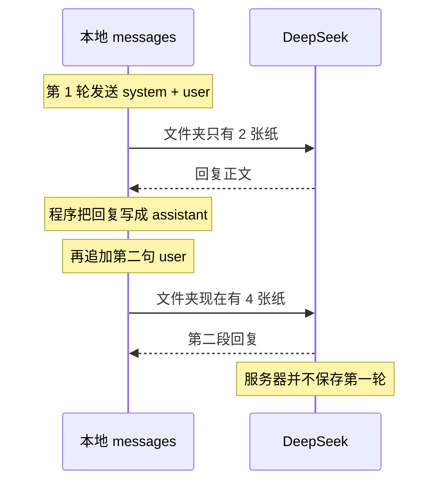

# 第 2 课：角色，以及为什么历史必须重发

对应代码：`stage0_basics/02_messages_roles.py`。

先运行：

```bash
python stage0_basics/02_messages_roles.py
```

脚本会自己发两轮，不用你打字。运行时请把两次「即将发送的 messages」和两行 token 留在屏幕上，读文档时要对照它们。

## 这一课要解决什么问题

第 1 课只有一轮，看不出服务器忘不忘事。这一课故意设计一个第二句离开第一句就听不懂的问题：

1. 顾客说耳机要退货，订单尾号是 86。
2. 顾客问：「那上面这个订单，如果已经拆封了，还能退吗？」

「上面这个订单」四个字里没有 86。如果第二次只把这句发给模型，它并不知道上面是哪一单。

很多人以为聊过一次，模型那边就开了一个会话。这个脚本用两次打印证明：第二次多出来的字，是我们的列表里多出来的，不是服务器帮我们存的。

## 它和以后的智能体有什么关系

智能体的「记得住」在很长一段时间里都不是模型自带的能力，而是程序把什么放进下一次 `messages`。

- 阶段 3 把这个列表从「进程一退出就消失」变成「短时间内存进 Redis，下次还能装回来」。
- 阶段 4 和阶段 5 解决另一件事：不能把所有文档和所有旧对话都塞进列表，因为上下文窗口装不下，`prompt_tokens` 也会贵到不可用。
- 阶段 2 的工具结果同样要写回列表，否则模型下一轮看不见工具刚才查到的订单。

这一课先把最朴素的版本做对：列表里有的，模型才看得到；列表里没有的，就等于没说过。

## 先建立一个脑中的模型

专家不留档案柜。每次你都得把整个文件夹重新递进去。

文件夹里的纸有三种抬头：

| 抬头 `role` | 谁写的 | 在文件夹里干什么 |
| --- | --- | --- |
| `system` | 开发者 | 封面说明。每轮都还在第 0 张，告诉专家「你是客服，别编金额」 |
| `user` | 顾客 | 顾客说过的话。新问题追加在最后 |
| `assistant` | 模型 | 专家上次写回来的答复。不放回去，专家就看不到自己承诺过什么 |

没有第四种叫 `memory` 的抬头。记忆如果存在，也只是旧纸还在这个文件夹里。

第二句使用「上面这个订单」，就是在检查文件夹有没有被重新递进去。这就像你对一个刚进门的人说「还是老样子」。他只有在你把上次的点菜单一起给他时，才知道老样子是什么。

## 两轮请求实际差在哪



第 1 轮发出去的形状：

```text
[0] system
[1] user      订单尾号是 86
```

第 2 轮发出去的形状：

```text
[0] system
[1] user      订单尾号是 86
[2] assistant 第 1 轮的回复原文
[3] user      上面这个订单，拆封了还能退吗
```

请用你屏幕上的打印核对这个形状。回复原文会变，格子的数量和角色顺序不该变。

## 这一课新用到的 Python

字典、列表和 `for` 在第 1 课。这里新的是「往列表末尾加一格」和「一个函数交还两样东西」。

```python
folder = [{"role": "system", "content": "你是客服"}]
folder.append({"role": "user", "content": "订单尾号是 86"})
print(len(folder))
print(folder[1]["content"])
```

`append` 改的是原来那个列表，不是交出一个新列表。`len` 是格子数。上面这段会打印 `2`，然后打印订单那句话。

函数可以一次交还两样东西，调用者按位置接住：

```python
def order_and_note():
    return "86", "已拆封"

number, note = order_and_note()
print(number)
print(note)
```

`request_reply` 交还的是「回复文字」和「整份响应」。文字用来放进下一轮；整份响应用来读 `usage`。如果只交还文字，就没法比较两轮的 token。

还有一个容易错的点：函数参数是一份你递进去的列表，不是「函数外面那个变量的别名魔法说明」。你把 `messages` 传进去，函数发的就是这一份的当前内容。你没放进这份列表的句子，函数不会到别的地方帮你找。

## 第二次请求的 JSON 示例

下面仍是**示例**。`assistant` 的句子是编的，好让你看见它夹在两句用户话中间。你屏幕上的第 2 轮打印应该是同样的四格结构。

```json
{
  "model": "deepseek-chat",
  "messages": [
    {
      "role": "system",
      "content": "你是「星河数码」的客服。用简体中文回答，不超过 80 个字。不要编造具体的退款金额或物流单号。不确定的规则，就说需要人工确认。"
    },
    {
      "role": "user",
      "content": "我买的耳机想退货，订单尾号是 86。"
    },
    {
      "role": "assistant",
      "content": "已记下尾号 86 的耳机退货。是否拆封会影响规则，我需要人工确认，不能直接承诺金额。"
    },
    {
      "role": "user",
      "content": "那上面这个订单，如果已经拆封了，还能退吗？"
    }
  ],
  "temperature": 0.3,
  "max_tokens": 200,
  "stream": false
}
```

和第 1 课相比，字段没有新种类。变的是 `messages` 变长了。因此示例里的用量也应该变大，下面的数字同样是编来讲解的：

```json
{
  "usage": {
    "prompt_tokens": 128,
    "completion_tokens": 40,
    "total_tokens": 168
  }
}
```

如果第 1 轮的 `prompt_tokens` 是 70 左右，第 2 轮通常更大，因为 70 里的那些字又被放进了新请求，还多了回复和第 2 句问题。你的具体数字不必等于 128。你要看的是「第 2 轮的 prompt 大于第 1 轮」。

`assistant` 这条不是我们替模型新写的指示。它是上一轮 `content` 的原文。改写、摘要或删掉一半，模型下一轮看到的就是改过的历史，不是它真正说过的话。阶段 0 先不摘要。摘要是以后窗口装不下时才做的事，而且会丢信息。

## 带着代码走一遍

### 列表一开始只有封面

```python
messages: list[dict[str, str]] = [
    {"role": "system", "content": SYSTEM_PROMPT},
]
```

`list[dict[str, str]]` 是给读代码的人看的注记：这是一个列表，每格是字典，字典里的名字和值都是字符串。它不会在运行时替你检查写错的角色名。写错仍要等服务器拒绝，或等你在打印里看见。

只有封面、还没有顾客的话时，我们不发送。先 `append` 第一句用户话。如果在空对话时就调用，模型只看见岗位说明，没有问题。

### 第 1 轮为什么现在就打印

```python
messages.append(
    {
        "role": "user",
        "content": "我买的耳机想退货，订单尾号是 86。",
    }
)
show_messages(messages)
reply, response = request_reply(client, settings.model, messages)
```

`show_messages` 在 `request_reply` 之前。你看到的是即将送出的文件夹，不是发送之后又被谁改过的。

`reply, response = ...` 就是上一节那个「一次接两样东西」。`reply` 是字符串。`response` 仍是第 1 课那个对象，所以 `response.usage` 还在。

温度用 `0.3` 而不是第 1 课的 `0.7`，是为了让两轮回答少飘一点，你的注意力放在列表格子上。把它调高不会破坏「必须重发历史」，只是更难判断模型是接上了订单，还是在自由发挥。

### 为什么回复要先写回列表，再追加下一个问题

```python
messages.append({"role": "assistant", "content": reply})
messages.append(
    {
        "role": "user",
        "content": "那上面这个订单，如果已经拆封了，还能退吗？",
    }
)
```

顺序是：专家的上一张纸，然后顾客的新问题。如果把两句 `user` 直接接在一起、中间没有 `assistant`，文件夹就缺了专家的答复。有的服务器仍接受这种表格，但模型会看到一个没人回答过的上一问。

删掉 `assistant` 那一次 `append` 再运行，是这一课最重要的实验。第 2 轮打印出来的列表里将没有订单尾号和第一段回复之间的那张专家的纸；尾号还在第 1 句 `user` 里。若要看「完全不重发」，需要改的是 `request_reply` 的参数，让第二次只发送最新一句。实验 2 会这么做。

### 为什么两轮共用一个函数

`request_reply` 把 `temperature`、`max_tokens` 和 `stream` 固定住。两次调用若各写一遍 `create()`，你可能只改了一处的温度，然后把「回答变了」误当成「历史起了作用」。

共用函数的代价是：函数内部看不到「这是第几轮」。轮次差别必须全部体现在传进去的列表上。这正是我们要观察的事实。

## 跑起来，然后观察

你应该看到两段结构。正文用词会不同：

```text
========== 第 1 轮 ==========
即将发送的 messages：
  [0] system: 你是「星河数码」的客服。……
  [1] user: 我买的耳机想退货，订单尾号是 86。
模型回复：
<一段不超过大约 80 字的中文>
第 1 轮 token：prompt=<较小的数>, completion=<数>, total=<数>

========== 第 2 轮 ==========
即将发送的 messages：
  [0] system: ……
  [1] user: 我买的耳机想退货，订单尾号是 86。
  [2] assistant: <和上面「模型回复」相同的那段>
  [3] user: 那上面这个订单，如果已经拆封了，还能退吗？
模型回复：
<应该接得上「尾号 86」或「耳机」，而不是反问哪一单>
第 2 轮 token：prompt=<通常大于第 1 轮>, ...

脚本结束时，本地历史一共 5 条。
```

第 2 轮「即将发送」的打印是 4 条，下标 0 到 3。那时第二段回复还没回来，不能提前放进即将发送的列表。脚本最后又把第二段回复 `append` 进去，所以结束时是 5 条：system、两句 user、两句 assistant。这第 5 条没有被再发送，因为没有第 3 轮。请自己数一次，不要把「发送前的 4 条」和「结束后的 5 条」当成同一个数字。

第 2 轮回复里如果完全不提耳机、拆封或上一单，先别怪模型「笨」。先看第 2 轮打印里有没有第 `[1]` 和第 `[2]` 格。格子丢了，是程序没递文件夹。

## 如果改掉它，会发生什么

1. **注释掉把第一段回复 `append` 为 `assistant` 的那一行，再运行。** 第 2 轮的打印里不应该再有角色 `assistant`。订单尾号仍在第一句 `user` 里，所以模型可能仍看得到 86。这个实验证明的是「专家自己的上一句话丢了」，还不是「整个历史都丢了」。看完改回来。
2. **让第二次调用不使用长列表。** 把第二次的 `request_reply(..., messages)` 临时改成只带最新问题，例如新建一个只有当前 `user` 的短列表再传进去。第 2 轮打印若你忘了改 `show_messages`，可能会骗过你：打印的是长列表，发出去的却是短列表。所以要让 `show_messages` 打印你真正传进去的那一份。你应该注意到回复开始反问「哪一单」，或不再提 86。看完一定改回传 `messages`。
3. **删掉 `system` 封面，两轮都不要它。** 调用仍可成功。注意它是不是更愿意说出具体退款金额或编一个运单号。封面不是法律，但没有封面时这种编造通常更明显。
4. **在第二句里把「上面这个订单」改成「订单尾号 86」。** 就算你做了实验 2、没有重发历史，模型也能答。关键事实如果又写进了第二句，这个实验就失效了，你会误以为历史无关紧要。

## 常见误解

- **「模型记得我，是因为我用的是聊天模型。」** 聊天模型只是擅长按角色读文件夹。文件夹要由客户端每次装好。
- **「`assistant` 消息是另一种系统提示，用来命令模型。」** 在重发历史时，它是模型已经说过的话的记录。你当然可以伪造一条，那就是在篡改记录。
- **「第 2 轮 token 变多，是因为模型想得更久。」** `prompt_tokens` 变多是因为你递进去的纸变多。`completion_tokens` 才跟它新写了多少有关。
- **「把历史存在变量里，服务器就也存了一份。」** 变量在你的进程里。请求结束，对方不保留这份变量。
- **「第 2 次发送时列表有 4 条，就是模型看见了 4 轮对话。」** 角色不是轮次。那 4 条是 1 条 system、2 条 user、1 条 assistant。脚本结束时变成 5 条，是因为第二段回复后来又被追加，但没有再发送。
- **「温度调高，模型就会自己想起上一句。」** 温度不创造它没收到的文字。

## 小测验

1. 第 2 轮的 `messages[2]` 应该是什么角色？它的文字从哪来？
2. 只把第二句 `user` 发给模型时，为什么「上面这个订单」会失效？
3. 为什么第 2 轮的 `prompt_tokens` 通常大于第 1 轮？这是费用变高的原因还是结果？
4. 程序退出以后，不靠数据库，小星还记得尾号 86 吗？
5. 如果第 2 轮回答正确提到了 86，能否证明 DeepSeek 为你保存了会话？怎样用本课的打印反驳？

## 对照答案

1. `assistant`。文字是第 1 轮 `choices[0].message.content` 的原文，由我们 `append` 回去，不是第 2 轮新生成的。
2. 那句话里没有订单号，也没有「耳机」。模型只能看见这次请求里的纸。纸上没有的事实，它只能猜。
3. 因为第 1 轮的系统提示、用户话和回复又被放进了第 2 次请求。token 变多是「重发了更多文字」的结果，同时就是这次更贵、更占窗口的原因。
4. 不记得。列表随进程消失，这一课也没有把列表写进文件或 Redis。
5. 不能。正确提到 86，只说明 86 出现在第二次送出的某张纸上。用第 2 轮打印可以指出它在 `[1]` 的 `user` 里。若打印里没有 86 而回答却像知道，才需要怀疑看错了输出；按本课的代码，不该发生。

下一课仍是一次请求，但回信不再是一封整信，而是专家一边写一边念：[第 3 课](03_streaming.md)。
