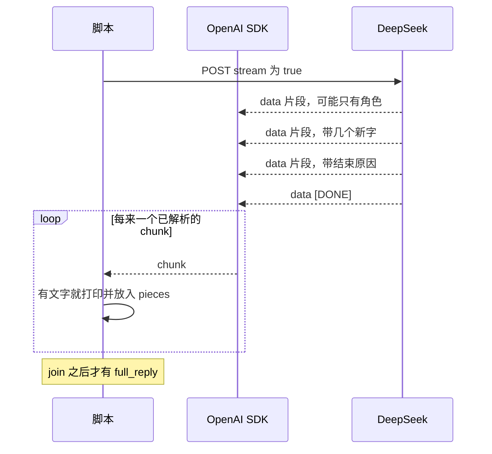

# 第 3 课：流式输出

对应代码：`stage0_basics/03_streaming.py`。

先运行：

```bash
python stage0_basics/03_streaming.py
```

请盯住「模型：」后面的文字是一下子出现，还是陆续冒出来。网很快时可能像一下子出现，这仍然可能是流式，只是片段间隔太短。脚本最后会告诉你非空片段有几个。如果个数大于 1，就可以确定不是「等全文到齐才第一次给你」。

## 这一课要解决什么问题

第 1 课的 `stream=False` 要等专家写完才把整封信交回。回复越长，屏幕空白越久。人会以为程序卡死了。

流式让专家每写一小段就送出一小段。总的写作时间差不多，但你更早看见第一个字。

新的问题也随之出现：接口不再交给你一篇完整的 `message.content`。它交给你很多张小纸条。聊天历史要的却仍是第 2 课那种一整条 `assistant`。所以谁负责把纸条粘成一封信，必须讲清楚。答案是我们的程序，不是 SDK 自动替历史粘好。

## 它和以后的智能体有什么关系

阶段 7 如果用网页显示客服，顾客同样无法接受先空白 10 秒再跳出一大段。网页那边要边收边显示。

但智能体的循环不能把「已经显示在屏幕上」当成「已经记住」。下一轮要重发的是粘好的全文。只显示、不保存，就会回到第 2 课的失败实验：下一句失去上文。

工具调用出现以后，流式还会夹杂「正在调用工具」这类不是正文的事件。这一课先把「正文片段」和「结束标记」分开，避免以后把所有包都当成要显示的字。

## 先建立一个脑中的模型

整段返回像等对方写完信再投进邮箱。流式像对方在电话里一句一句念，你边听边记笔记。

电话那头不会在最后再送你一封整理好的信。你的笔记本如果是空白的，挂电话之后就只剩耳朵里的印象，程序没有印象。

每一句新念出来的话是增量，英文接口里叫 `delta`。它不是「从开头到现在的全文」。如果第一句是「请准备」，第二句是「订单号」，笔记应该变成「请准备订单号」，而不是用第二句替换第一句。

传输这些句子时，线上常见的格式是 SSE：一条一直开着的 HTTP 响应，里面连续出现很多行 `data: ` 开头的文本，最后用 `data: [DONE]` 表示念完了。SDK 把这些行变成 Python 对象。`for chunk in stream` 里的 `chunk` 是对象，不是你在网上教程里看见的那行 `data: ...` 原文。两个层次都要认识，不然你会去代码里找一个并不存在的 `data:` 字符串。

## 片段是怎么到达循环的



创建 `stream` 那一行往往很快返回。真正的等待分散在 `for` 循环的每一次「再要下一段」。所以超时和断线也可能发生在已经打印出半句话之后。这时屏幕上的半句话不是完整答案，列表里也还没有 `assistant`。

## 这一课新用到的 Python：生成器

第 1 课的 `for` 是在一个已经装好的列表上走。流式的 `for` 是在一个「还没全部到齐」的东西上走。生成器就是这种东西的一种写法：每次交出一个值，然后暂停，等你再要下一个。

把下面贴进交互模式：

```python
def count_slowly():
    print("准备交出一")
    yield "一"
    print("准备交出二")
    yield "二"

for piece in count_slowly():
    print("拿到了", piece)
```

你应该看到「准备交出一」「拿到了一」，然后才是「准备交出二」。不是函数先把「一」和「二」都做完放进列表。`yield` 交出一个值并暂停。

`stream` 不一定是我们自己写的生成器，但用法一样：循环每进行一轮，才可能从网络上再读一块。因此：

- 不要假设 `create(..., stream=True)` 返回的是列表。
- 不要对它先 `len(stream)` 来问一共几段。没读完之前，连发送方也不一定知道还有几段。
- 循环中途断了，你只能保留已经拿到的那些。

粘贴用的是普通字符串操作：

```python
pieces = ["请准备", "订单号"]
print("".join(pieces))
```

`"".join(pieces)` 用空字符串把它们连起来，中间不加逗号、不加空格。空格如果需要，会本来就在某个片段里面。你再加分隔符，回复里就会多出你没要求的字符。

`continue` 是「这一轮循环剩下的别做了，直接要下一项」：

```python
for item in ["", "有字", ""]:
    if item == "":
        continue
    print(item)
```

只会打印 `有字`。流式循环用它跳过没有 `choices` 的包，避免把用量包误当成正文。

## 线上的 SSE 和你拿到的对象

下面是**示例**，模仿连接上可能出现的三块数据。真实碎片怎么切，由服务器决定，不会每次都是这两个字。

```text
data: {"choices":[{"index":0,"delta":{"role":"assistant","content":""},"finish_reason":null}]}

data: {"choices":[{"index":0,"delta":{"content":"请准备"},"finish_reason":null}]}

data: {"choices":[{"index":0,"delta":{"content":"订单号"},"finish_reason":null}]}

data: {"choices":[{"index":0,"delta":{},"finish_reason":"stop"}]}

data: [DONE]
```

对照第 1 课的完整 JSON，差别在这里：

| 完整响应 | 流式的一块 | 含义 |
| --- | --- | --- |
| `message.content` 是全文 | `delta.content` 是新字 | 不要把 delta 当成累计全文去覆盖笔记 |
| `message.role` 是 `assistant` | 第一块的 `delta.role` 常常先宣布角色 | 角色包的 `content` 可能是空的，要跳过 |
| `finish_reason` 在唯一的 choice 上 | 多半在最后一块才不是 null | 中途的 null 表示还没说完 |
| `usage` 常在同一份 JSON 里 | 可能没有，或在一个没有 `choices` 的收尾包里 | 本课不靠流式来学 token，用量仍以第 1、2 课为准 |

代码对应的是解析之后的对象，不是去读 `data: ` 这五个字符：

```python
choice = chunk.choices[0]
piece = choice.delta.content
```

空字符串和 `None` 都表示「这一包没有新正文」。第一包常常只有角色。若把 `None` 放进 `pieces`，最后 `join` 会失败，你会以为流式本身坏了。

`finish_reason` 仍是 `stop` 或 `length` 那些值，只是来得晚。本课在每一包上看一次，有值就记下。不能只看第一包，第一包几乎总是还没结束。

## 带着代码走一遍

### 为什么先打印前缀，并且立刻刷新

```python
print("模型：", end="", flush=True)
```

`end=""` 表示不要自动换行，后面的片段才能接在同一段话里。`flush=True` 表示不要把字攒在缓冲区里。

删掉 `flush=True` 时，有的终端仍会逐段出现，有的会等缓冲区满了或程序结束才一起吐出来。现象不稳定，所以代码写明要刷新，而不是依赖终端碰巧。

删掉 `end=""` 时，每个小片段都会单独占一行。字还是那些字，但你很难把它读成一段话，也容易误以为服务器是按句子切好的。服务器没有这个义务，它可能切在一个词的中间。

### 为什么既要打印，又要放进 `pieces`

```python
if isinstance(piece, str) and piece != "":
    pieces.append(piece)
    print(piece, end="", flush=True)
```

打印解决「人什么时候看见」。`pieces` 解决「程序留下什么」。两件事先写成相邻的两行，就是为了让你看见它们是两件事。

只保留 `print`、删掉 `append`：屏幕上仍然有字，函数结束后没有任何完整字符串可以放进第 2 课的历史。下一轮等于没听过这段话。

只保留 `append`、删掉 `print`：程序是对的，但你要等到 `join` 之后才看见全文，这一课的体感就退回第 1 课了。

`isinstance(piece, str)` 是在拒绝非文本。有的包会给空，有的实现可能给别的类型。与其让 `join` 在最后才崩溃，不如这一包直接不要。

### 为什么结束之后还要拼一次

```python
full_reply = "".join(pieces)
```

`pieces` 是一列碎片。历史协议要的是一个字符串。`full_reply` 才是可以放进 `{"role": "assistant", "content": full_reply}` 的东西。

本课故意不执行这句 `append`。它只把那行代码打印出来，让你看见「流式脚本默认还没有进入多轮」。如果在这里自动追加，你还没学会保存，列表里却已经有了，两件事又叠在一起。

如果把每个碎片各追加成一条 `assistant`，下一轮的文件夹会变成很多条极短的专家发言。模型也许仍能读，但这不是真正发生过的一轮对话，token 也会被重复的角色结构浪费。一轮回复，历史里就应该是一条 `assistant`。

### 为什么异常要包住整个循环

`create()` 返回流之后，读下一块仍可能失败。`try` 若只包住 `create()`、不包住 `for`，中途断线会变成没人翻译的追溯，而且出现在半句话后面，更难看懂。

失败分支先补一个换行，是为了不让错误说明粘在半句话同一行。然后明确告诉你：上面那些字不能当完整答案。本课没有把半句话写进 `messages`。

## 跑起来，然后观察

骨架类似：

```text
开始流式输出。文字会一段段出现；……

模型：<这里的字可能陆续出现>

把片段拼回去的完整回复：
<和上面同一段文字，再打印一次>

共收到 <大于 0 的整数> 个非空片段。结束原因：stop
```

请核对：

- 「完整回复」和上面流出来的字是同一段，不是模型又回答了一次。它是 `join` 的结果，没有第二次 `create()`。
- 片段数经常大于 1。若等于 1，可能是回复太短或网络把多块攒到了一起才显示。可以把问题改得更长再看一次，不要立刻认为 `stream=True` 没生效。
- 结束原因出现在全部片段之后。读第一块的时候还没有这个结论。

## 如果改掉它，会发生什么

1. **把 `stream=True` 改回 `False`。** 这行的返回值不再适合 `for chunk in stream`。你应该看到程序报错，而不是安静地退回整段模式。整段模式要用第 1 课的 `.message.content`。看完改回 `True`。
2. **去掉 `flush=True`，问题保持较长。** 观察字是仍然逐段出现，还是顿一下然后一起出来。两种都可能，取决于终端。这个实验是为了看见「显示时机」不是服务器单独决定的。
3. **在 `append` 那一行前面加上 `continue`，让碎片只打印、不保存。再在结尾打印 `pieces`。** 屏幕上有文章，列表是空的。这就是「看见了」不等于「记住了」。
4. **把 `"".join(pieces)` 改成 `" | ".join(pieces)`。** 完整回复里会出现很多竖线。那些竖线不是模型写的，是你粘纸条时加的。历史如果保存这一版，下一轮模型会以为自己写过这些竖线。

## 常见误解

- **「流式更快生成完。」** 通常不是。它让第一个字更早到。最后一个字到齐的时间往往和整段返回接近。
- **「`delta.content` 是目前为止的全文，打印时覆盖上一行就行。」** 按本课这种接口，它是新增片段。覆盖会只剩下最后几个字。
- **「SDK 最后会再给我一个和第 1 课一样的完整 `message`。」** 不会。完整正文是 `"".join(pieces)`。没有这行就没有正文变量。
- **「`for` 循环开始时，所有片段已经在内存里。」** 那是列表。流是要下一块才继续等。所以循环中间也能失败。
- **「SSE 是一种 Python 数据类型。」** 它是服务器推送的文本格式。Python 里你拿到的是 SDK 解析后的 `chunk`。
- **「片段数等于句子数。」** 服务器可以切在任何位置，包括一个词的中间。不要按片段数去理解段落结构。

## 小测验

1. 为什么流式时不能再写 `response.choices[0].message.content` 来拿全文？
2. 第一块的 `delta.content` 常常是空的。它还是一次有效的传输吗，代码为什么跳过它？
3. 只把片段打印到屏幕，会对第 2 课的「重发历史」造成什么后果？
4. `data: [DONE]` 出现时，笔记里的全文是谁拼出来的？
5. 下面哪句是对的？
   - A. `yield` 会把函数里所有结果立刻放进列表。
   - B. 生成器每次交出一个值就暂停，所以循环的下一轮才取下一个。
   - C. 流式生成器一定比列表省钱，因为 token 不计。

## 对照答案

1. `stream=True` 时 `create()` 的返回值是流，不是那份带 `message.content` 的完整对象。全文还没到齐，也不存在那一个字段给你。
2. 是有效传输。它常用来宣布 `role` 是 `assistant`。跳过是因为空内容不是正文，放进 `pieces` 没有字，还可能干扰拼接。
3. 下一轮的 `messages` 里没有这条 `assistant`。模型看不见自己刚刚说过的退货步骤，即使用户明明在屏幕上读过。
4. 是客户端用 `"".join(pieces)` 拼的。`[DONE]` 只表示没有下一块了，它本身不是全文。
5. B。A 把生成器说成了列表。C 错：流式仍按真实的提示和回复 token 计费，只是用量往往不在每个小片段里。

下一课把前三课套进一个你能打字的循环。请注意那个循环仍然不会查订单：[第 4 课](04_cli_chatbot.md)。
