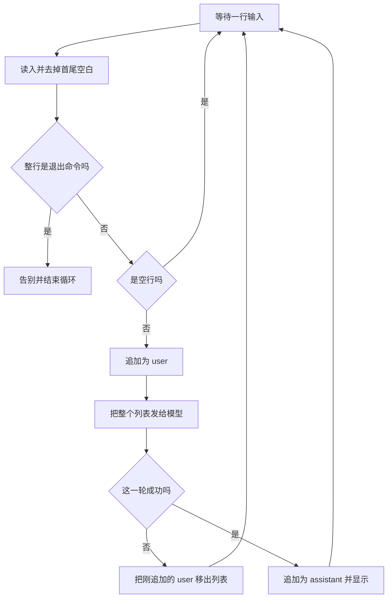

# 第 4 课：一个还不能查订单的命令行客服

对应代码：`stage0_basics/04_cli_chatbot.py`。

先运行：

```bash
python stage0_basics/04_cli_chatbot.py
```

不要只说一句「你好」就退出。至少连续说两句，第二句依赖第一句，例如先说「我想退昨天买的耳机」，再说「那运费谁出」。看完第二句的回答，再读这一课。结束时整行输入 `退出`。

## 这一课要解决什么问题

前三课都是程序自己把问题写死。客服要等一个人不断打字，并且：

- 有一句固定的岗位说明，每轮都在。
- 有一份越来越长的本地历史，每轮整包重发。
- 人说「退出」时要结束，而且不能把「退出」两个字当成顾客问题花钱去问模型。
- 某一轮网络或密钥失败时，对话进程还在，失败的那句也不能污染历史。

它看起来已经像一个机器人。这一课要你分清：像，是因为循环和系统提示；能查订单，并没有发生。

## 它和以后的智能体有什么关系

这个 `while` 循环就是以后智能体循环的胚子：

```text
读入 → 决定要不要调用模型 → 调用 → 把结果写回历史 → 再读入
```

阶段 7 会把「决定」变厚：有时先查意图，有时调用工具，有时先做合规审查，然后再说话。阶段 0 的决定只有三种：退出、忽略空行、把整份历史发给模型。

系统提示里写着「还不能查询真实订单」。这是一句交给模型的话，不是数据库查询。阶段 2 才会在同样的循环里增加工具：模型提出「我要查订单」，程序去 SQLite 查，再把查询结果作为新的消息放回列表。没有那个工具之前，小星若说出具体运单号，就是在编。

岗位说明里还写了「不要索要密码和完整银行卡号」。阶段 6 才会在发送前用代码检查顾客的输入和模型的输出。现在如果你把卡号打进去，程序会原样放进 `messages` 发给服务器。

进程一退出，列表就没了。阶段 3 用 Redis 保存短期会话，就是因为这个列表活得不够久。那也不是把无限历史永远存下去：上下文窗口仍然限制一次请求能带多少。

## 先建立一个脑中的模型

小星是柜台后的人，但档案不在他脑子里。档案是你面前这一叠纸（`messages`）。每听完顾客一句，店员就把整叠纸递给另一栋楼的专家，专家写一张答复，店员把答复钉回纸叠，再念给顾客听。

专家没有本店的订单电脑。岗位说明要求他在被问到物流时承认查不到。他如果编了一个运单号，那是他违背说明在即兴发挥，不是柜台真的查到了。

「退出」是店员自己认识的口令，不必问专家。空回车也是。只有真正的顾客句子才值得递出那叠纸。

某一轮专家楼没接电话，店员要把刚钉上、还没得到答复的那张顾客的纸拿下来。否则下一轮的纸叠会变成两句顾客话紧挨着，中间缺了专家的答复。

## 一轮输入怎么走



每次从「等待一行输入」回来，列表都要么没变（空行或失败后已撤销），要么成对多了 user 和 assistant。退出不会往列表里加东西。

## 这一课新用到的 Python

### while 循环和为什么它不会自己停

```python
n = 0
while n < 3:
    n = n + 1
    print(n)
```

条件为真就再来一轮。`while True` 的条件永远为真，所以必须在里面用 `return` 离开函数，或用 `break` 离开循环。本课用 `return`，因为离开时还要顺便结束 `main`。

如果退出命令写错、又没有任何 `return`，程序会永远等输入。那不是死机，是循环还在，只是你没给它结束条件。

`continue` 和 `return` 不同：

```python
for text in ["", "耳机", "退出"]:
    if text == "":
        continue
    if text == "退出":
        break
    print("要发送", text)
```

空字符串被跳过，循环还在。「退出」会停掉整个循环。「耳机」才会被处理。把空行写成 `return`，顾客误触一次回车，客服就下班了。

### input、strip，以及两种「没有输入」

`input("你：")` 停下来等一行，返回的字符串不含行末回车。`.strip()` 去掉你多打的首尾空格，避免 `"退出 "` 因为多一个空格而匹配失败，被当成问题发送出去。

输入被关掉时（终端里常是 Ctrl+D，管道读到文件末尾时也会发生）会抛 `EOFError`，不是普通的空字符串。代码把它当成正常告别。若不管它，管道跑完脚本会以追溯结束，看起来像崩溃。

Ctrl+C 是 `KeyboardInterrupt`。人也是想离开，所以同样告别，不走接口错误那一套说明。

### 用集合判断整行命令

```python
commands = {"quit", "exit", "q", "退出"}
print("quit" in commands)
print("我想 quit" in commands)
```

第一行是 `True`，第二行是 `False`。`in` 问的是「这一整串是不是集合里的一项」，不是「里面有没有包含这几个字母」。所以顾客说「我想 quit 退货」不会被踢出去。

比较前先 `.lower()`，是为了让 `QUIT` 和 `quit` 相同。中文「退出」没有大小写，写进同一个集合里即可。

### pop 拿掉最后一格

```python
papers = ["system", "user"]
papers.pop()
print(papers)
```

剩下 `['system']`。`pop` 默认拿最后一格，正好是我们刚刚追加、还没得到回复的那句 `user`。它改的是本机列表，不会通知服务器「请忘记」。服务器本来也没存。

## 系统提示不是数据库

这一课的封面大意是：

- 你叫小星，说短句、说中文。
- 你没有订单、库存和物流数据。
- 被追问时，说明查不到，并告诉顾客要准备订单号和手机号后四位。
- 不要编运单号、到货时间、退款金额。
- 不要索要密码、验证码和完整卡号。
- 不确定就说要人工确认。

这些句子每次都在 `messages[0]`，会占用 `prompt_tokens`。它们约束的是模型「倾向于说什么」，不是程序「能够做什么」。

请用一次真实对话验证后半句：问它「订单 10086 的运单号是多少」。合格的表现是承认查不到。若它说出一个看起来很具体的运单号，把那个号码当成假的。程序里没有任何一行在读数据库。这就是阶段 4 和阶段 6 要补的洞：一个靠检索到的文档回答，一个在发出去之前检查它有没有乱承诺。

## 一轮成功时发出去的 JSON 示例

假设你已经说过「我想退昨天买的耳机」，模型也回复过，然后你又说「那运费谁出」。第二次请求的形状是**示例**：

```json
{
  "model": "deepseek-chat",
  "messages": [
    {"role": "system", "content": "你是「星河数码」的在线客服，名字叫小星。……"},
    {"role": "user", "content": "我想退昨天买的耳机"},
    {"role": "assistant", "content": "可以帮你看退货流程。我现在查不到这笔订单的真实状态。"},
    {"role": "user", "content": "那运费谁出？"}
  ],
  "temperature": 0.3,
  "max_tokens": 512,
  "stream": false
}
```

字段和第 2 课相同。新的只是这些句子来自 `input`，而不是写死在文件里。`temperature` 用 `0.3`，是希望客服前后说法稳一些。它仍不增加真实性。

屏幕上「当前 messages 共 N 条」包含最前面的 system。说完两轮后，N 通常是 5：1 条系统 + 2 条用户 + 2 条助手。下一句会把这 5 条全部再发送，`prompt_tokens` 继续涨。

失败的那一轮不应该让 N 增加。这是 `pop` 的验收标准。

## 带着代码走一遍

### 为什么客户端和列表都在循环外面创建

```python
client = create_client(settings)
messages = [
    {"role": "system", "content": SYSTEM_PROMPT},
]
```

放进 `while` 里面的话，每一句都会得到一部新电话和一叠只剩封面的新纸。对话将永远接不上。创建客户端不包含记忆；记忆是 `messages` 这个变量还活着。

循环外面的列表会一直被追加，所以它既是工作台，也是这一次运行的全部短期记录。阶段 0 故意不把两者分开。阶段 3 才会说：工作台上这一两件正在办的事，和最近十几轮对话，不该永远混成一叠越来越厚的纸。

### 为什么先判断退出，再追加到列表

```python
if user_text.lower() in EXIT_COMMANDS:
    print("小星：感谢咨询，再见。")
    return
if user_text == "":
    print("请输入内容。想结束时，整行输入：退出")
    continue
messages.append({"role": "user", "content": user_text})
```

顺序就是钱和干净历史的问题。先追加再判断的话，「退出」会进列表，还可能触发一次请求。先判断空行，是为了不发送空 `content`。

`return` 在这里结束整个 `main`。用 `continue` 处理退出命令的话，人永远退不出去。

### 为什么失败时要 pop，然后 continue

```python
messages.append({"role": "user", "content": user_text})
try:
    reply = request_reply(client, settings.model, messages)
except Exception as error:
    print_api_error(error)
    if messages and messages[-1]["role"] == "user":
        messages.pop()
    continue
messages.append({"role": "assistant", "content": reply})
```

`append` 放在 `try` 外面，是因为「准备把这句话送出去」本身不会失败，失败的是请求。一旦失败，这句 user 就成了没有配对回复的最后一格，所以拿掉。

`if messages and messages[-1]["role"] == "user"` 是在确认拿掉的是刚放进去的那句，而不是误删封面。`messages[-1]` 表示最后一格。

`continue` 回到 `input`。顾客可以改一句话再试，也可以输入退出。若这里改成 `return`，一次断网就会把客服关掉。

`request_reply` 在没有正文时抛出普通的 `RuntimeError`，而不是自己退出。这样空响应和 401 一样，都掉进这个循环的同一张网里。

### 为什么这一课不用流式

流式要自己拼 `full_reply`，拼完仍然得做同一次 `append`。这一课的重点是循环、退出和失败时的历史卫生。把第 3 课的拼接再混进来，失败时你还要决定「已经打印的半句话算不算数」。那是下一阶段的产品问题，不是这一课的基础。

## 跑起来，然后观察

一次短对话的骨架：

```text
星河数码在线客服（阶段 0 练习）
输入问题后回车。输入 退出 或 quit 结束本次对话。

你：我想退昨天买的耳机
小星：<一段中文>
（当前 messages 共 3 条，下一次会全部重新发送。）

你：那运费谁出？
小星：<回答里应接得上退货或耳机，而不是当成一个全新的无关问题>
（当前 messages 共 5 条，下一次会全部重新发送。）

你：退出
小星：感谢咨询，再见。
```

第一条用户话之后是 3 条：system、user、assistant。再加上第二轮的一对，是 5 条。如果你数出来是 4 或 6，先别继续加功能，回到「每次成功是否成对追加」。

再单独试这些输入，它们不该去调用模型，所以即使你暂时把模型名改错，也应该立刻看到本地反应：

| 你输入的整行 | 你应该看到 |
| --- | --- |
| 直接回车 | 「请输入内容」，程序还在 |
| `退出` | 告别，程序结束 |
| `QUIT` | 同样告别 |
| `我想退出货` | 不会退出，这句话会被发送 |

最后一行是故意的：退出必须整行命中，不能看见这两个字就结束。

## 如果改掉它，会发生什么

1. **问一个具体物流问题。** 例如「订单 10086 现在到哪了，把运单号告诉我」。注意它有没有承认查不到。若编了号码，记下「系统提示没有拦住编造」。不要把号码当成真的。
2. **制造一次失败但不退出程序。** 把 `.env` 里的 `DEEPSEEK_MODEL` 临时改成 `definitely-not-a-model`，运行后随便问一句。你应该看到中文错误，以及「这一轮没有写入历史」，然后还能再输入。再输入 `退出`，程序结束。最后把模型名改回去。
3. **在失败实验里暂时注释掉 `pop` 那两行。** 失败后再问一句正常问题（记得先把模型名改回）。下一轮送出的历史里会留着上一句没得到回复的 user。你可以把 `print(messages)` 临时加在调用前看见它。这就是「历史变脏」。看完恢复 `pop`。
4. **把空行的 `continue` 改成 `return`。** 按一次回车，客服直接结束。这能说明 `continue` 不是可有可无的格式，它决定空行是失误还是下班。
5. **输入 `我想 quit 退货`。** 不应退出。若你把判断改成 `if "quit" in user_text`，这句话就会被误伤。整行匹配是为了避免这个。

## 常见误解

- **「能连续聊天，说明 DeepSeek 开了一个会话。**」 能接上，是因为列表还在，并且每轮整包重发。关掉程序再打开，不靠别的存储的话，尾号和运费都没了。
- **「系统提示写了不能查订单，所以它不可能编运单号。」** 提示是请求里的一段文字，不是拦截器。它降低编造的倾向，不提供保证。
- **「条数增加是因为服务器记住了更多。」** 条数是本机列表的 `len`。服务器只在这一次请求里看见这些条。
- **「`pop` 会让服务器删除刚才那句话。」** 服务器没有那句话的存档。`pop` 只是下一轮不再发送它。
- **「失败了还继续循环，是把错误藏起来。」** 错误已经打印。继续循环是为了让人重试或退出。藏起来的是失败句子没有进入历史，这是故意的。
- **「客服回复提到订单号，就说明第 2 阶段的数据库已经接上了。」** 没有。订单号来自你刚打的字，或来自模型的编造。

## 小测验

1. 成功聊了两轮之后，`messages` 里为什么通常是 5 条，不是 4 条或 2 条？
2. 为什么「退出」要在 `append` 之前判断？
3. 请求失败时如果忘记 `pop`，下一轮的列表会坏在哪里？
4. 小星说出一个具体运单号时，程序里的哪一步真正查询了物流？若没有这样的步骤，这个号码是什么？
5. 这个 `while True` 和第 7 阶段的智能体循环，相同的骨架是什么，缺的又是什么？

## 对照答案

1. 1 条系统提示从一开始就在。每一轮成功会再加 1 条 user 和 1 条 assistant。两轮就是 1+2+2。它不是「两轮所以两条」。
2. 否则退出口令会变成一条用户消息，甚至变成一次付费请求。口令是本地控制，不是要咨询的内容。
3. 最后会留下一条没有配对 `assistant` 的 `user`。下一轮模型会看到一个没人回答过的问题，还以为那是对话的一部分。
4. 没有这样的步骤。号码要么是把你输入里的数字复述了一遍，要么是模型编的。阶段 2 才会有真正的查询代码。
5. 相同的是「读入、调用、把结果写回、再来」。缺的是意图分支、工具、循环之外的记忆、检索，以及发出前后的合规检查。

读完四课之后，用 [阶段小结](stage_summary.md) 把这些限制对上后面的阶段，避免以为客服已经做完了。
