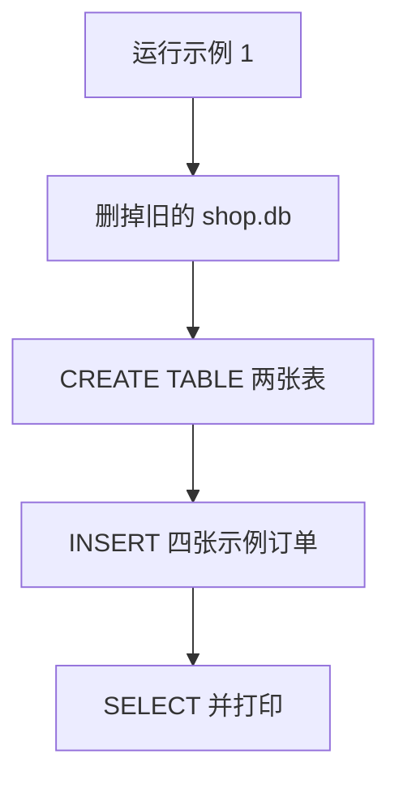

# 顺着建库逐行读

这一课要先会的基础课：

- [基础课 · 类和方法](../../00_python_basics/33_class_methods.md)
- [基础课 · with](../../00_python_basics/34_with.md)
- [基础课 · sqlite3 与 SQL](../../00_python_basics/35_sqlite.md)
- [基础课 · 日期时间](../../00_python_basics/36_datetime.md)

先运行，不需要密钥：

```bash
python stage2_tools_tickets/01_create_database.py
```

屏幕上应有「表：orders、tickets」、四张订单，以及「工单 0 张」。时间是你运行的那一刻，格式是 `年-月-日 时:分:秒`，和教程里的钟点不会相同。订单号、商品、金额、状态应和下面一致：

- `10086` 星河蓝牙耳机，299 元，已发货
- `20001888` 星河机械键盘，459 元，已签收
- `30021` 星河鼠标，129 元，待发货
- `88421` 星河扩展坞，189 元，已签收

再运行一次，还是这四张，工单仍是 0。旧文件被删掉重建了。



逻辑在 `db.py`。示例脚本只负责重建和打印。

## `db.py` 第 18 到 34 行：路径放在对象里

👉 不懂类？先看 [基础课 · 类和方法](../../00_python_basics/33_class_methods.md)。

`DATA_DIR` 用 `__file__` 找到 `stage2_tools_tickets/data`。你在哪个目录执行命令，文件都落在这里。复习 [从别的文件夹导入](../../00_python_basics/26_import_other_folder.md) 里「跟文件走」那一段。

`DatabaseLocation` 只有一个属性 `path`。工具函数不能多一个「数据库文件」参数，否则模型的说明书里也会出现这个参数。路径放在模块里的 `location` 对象上。示例 7 调用 `use_database`，改的是 `location.path`。已经写着 `db.location.path` 的函数看见的是同一个对象。

若写成一个普通字符串，再在别的文件里 `from db import DB_PATH`，拿走的是当时那个字符串。后面给变量重新赋值，拿走过的名字不变。这是示例 7 必须改对象属性的原因。

## 第 37 到 43 行：时间存成文本

👉 不懂 datetime？先看 [基础课 · 日期时间](../../00_python_basics/36_datetime.md)。

`now_text` 用本机时间。练习项目不跨时区，这样屏幕上的钟和库里的字对得上。格式带前导零，按文本排序就是按时间排序。SQLite 这里不另找一种日期类型。

## 第 46 到 76 行：with 负责打开和关闭

👉 不懂 with？先看 [基础课 · with](../../00_python_basics/34_with.md)。

`ShopConnection.__enter__` 连接文件，并把 `row_factory` 设成 `sqlite3.Row`，后面才能写 `row["order_id"]`，不用去数这列是第几个。

`__exit__` 里没有异常就 `commit`，有异常就 `rollback`，然后 `finally` 里 `close`。返回 `False`，异常继续往外走。关掉文件不等于 SQL 写对了。

`sqlite3` 自己的 `with` 不 `close`。所以这里自己写这个类，而不是把连接直接放进 `with sqlite3.connect`。

## 第 79 到 134 行：两张表和四张订单

👉 不懂 CREATE 和 INSERT？先看 [基础课 · sqlite3 与 SQL](../../00_python_basics/35_sqlite.md)。

`orders.order_id` 是 `TEXT` 主键。阶段 1 的正则交回字符串。存成整数会丢掉前导零，也和槽位里的类型对不上。

`tickets.id` 用 `INTEGER PRIMARY KEY AUTOINCREMENT`，编号由数据库从 1 往上加。不要在 Python 里自己编工单号。

`tickets.order_id` 允许空字符串。投诉可以先没有订单。空字符串不是一张订单，所以这里不加外键。加了的话，没有订单号的投诉插不进去。

订单状态用「已发货」「已签收」「待发货」。这是物流词。工单状态是另一套，下一课才写。两套词不要混用。

`SEED_ORDERS` 用字典，是为了看见 `10086` 是订单号。真正 `INSERT` 时再排成元组，因为 `?` 认位置。四个订单号都至少 5 位，阶段 1 在没有「订单」两个字时也能抽出来。`10086` 和阶段 1 示例里的那张是同一个号，方便你对照。

## 第 156 到 188 行：重建、保持、拒绝空文件

`reset_database` 先 `unlink` 再创建。示例 1 要反复运行，工单编号才每次从 1 开始。这会清掉你在命令行客服里记下的工单。打印的第一句就是在提醒这件事。

`ensure_database` 在文件已经存在时直接返回。示例 6 用它。客服不能每次启动都把昨天的工单删掉。

`require_database` 在连接之前看文件在不在。`sqlite3.connect` 发现没有文件时会新建一个空库。空库里没有表，下一条 `SELECT` 就是 `no such table`，磁盘上还多出一个坏文件。所以缺文件时抛出带中文路径的 `FileNotFoundError`，不要先连接。

`reset_database` 里面 `executescript` 一次跑两句 `CREATE`。`execute` 一次一句，所以建表不用它。四张订单的 `created_at` 用同一次 `now_text()`，这一批示例的时间相同。

## 第 191 到 229 行：把表和订单读出来

`sqlite_master` 是 SQLite 自己用来记「这个文件里有哪些表」的表。`name NOT LIKE 'sqlite_%'` 去掉内部表，例如自动编号用的 `sqlite_sequence`。剩下按名字排序，就是 `orders`、`tickets`。

`fetch_orders` 的 `ORDER BY order_id` 是为了每次打印顺序固定，教程才对得上。订单号是文本，排序按字典序，不按数字大小。`99` 会排在 `10086` 后面，因为 `"9"` 比 `"1"` 大。我们的示例号碰巧和数字大小一致，不要据此以为 SQLite 在按整数排。

`dict(row)` 写在 `with` 里面。离开 `with` 后连接已关，趁行还在手上时把它收成普通字典。

`COUNT(*) AS total` 给这一列起名叫 `total`，再用 `row["total"]`。新建库时工单是 0，不是「没有这张表」。

## 示例脚本

`01_create_database.py` 第 14 到 29 行只做四件事：提醒会清空、`reset_database`、打印表名、逐张打印订单。循环复习 [for](../../00_python_basics/14_for.md)。它不调用模型，文件末尾也没有包一层网络用的 `try`。建库失败应该露出追溯。

## 常见坑

- 示例 1、3、5 会删除 `shop.db`。想留下命令行里建的工单，就不要在那之后又运行这三个脚本。
- 数据库文件被 `.gitignore` 忽略。`git status` 里不应出现 `shop.db`。
- 把订单号改成 `99` 再在阶段 1 的规则里抽，不带「订单」标签时抽不出来。标签模式要至少 4 位，裸数字要至少 5 位。
- 在 SQL 字符串里用 f-string 把顾客的话拼进去。基础课里有一个能删掉整张表的例子。这里所有值都走 `?`。

## 改一行会看见什么

1. 把 `SEED_ORDERS` 里第一张的 `status` 改成 `已签收`，再运行。打印里耳机那一行应变，表结构不变。看完改回去。
2. 在 `reset_database` 里暂时删掉 `unlink` 那两行，连续运行两次。第二次应在 `INSERT` 时失败，因为主键 `10086` 已经在。这就是要先删文件的原因。看完改回去。

下一课不打开数据库，只规定工单状态能不能往前走：[状态流转](02_states.md)。
