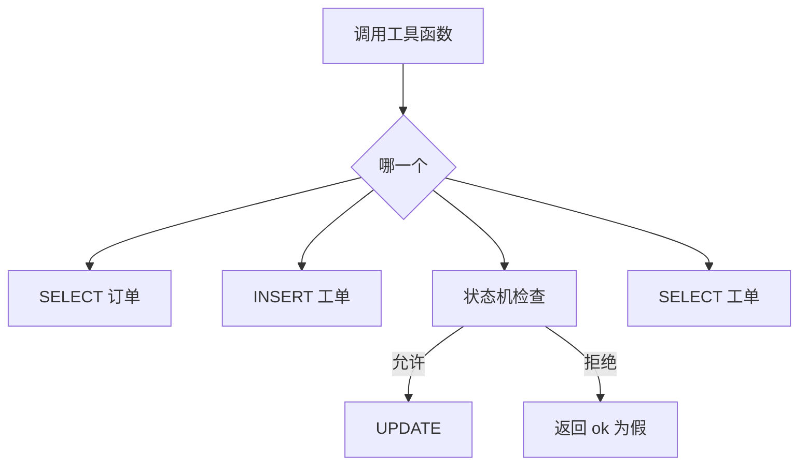

# 顺着四个工具逐行读

这一课要先会的基础课：

- [基础课 · 默认参数](../../00_python_basics/37_default_args.md)

登记表复习 [把函数放进字典](../../00_python_basics/28_functions_in_dict.md)。SQL 复习 [sqlite3](../../00_python_basics/35_sqlite.md)。

先运行：

```bash
python stage2_tools_tickets/03_tool_functions.py
```

它会重建 `shop.db`。查 `10086` 的 `ok` 为真，商品是星河蓝牙耳机。查 `99999` 的 `ok` 为假。退款工单的 `id` 是 1，状态是待处理，顾客是「演示用户」。推进到「处理中」成功。从「处理中」直接改成「已关闭」失败，再读一次，状态仍是处理中。没有订单号的投诉能建成，工单 2 的 `order_id` 是空字符串。没有订单号的退款、以及订单 `99999` 的退款，都是 `ok` 为假。时间以你的屏幕为准。

这一步没有模型。打印出来的 JSON 就是以后要交给模型的那种结果。



## `tools.py` 第 11 到 37 行：类型、默认名、编号

`TICKET_TYPES` 只有退款、投诉、转人工。阶段 1 说过转人工以后要留下工单，所以类型里有它，和退款分开，同事才看得出这不是来退钱的。

`DEFAULT_USER_NAME` 是「演示用户」。练习项目没有登录，不能从账号里知道是谁。

`_MACHINE` 在模块加载时做一台。规则不变，不必每来一句就 `StatusMachine()` 一次。

`_as_ticket_id` 接受整数，也接受 `"1"` 这种字符串，因为 JSON 里两种都可能出现。`bool` 要先挡住：`True` 也算整数的一种，`int(True)` 是 1，会去改 1 号工单。`JSON` 的 `true` 进 Python 就是这个 `True`。

## 第 54 到 74 行：`query_order`

没查到是正常业务，返回 `{"ok": False, "error": "..."}`，不抛异常。客服要把这句话告诉顾客，而不是打出一段追溯。

`WHERE order_id = ?` 的参数是 `(text,)`。逗号把单个字符串收成元组。复习 sqlite 课里这个逗号。

`db.location.path` 在调用时才读。示例 7 若先换了路径，这里看见的是新文件。

## 第 77 到 120 行：`create_ticket` 和默认参数

👉 不懂默认参数？先看 [基础课 · 默认参数](../../00_python_basics/37_default_args.md)。

`user_name` 默认「演示用户」，`order_id` 默认空字符串。示例 3 创建投诉时只写了类型和描述，这两个就用默认值。

默认值只在参数名根本没出现时生效。模型若传 `user_name: "  "`，第 91 行 `strip` 之后是空的，再用 `or DEFAULT_USER_NAME` 补上。这是默认参数盖不住的那种空值。

初始状态写死「待处理」。参数里没有 `status`，调用方不能新建一张已关闭的工单。

退款多两道检查：订单号不能空，而且 `query_order` 必须成功。没有这张订单就不要留下一张对不上账的退款单。投诉不走这两道，空订单号可以插入。

`lastrowid` 是刚刚插入的那一行的编号。插完再 `SELECT` 一次，返回的字典和表里的列一致，避免手写字典时漏掉 `updated_at`。

退款不会打款。函数只插入一行。回复里也会说钱还没有退。

## 第 123 到 172 行：改状态和读取

`update_ticket_status` 先读出当前状态，再调用 `_MACHINE.move`。`ValueError` 被收成 `ok` 为假的字典。注释写了原因：模型读不懂异常对象，它只能读我们回传的文本。

拒绝时函数在 `UPDATE` 之前返回。再 `get_ticket`，状态还是原来的。示例 3 的「跳到已关闭」就是为了让你看见库没被改。

成功时 `UPDATE` 只改 `status` 和 `updated_at`。`WHERE id = ?` 只动这一行。

`get_ticket` 没有这张工单时同样返回字典，不抛异常。

## 第 175 到 182 行：登记表

值没有括号。`TOOL_FUNCTIONS["query_order"]` 是函数本身。加了括号就会立刻去查，而当时还没有订单号。这和阶段 1 的 `HANDLERS` 是同一种写法。

键必须和 `schema.py` 里的 `name` 相同。示例 7 会断言两边的名字集合相等。模型说出 `delete_all` 时，`.get` 得到 `None`，不会在这张表外面找一个同名函数来执行。

## 示例脚本

`03_tool_functions.py` 用 `json.dumps(..., ensure_ascii=False)` 打印。中文还是中文。这行复习 [JSON](../../00_python_basics/23_http_json.md) 里的 `dumps`。脚本开头就说会重建数据库。你在示例 6 里建的工单，运行这一课会被清空。

## 常见坑

- 调用写成 `create_ticket("退款", "不想要了", "10086")`。第三个位置是 `user_name`，订单号会变成顾客名，订单号反而变成默认的空字符串，退款检查会说缺少订单号。示例和客服都用 `ticket_type=` 这种名字。
- 非法流转如果只打印异常、不看数据库，你会以为已经改了。要再 `get_ticket` 一次。
- 登记表里写成 `query_order()`。导入这个文件时就会执行查询，而且参数对不上。

## 改一行会看见什么

1. 把创建退款时的 `order_id` 改成 `20001888`，再运行。工单里的订单号和描述应跟着变，`id` 仍是 1，因为脚本每次都重建。看完改回 `10086`。
2. 在 `TICKET_TYPES` 里暂时去掉「投诉」，再运行「没有订单号的投诉」那一段。应看到不认识的工单类型。看完加回去。

下一课把这四份函数交给模型挑选：[function calling](04_function_calling.md)。
