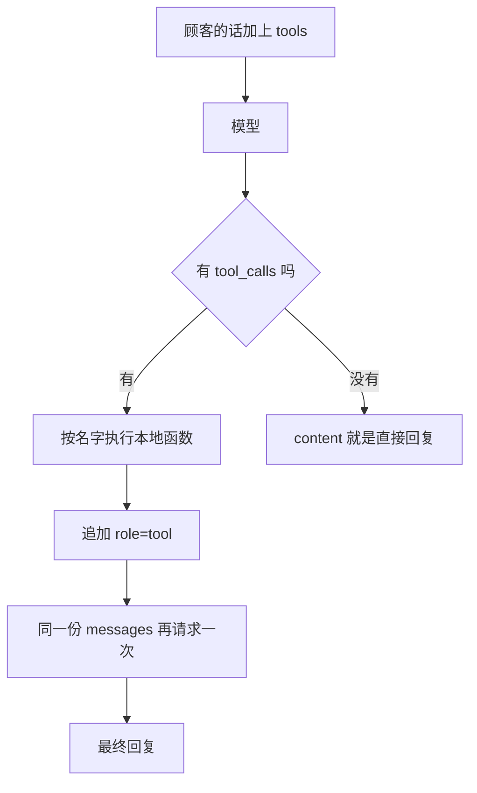

# 顺着 function calling 逐行读

这一课要先会的基础课：

- [基础课 · 星号解包](../../00_python_basics/38_star_args.md)

`json.dumps` 复习 [HTTP 与 JSON](../../00_python_basics/23_http_json.md)。登记表复习 [函数放进字典](../../00_python_basics/28_functions_in_dict.md)。

先运行：

```bash
python stage2_tools_tickets/04_function_calling.py
```

没有密钥时，屏幕先打出一整份 `tools` JSON，然后说明跳过模型。这不是安装失败。同一套执行在示例 7 里用假响应跑完。

有密钥时才会向 DeepSeek 发两次请求：第一次让模型决定要不要调用工具，程序执行本地函数，第二次拿最终回复。示例订单必须已经在库里。脚本用 `ensure_database`，不会把已有工单清空；文件还不存在时会先建库。



## 模型不执行函数

Function calling 是一种请求格式。你把工具的说明书放进 `tools`。模型若认为需要事实，就在助手消息里放 `tool_calls`：哪一个名字、参数的 JSON 文本、这一次调用的 `id`。程序在自己的电脑上执行函数，再追加一条 `role` 为 `tool` 的消息，用 `tool_call_id` 对上那次调用。然后整份 `messages` 再发给模型，它才写出给顾客的句子。

模型看不见 `tools.py`，也打不开 `shop.db`。它只能看见说明书和你回传的文本。

## `schema.py`：说明书

文件开头写明这是说明书，不是函数。`_function` 把重复的外壳收成一项：`type` 固定是 `function`，里面才是名字、说明和 `parameters`。

`parameters` 是一份 JSON Schema。`properties` 列出参数名和类型，`required` 列出不能省略的名字。`query_order` 的订单号是必填。`create_ticket` 的类型和描述是必填，顾客名和订单号可以省略，对应函数的默认参数。

`enum` 把允许的字符串写死。工单类型来自 `TICKET_TYPES`，状态来自 `STATUS_NAMES`。不要在说明书里再抄一份，否则两边会各写各的。示例 7 还会检查名字集合和登记表一致。

列表的顺序不是优先级。阶段 1 的关键词规则靠顺序，这里靠说明文字。说明里写了「没有订单号时不要调用，先向顾客追问」，也写了「不会真的打款」。

`update_ticket_status` 的说明把三步合法方向写进了人话。真正拒绝跳步的仍是状态机。说明书只是让模型少提一次非法请求。

## `calling.py` 第 18 到 71 行：字典和 SDK 对象

在线接口给的 `arguments` 是 JSON 文本，不是字典。离线测试有时直接给字典。`arguments_text` 把字典 `dumps` 成文本，后面只 `loads` 一次。

`read_tool_call` 从字典或 SDK 对象里取出三样：`id`、函数名、参数文本。字段的名字相同，外壳不同，所以执行函数可以只有一份。

`assistant_message_dict` 把这一轮收成普通字典，方便 `json.dumps` 打印，也方便放进下一轮请求。`content` 在只有工具调用时常常是 `null`。打印出来就是 JSON 的 `null`，不是字符串 `"None"`。

思考模式还会多一个 `reasoning_content`。请求里用 `extra_body` 关掉了思考。若响应仍带着它，字典里原样留下。删掉再送回去，有的模型会返回 400。

## 第 74 到 113 行：执行并追加

👉 不懂 `**arguments`？先看 [基础课 · 星号解包](../../00_python_basics/38_star_args.md)。

`run_tool` 用登记表 `.get`。没有这个名字，返回「没有这个工具」，不会按名字去调用别的函数。

`json.loads` 失败时收成错误字典。复习 [解析 JSON](../../00_python_basics/27_json_parse.md)。解析结果必须是对象。列表或字符串不能拆成参数。

`function(**arguments)` 把键变成参数名。多一个字段或少一个必填字段，是 `TypeError`。这里接住它。模型仍能在下一轮看见这条错误，而不是整个进程退出。

`append_tool_results` 对每一个 `tool_call` 执行一次，追加：

```python
{"role": "tool", "tool_call_id": call_id, "content": "..."}
```

`content` 必须是文本，所以结果字典要 `json.dumps`。`ensure_ascii=False` 让中文保持中文，和基础课 23 里的理由相同。失败的结果也追加。模型靠这条消息知道没查到，不靠程序崩溃。

`tool_call_id` 必须和助手消息里的 `id` 相同。对不上，接口会拒绝下一轮请求。

## 第 116 到 136 行：带 tools 的那一次请求

`tools=TOOLS`，`tool_choice="auto"`。`auto` 表示模型可以调用工具，也可以直接写回复。温度是 0，这一课要的是稳定的选择。

`stream=False`。参数只到一半时不能拿去执行函数。流式适合把已经生成的字显示出来，不适合这一课。

`extra_body={"thinking": {"type": "disabled"}}` 对齐 DeepSeek 文档里非思考模式的示例。思考模式还要求把 `reasoning_content` 原样带回，本阶段先不把那条线加进来。若原始错误说不认识 `thinking`，把这一行暂时去掉再试，代码其余部分不用改。

## 示例脚本第 40 到 88 行

没有密钥就在第 48 到 51 行返回。先打印的说明书不需要网络。

有密钥时，`messages` 先是一条 system、一条 user。`USER_TEXT` 里已经有 `10086`，所以预期是一轮 `query_order`，而不是先追问。追问放在下一课，用代码保证。

第一轮结束后看 `finish_reason`。调用了工具时，它常常是 `tool_calls`。然后 `append_tool_results`，再请求第二次。第二次若还想调用工具，脚本打印一句并停。注释写了原因：这一课只演示一轮，避免不知不觉打很多轮、产生费用。

没有 `tool_calls` 时，`content` 就是直接回复。把 `USER_TEXT` 改得含糊，有可能走到这一支。

## 一轮消息长什么样

有密钥且模型按预期调用时，列表里依次是：

1. `system`：岗位说明
2. `user`：请查订单 10086
3. `assistant`：`content` 多为 `null`，`tool_calls` 里是 `query_order` 和参数文本
4. `tool`：`tool_call_id` 对上，`content` 是查询结果的 JSON
5. `assistant`：给顾客的短句，里面应有耳机、299 元、已发货这些结果里真有的字

没有密钥时看不到第 3 步往后。示例 7 会用一份写死的第 3 步，把第 4 步跑出来。

## 常见坑

- 把说明书当成已经执行。打印了 `tools` 不等于查过数据库。查库发生在 `run_tool`。
- 本地执行之后忘记把 `role=tool` 放回 `messages` 就请求第二次。模型看不见结果，只能再编。
- `arguments` 已经是文本，又 `json.dumps` 一次。模型会收到一层多余的引号，`loads` 之后变成字符串，不再是对象。在线路径不要对字符串再 dumps。`arguments_text` 只在传入的不是字符串时才 dumps。
- 用 f-string 自己拼一条假的 `tool` 消息，却编了一个对不上的 `tool_call_id`。

## 改一行会看见什么

1. 没有密钥时，这一课能改的是说明书。把 `query_order` 的 description 改短，再运行，打印的 JSON 应跟着变。看完改回去。有密钥时再把 `USER_TEXT` 改成 `我要退款`。模型可能不调用工具、而是在 `content` 里追问订单号。那就是下一课同一件事，由模型说出来。也可能它仍然调用 `create_ticket` 却没有订单号，工具会返回错误，第二轮应根据这条错误来问。看完改回原来的句子。
2. 在 `run_tool` 里暂时把 `**arguments` 改成 `arguments`，用示例 7 跑。应失败，因为整份字典被当成了 `order_id`。看完改回两个星号。

下一课用代码追问，不依赖模型记不记得问：[补槽位](05_slots.md)。
