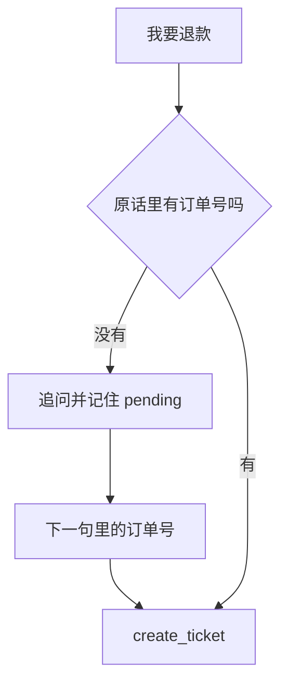

# 顺着追问补槽位逐行读

这一课没有新的语法课。字典、正则和默认参数都已经出现过。

槽位是办成这件事必须先知道的一项事实。阶段 1 的 `extract_order_id` 会抽订单号，抽不到就是 `None`。`None` 不能拿去查库，也不能编一个 `10086`。

先运行：

```bash
python stage2_tools_tickets/05_fill_slots.py
```

脚本会重建 `shop.db`。你应看到：

- 第 1 轮顾客「我要退款」。小星追问订单号。工具是 `None`。正在等待的槽位是退款和原话「我要退款」。工单张数是 0。
- 第 2 轮顾客「订单号 10086」。来源是 `slots`。工具是 `create_ticket`。工单 1，描述仍是「我要退款」，不是只有数字。等待的槽位变成 `None`。工单张数是 1。
- 回复里写明钱还没有退。



## `slots.py`

`REQUIRED_SLOTS` 只给查订单和退款放了 `order_id`。投诉和转人工不在表里，没有订单号也可以建工单。`dict.get(intent, ())` 对不在表里的意图得到空元组，`missing_slots` 就得到空列表。

`question_for` 的句子写在程序里。缺订单号时不请模型现编一句，也不请它猜号码。模型可以稍后把工具结果说得更礼貌，追问这一句以这里为准。

## `service.py` 第 80 到 95 行：订单号只信原话

意图可以来自规则，也可以来自模型。订单号这一格被改成 `extract_order_id(text)` 的结果。模型若在 JSON 里另外填了一个号，可能是编的，不能拿去查库。正则复习 [正则](../../00_python_basics/25_regex.md)。

`source` 为 `fallback` 时，阶段 1 会把意图收成「其他」。那种结果不能用来决定建不建工单，所以改回规则。

## 第 144 到 155 行：缺了就记在 session 里

`missing_slots` 不为空时，不调用工具。`session["pending"]` 记下意图和原话。原话要留下，因为下一句可能只是 `10086`，工单描述仍应该是「我要退款」。

`asked` 是 `"order_id"`。示例 6 看见这个字段，就知道这一轮是追问，有模型时也不要把追问再交给模型改写，避免它顺手编一个订单号。

`session` 必须是调用方留着的同一个字典。示例脚本第 32 到 34 行两次 `show_turn` 传入同一个 `session`。若第二次换一个新的 `{"pending": None}`，程序会把「订单号 10086」当成一句新的话。里面有「订单」，规则会判成查订单，去查询而不是建退款单。

## 第 158 到 178 行：下一句怎么接

先用规则看这句是不是投诉或转人工。这两种即使带着订单号，也表示人改口了，不再把数字填进上一张退款单。

否则若抽得出订单号，就结束等待。上一问是查订单，就 `query_order`。上一问是退款，就 `create_ticket`，描述用 `pending["text"]`。来源写成 `slots`，表示这一句是在补缺口，不是重新分类。

抽不出订单号，而这句明确换成了另一种需要订单号的意图，就放下上一问，按新意图重新开始。那通常会再追问一次。

其余句子再问一遍，`pending` 保持不变。

## 第 181 到 190 行：一句进来先看命令

`handle_turn` 先认「查询工单 1」「把工单 1 改为处理中」这种句式。这不属于阶段 1 的六个意图，来源是 `command`。正在追问时若顾客改口去查工单，`pending` 会被清掉，避免下一句数字又被填进退款。

句式写在第 18 到 21 行。闲聊里只出现「工单」两个字不会命中，必须是「查询工单」加数字，或「工单 数字 改为 某个状态」。

## 示例脚本

第 1 轮工具是 `None`，张数是 0，证明追问没有偷偷插入。第 2 轮张数是 1。`count_tickets` 就是这个证据。不要只看回复里有没有「已记下」，那句话也可能是编的。张数从数据库数出来。

## 常见坑

- 两轮各用一个新的 `session`。第二轮失去「还在办退款」。
- 正在等退款订单号时说「10086 我要投诉」。投诉会优先，这张单会建成投诉，不会建成退款。想完成退款，下一句就只给订单号。
- 「怎么样」里含有「怎么」，阶段 1 的规则可能把它判成咨询。追问过程中这种句子不会打断退款，因为咨询不在改口名单里，程序会再问一次订单号。
- 把追问交给模型自由发挥。它可能回答「订单号是 10086」这种库里恰好有的例子。这一课的问句是写死的。

## 改一行会看见什么

1. 把第 2 轮的句子改成 `99999`，再运行。工具仍会被调用，`ok` 应为假，因为没有这张订单，退款单不会出现，张数应仍是 0。看完改回 `订单号 10086`。
2. 把第 1 轮改成 `我要退款，订单号 10086`。第一轮就应该建单，`pending` 是 `None`，第二轮会再按新的一句处理。看完改回去。

下一课把追问、意图和工具放进可以对话的客服：[命令行](06_cli.md)。
