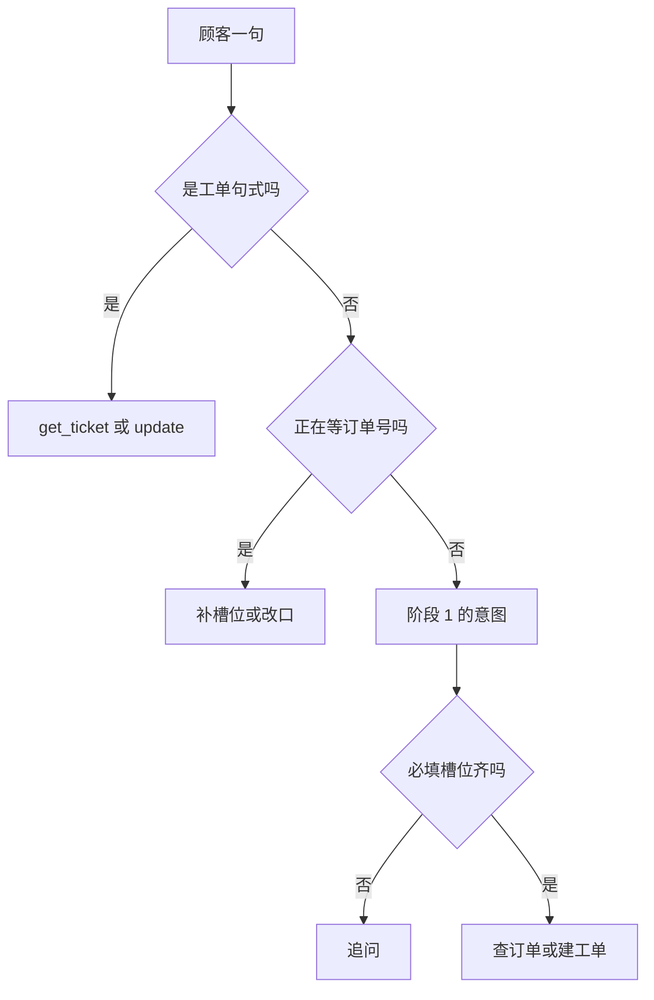

# 顺着命令行客服逐行读

这一课没有新的语法。退出、空行、历史列表和阶段 1 的客服相同。新的是 `handle_turn` 会真的查库、建工单。

先在没有密钥时运行：

```bash
python stage2_tools_tickets/06_cli_with_tools.py
```

它不会清空数据库。若你刚跑过示例 5，库里已经有一张退款工单。可以按屏幕上的例句输入：

1. `订单号 10086 到哪了`  
   意图是查订单。回复里有星河蓝牙耳机、299 元、已发货。
2. `我要退款`  
   程序追问订单号，此时工单张数不变。
3. `10086`  
   来源变成 `slots`，新的一张退款工单出现。回复写明还没有退钱。
4. `我要投诉，耳机有杂音`  
   立刻建投诉单，可以没有订单号。
5. `查询工单 1`  
   来源是 `command`。
6. `把工单 1 改为处理中`  
   若这张单还是待处理，会改成功。再输入 `把工单 1 改为已关闭`，应被拒绝，状态停在处理中。
7. `退出`

没有密钥时，小星的句子是 `render` 拼的，不是模型写的。工单已经在 `stage2_tools_tickets/data/shop.db` 里。你可以再运行示例 3 之前用「查询工单」确认它还在。示例 1、3、5 会重建这个文件。

有密钥时，分类可以走阶段 1 的模型，工具仍由程序执行。模型只把结果说成客服的话。屏幕上的「小星」那一句可能换措辞，金额和状态仍应来自工具结果。



## 和第 1 阶段的差别

阶段 1 的处理函数说「我先记下了」「真正去数据库查，要到阶段 2」。那些函数还在 `stage1_intent/router.py` 里，这一阶段不改它们，避免阶段 1 的示例突然开始写数据库。

阶段 2 另写 `service.py`，只借用分类和抽订单号。`stage2_link.enable()` 把阶段 1、阶段 0 放进查找路径，才能 `import` 到 `rule_intent` 和 `config`。复习 [从别的文件夹导入](../../00_python_basics/26_import_other_folder.md)。`enable()` 必须写在这两次 import 之前。

## 没有密钥的那一支

`api_key_ready` 为假时不创建客户端。`handle_turn` 只用规则。`session = {"pending": None}` 是这一次进程里的缺口。退出程序，缺口消失。已经 `INSERT` 的工单还在文件里。

这和阶段 0「列表是唯一记忆」要分开看：没有模型时，甚至没有那份对话列表。工单记忆是数据库文件。对话上半句还缺订单号，记在 `session` 里，不在 SQLite 里。

## 有密钥的那一支

不在追问中时，先 `classify_by_llm`。网络失败就打印错误，这一句改用规则。`service.py` 还会在 `fallback` 时改用规则，避免坏 JSON 把退款收成「其他」。

订单号仍然只用正则，不用模型填的那一格。见上一课。

`outcome["asked"]` 有值时，不把追问再送给客服模型。程序的问句直接说给顾客，并追加进 `messages`，下一轮才看得见曾经问过。若交给模型润色，它可能自己报一个订单号。

工具已经执行过的回合，`phrase` 把顾客原话和结果说明放进历史，再 `request_reply`。这次请求不带 `tools`。工具已经由意图选好并执行了。再把说明书给模型，它可能再要一轮调用，这一课的路由就被绕开。

结果说明是一条 `system` 消息，不是假的 `tool_calls`。这条助手消息不是模型自己产生的，聊天补全接口不保证接受你中途插入的工具调用。示例 4 才使用真正的 `tool_calls`，因为那一轮的调用是模型返回的。

失败时先弹出刚加的 system，再弹出 user。顺序和阶段 1 相同。

## `render` 说什么

查到订单时，句子里有商品、金额、物流状态、下单人，都来自那一行。建退款单时明确说钱还没有退。建转人工单时说同事会按工单接手。更新成功时说出原来的状态和现在的状态。失败时直接用工具返回的 `error`，所以非法流转的那句中文会原样出现。

有密钥时，模型被要求只根据这段事实说话，不要补充结果里没有的单号、金额或时间。它仍可能说漏。阶段 6 才会在发出去之前做检查。这一阶段你要自己对一下屏幕和「查询工单」的结果。

## 常见坑

- 运行示例 6 之后又运行示例 1。`shop.db` 被重建，刚才的工单没了。启动时的那句「示例 1、示例 3、示例 5 会重建数据库」就是在说这件事。
- 输入 `工单 1` 却不写「查询」。句式对不上，这句话会落到「其他」，不会去读库。
- 把阶段 1 的 `handle_refund` 改成调用数据库。阶段 1 的示例 3 会开始写文件，和当时的文档对不上。新的调用写在阶段 2。
- 没有密钥时以为工单也没写进去。看张数或再查一次工单。回复是写死的，插入是真的。

## 改一行会看见什么

1. 输入 `今天天气怎么样`。规则仍可能因为「怎么」判成咨询，回复是产品问题那一句，不会建工单。这是阶段 1 的局限，路由没有把它纠正成查订单。
2. 把「把工单 1 改为处理中」改成「工单 1 处理中」，去掉「改为」。应查不到这个命令。看完用回带「改为」的句子。

离线把上面这些断言锁住的脚本是：[示例 7](07_offline.md)。
