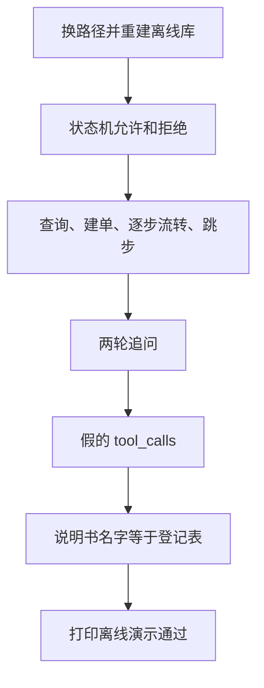

# 顺着离线演示逐行读

这一课要先会的基础课，只有以前学过的断言：

复习 [assert](../../00_python_basics/30_assert.md)。不要用 `python -O` 运行，否则断言会被拿掉，脚本会在错误时仍打印通过。

先运行：

```bash
python stage2_tools_tickets/07_offline_demo.py
```

不需要密钥，也不访问网络。最后一行必须是：

```text
离线演示通过
```

前面任何一条 `assert` 失败，程序停在 `AssertionError`，你看不到这句。数据库用的是 `stage2_tools_tickets/data/offline_demo.db`，不是 `shop.db`。命令行客服里的工单不会被这个脚本清掉。



## 为什么要一份假的模型响应

示例 4 的在线路径取决于模型和密钥。教学仓库要在没有密钥时仍能证明：解析 `tool_calls`、执行本地函数、追加 `role=tool`，这三步是通的。

假消息的形状和接口相同：`role` 是 `assistant`，`content` 是 `null`，`tool_calls` 里有 `id`、`type`、`function.name`、`function.arguments`。`arguments` 是 JSON 文本，不是字典。示例故意 `json.dumps` 一次，就是为了和在线接口一样先变成文本，再由 `run_tool` 解析。

这份假消息只在本进程里执行。不要把它塞进真实的聊天补全请求。那次调用不是模型生成的，接口不保证接受。

## `check_states`

`move("待处理", "处理中")` 必须得到「处理中」。跳到「已关闭」必须抛 `ValueError`。`else` 挂在 `try` 上：如果没有抛错，就 `raise AssertionError`。只写 `assert` 不够表达「这里应该失败」，因为没抛错时程序会安静地继续。

已关闭再改回处理中，同样必须失败。

## `check_orders_and_tickets`

重建之后第一张退款单的 `id` 是 1，状态是待处理，顾客名是默认的「演示用户」。然后按合法方向走到已关闭，再改一次必须失败，并且 `get_ticket` 看见的仍是已关闭。

第二张是带订单号的投诉，停在待处理。直接改成已关闭必须失败，状态不变。把状态写成订单才有的「已发货」也必须失败。

没有订单号的退款、订单不存在的退款，都必须 `ok` 为假。

这些断言锁的是库里的结果，不是打印出来的句子。句子可以改措辞，状态不能跳步。

## `check_slots`

这一段开始时库里已经有两张工单。`我要退款` 之后张数仍是 2，`asked` 是 `order_id`。下一句 `订单号 10086` 建成第 3 张，描述是「我要退款」，来源是 `slots`，`pending` 回到 `None`。

接着用新的 `{"pending": None}` 查 `20001888`，商品应是星河机械键盘。投诉会再建一张。`查询工单 2` 读到的是前面那张投诉。`把工单 2 改为处理中` 成功。

工单编号和前面的插入次数绑在一起。你若在这些函数中间又插入一次 `create_ticket`，后面的 `id` 断言会失败。那是故意的：编号不是猜的，是数出来的。

## `check_fake_model`

消息列表先有 system 和 user，再追加假的 assistant。`append_tool_results` 追加的最后一条 `role` 必须是 `tool`，`tool_call_id` 是 `call_offline_query`。`content` 再 `json.loads` 回来，`order_id` 是 `10086`。

四条角色的顺序是 `system`、`user`、`assistant`、`tool`。少了 `tool`，就表示执行结果没有回到列表里。

`run_tool("delete_all", "{}")` 必须失败。登记表里没有的名字不能执行。`query_order` 配上一段不是 JSON 的中文，也必须失败。

只给 `ticket_type` 和 `description` 时，`user_name` 应是「演示用户」，`order_id` 应是空字符串。这是默认参数通过 `**arguments` 生效的证据。再传一个空格组成的 `user_name`，结果仍应是「演示用户」，证明空字符串不会偷偷变成另一个人，也不会把默认值原样留下而不经检查。

## `check_schema_matches_functions`

说明书里的 `name` 收成一个集合，和 `TOOL_FUNCTIONS` 的键比较。多写一个工具却忘了登记，或登记了却没写进 `tools`，这里都会停。集合比较不看顺序。说明书那一课说过，顺序不是优先级。

## 第 217 到 224 行：换文件

`use_database` 改的是 `db.location.path`。工具函数读的是这个属性，所以这一进程里的查询都进 `offline_demo.db`。脚本结束，下一个进程仍从默认的 `shop.db` 开始，因为 `location` 的初始值写在 `db.py` 里，不会被上一次进程记住。

## 常见坑

- 用 `python -O` 跑。断言消失，最后仍可能打印通过。
- 以为这个脚本会调用 DeepSeek。它不读密钥。打印里的「假的模型响应」是我们写的字典。
- 把 `offline_demo.db` 提交进 Git。`*.db` 已经在 `.gitignore` 里。

## 改一行会看见什么

1. 把 `assert ticket_id == 1` 改成 `assert ticket_id == 2`，再运行。应在创建第一张工单后停下，看不到「离线演示通过」。看完改回 1。
2. 把假消息里的 `order_id` 改成 `99999`。`append_tool_results` 仍会追加 `role=tool`，但 `body["ok"]` 为假，后面的断言会停。这表示「调用格式对了」和「业务查到了」是两件事。看完改回 `10086`。

阶段里这些脚本串起来之后，读 [阶段小结](stage_summary.md)。
