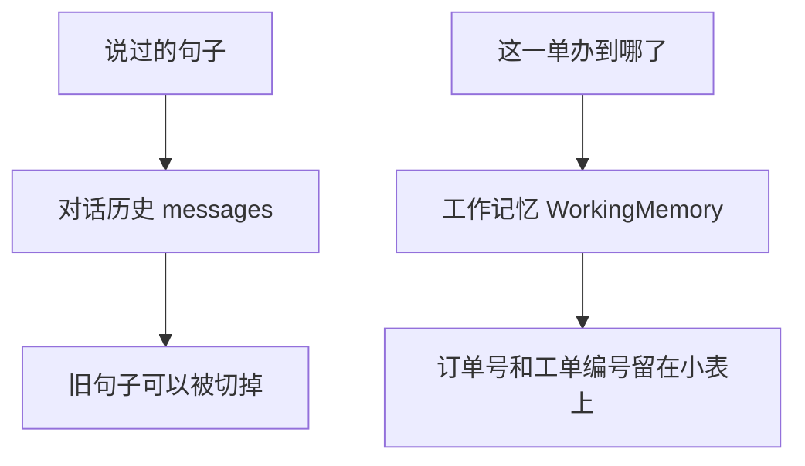

# 顺着工作记忆逐行读

这一课要先会的基础课：

- 👉 不懂类型注解？先看 [基础课 · 类型注解](../../00_python_basics/40_type_annotations.md)
- 👉 不懂 dataclass？先看 [基础课 · dataclass](../../00_python_basics/41_dataclass.md)

先运行，不需要密钥，也不需要 Redis：

```bash
python stage3_memory/01_working_memory.py
```

屏幕上先是一张空的 `WorkingMemory`，历史 0 条。顾客说「我要退款」之后，历史有 2 条，小表上 `pending_slot` 是 `order_id`，槽位还是空的。再说「订单号 10086」之后，`slots` 里有 `10086`，`ticket_id` 是 `1`，`task_status` 是 `done`。最后丢掉最早两句历史，订单号和工单编号仍印在小表上。



## 三份东西先分开

对话历史是 `messages`：谁说了哪一句，按顺序排着。它回答「刚才说过什么」。

工作记忆是 `WorkingMemory`：意图、槽位、正在等哪一项、手头的工单编号、办到哪一步。它回答「这一单办到哪了」。顾客已经报过订单号之后，就算窗口把那一句切掉，小表上还可以留着 `order_id`。

短期记忆是下一课才动手的事：把历史里最近一段，和这张小表，放到进程外面，退出程序再打开还能读到，空闲久了再过期。长期记忆是阶段 5 的事，指可以跨很多天保留的偏好，这一阶段不做。

阶段 2 的 `shop.db` 是工单账本。账本回答「库里有没有这张单」，不回答「刚才那句闲聊是什么」。三份不要叫成同一个名字。

## `working.py` 第 13 到 24 行

👉 不懂 dataclass？先看 [基础课 · dataclass](../../00_python_basics/41_dataclass.md)。👉 不懂 `str | None`？先看 [基础课 · 类型注解](../../00_python_basics/40_type_annotations.md)。

`messages` 故意不放进这个类。放进去，一切历史就会把订单号一起切掉，这一课的差别就看不见了。

`intent` 和 `pending_slot` 用 `None` 表示还没有。`pending_text` 和 `ticket_id` 用空字符串，因为它们一旦要写进 Redis 的 HASH，空着也得是一段文本。`slots` 用 `default_factory`，每个会话一份字典。

`task_status` 只用三个词：`idle` 还没办，`waiting` 正在等订单号，`done` 这一步已经有了工具结果。它不是阶段 2 工单上的「待处理 / 处理中」。工单状态在数据库那一列，这一格只描述客服手头的任务。

## 示例脚本在填表

`01_working_memory.py` 没有调用阶段 2 的工具。订单号和工单编号是写死的，为了让你先看清字段。真正写入工单在示例 6。这里若先连数据库，你要同时记住建表和这张小表，第一课会混。

丢掉最早两句时用的是 `for`，不是切片。切片在下一课。这里只要看见：历史变短了，`memory.slots["order_id"]` 还在。

`print(memory)` 能看见每个字段，是 dataclass 生成的。这行不是 JSON。

## 常见坑

- 把 `messages` 放进 `WorkingMemory`，然后整份对象一起截断。订单号会和旧句子一起被丢掉。
- 把 `task_status` 写成「待处理」。那是工单状态机的词。小表上的 `waiting` 只表示还在追问。
- 看到 `ticket_id` 是 `"1"` 就以为数据库里真有这张单。示例 1 没有打开 SQLite。

## 改一行会看见什么

1. 把 `memory.slots["order_id"] = "10086"` 删掉，再运行。最后一行的订单号会变成取一个不存在的键，程序停在 `KeyError`。小表不会自动从历史那句「订单号 10086」里把号码抄进来。看完把这一行加回去。
2. 在丢掉历史之后再 `print(len(messages))`。仍是 4。`shortened` 是另一份列表。原历史没有被改短。

下一课处理历史太长时怎么切：[截断](02_truncate.md)。
