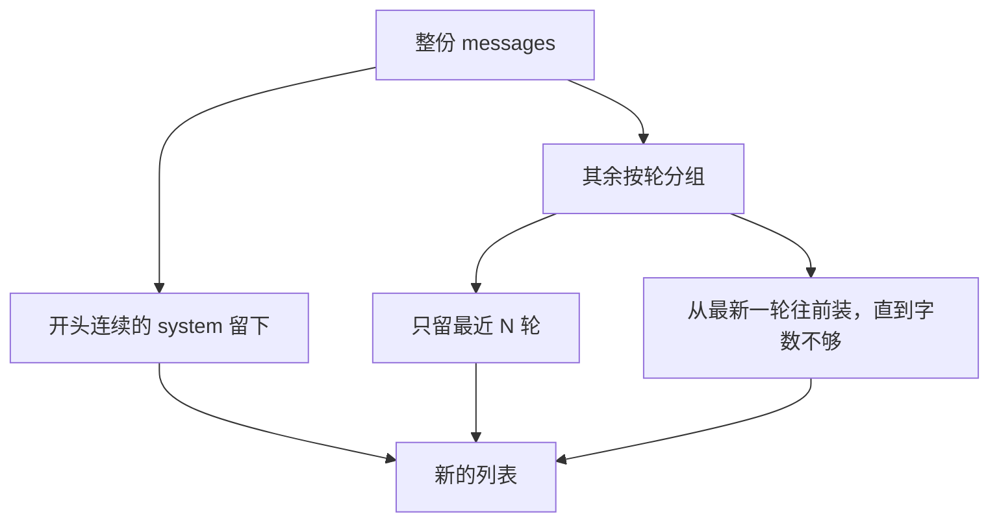

# 顺着截断逐行读

这一课要先会的基础课：

- 👉 不懂切片？先看 [基础课 · 切片](../../00_python_basics/39_slice.md)

上下文窗口这个词在阶段 0 的 [名词表](../../stage0_basics/docs/glossary.md)。这一课把它落到「列表太长就留下最近一段」。

先运行：

```bash
python stage3_memory/02_truncate.py
```

切之前是 7 条，字数 88。只留最近 1 轮之后，剩下岗位说明和「第三句要留下」。字数上限 70 时，第一轮被丢掉，第二轮和第三轮还在，字数 67。原列表仍是 7 条。`0` 轮会打印「至少保留 1 轮」。



## 为什么要切

模型一次请求能放下的 token 有上限。超出去的字不会自动变成摘要，而是这次请求放不进去。历史若只追加、从不删，总有一次会失败，费用和等待也会变长。

token 不是「一个汉字」。本仓库没有自带分词器，所以用 `content` 的字符数做教学用的上限。字符数和 token 数不会相等。你要记住的是：有上限，旧的要让位。接口账单仍按 token 算。

## 一轮是什么

`window.py` 的 `group_turns`：一条 `user` 开始新的一轮，直到下一条 `user` 之前。紧跟的 `assistant` 和这条问话留在一起。若按条数一刀切，可能只留下回答、丢掉问题，模型会看见一句没头没尾的话。

开头连续的 `role` 为 `system` 的消息不计入轮数。那是岗位说明，也可能是后面加上的摘要。它们必须留在列表最前面。夹在对话中间的 `system` 算进那一轮，可以一起被切掉。所以「必须留下的说明」要放在列表开头，不要插在两句闲聊中间。

## `truncate_by_turns`

第 63 到 70 行。`max_turns < 1` 直接拒绝。留 0 轮等于把顾客刚刚的话也丢了，下一句请求没有问题可答。

`turns[-max_turns:]` 是切片。右端省略，表示一直取到最后。👉 不懂这个写法？先看 [基础课 · 切片](../../00_python_basics/39_slice.md)。

交回去的是 `copy_messages` 做的新列表。示例末尾打印原列表仍是 7 条，就是为了看见旧历史没有被改短。调用方若还要把新的一句 `append` 到原列表，窗口结果不会跟着变长。

## `truncate_by_chars`

第 73 到 97 行。先减去岗位说明已经占用的字数，剩下的额度从最新一轮往前装。最新一轮即使自己就超过额度也留下。再往前的轮，放不下就停。

示例里的 70，装得下岗位说明加后两轮（67 字），装不下把第一轮也算上（88 字）。所以你看见第二句还在，第一句不在。这和「只留 1 轮」的结果不一样。两种切法回答的问题不同：一轮限制说话的来回次数，字数限制这一包有多长。

岗位说明加上最新一轮若已经超过上限，结果仍可能超标。窗口的职责是不要无限变长，不是在超标时把岗位说明删掉。删掉岗位说明，模型就不再知道自己是星河数码的客服。

## 常见坑

- 用 `python` 列表的 `del messages[1]` 在原列表上删。下一次还持有这份列表的代码会看见缺了一句，和「窗口是一份新列表」对不上。
- 按单条消息切，不按轮。问话和回答被拆开。
- 把字符数当成 token 去估账单。字符数只说明「这里有一个上限」。账单以接口返回的 `usage` 为准，阶段 0 已经看过那一格。

## 改一行会看见什么

1. 把 `truncate_by_turns(messages, max_turns=1)` 改成 `max_turns=2`，再运行。第二句和第三句都会留下，第一句仍不在。看完改回 1。
2. 把字数上限改成 `40`。岗位说明加最新一轮已经是 48 字，函数仍会留下这一轮，字数打印会大于 40。这就是「最新一轮宁可超标」。看完改回 70。

旧句子被丢掉之后，里面的订单号若没有另外记在工作记忆里，就真的没了。下一课用摘要把旧句子换成一段短的说明，而不是直接扔掉：[摘要](03_summarize.md)。
