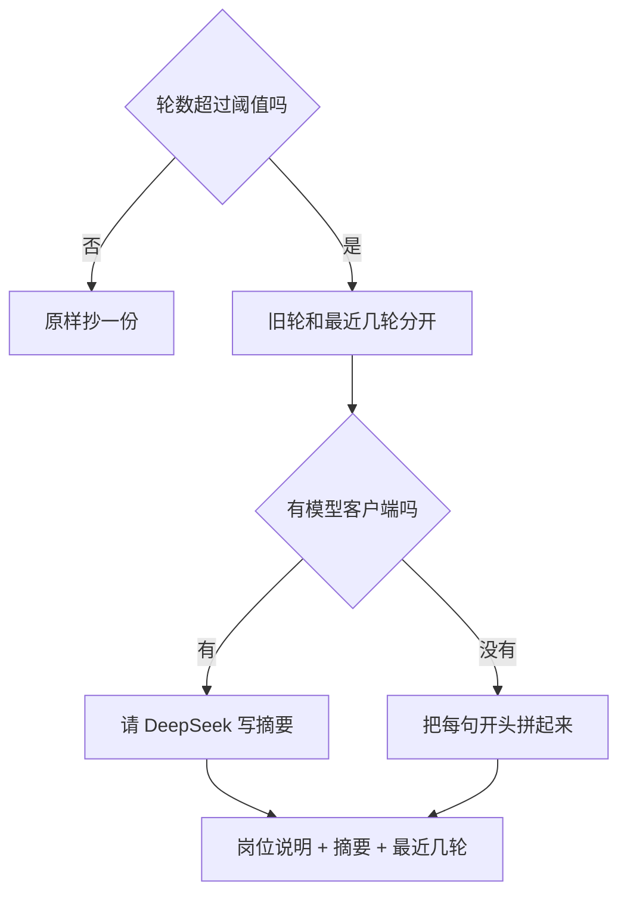

# 顺着摘要逐行读

这一课没有新的语法课。超过阈值才压缩，用的仍是上一课的「轮」。打印 JSON 时的 `dumps` 在 [基础课 · JSON](../../00_python_basics/23_http_json.md)。

先运行：

```bash
python stage3_memory/03_summarize.py
```

没有密钥时，你应看到：刚好 4 轮、阈值也是 4，来源是 `none`，消息仍是 9 条。然后来源变成 `fake`，摘要里能看见「紫色包装」和「10086」。压缩后的列表是：原来的岗位说明、一条以「此前对话摘要：」开头的 system、以及最后一轮「还在吗」。最后几行说明跳过了模型。

有密钥时，同一份历史会再压一次，来源一般是 `llm`。模型若失败，来源仍是 `fake`，`note` 里有错误类型。程序不会因此停住。



## 截断和摘要差在哪

截断把旧句子扔掉。便宜，也不调用模型。订单号若只出现在被扔掉的那一句里，后面的请求就看不见它。工作记忆的小表可以留下订单号，但「紫色包装破了」这种描述不在小表的固定栏目里。

摘要用一段更短的文字换掉旧句子。多一次模型调用，换来「旧事实还在文本里」。假摘要不理解对话，只把每句的前 30 个字用分号接上，所以订单号这种写在句子开头的事实还在，写在长句末尾的事实可能被剪掉。没有密钥时用它，是为了练习能跑完，不是因为它和模型一样可靠。

## `compress_messages`

阈值用的是「超过才压缩」。4 轮配上阈值 4，来源是 `none`，你仍看见原来的 9 条。等于阈值时不压缩，避免对话刚到上限就被换成摘要，你分不清「还在原文里」和「已经在摘要里」。

超过之后，`keep_turns` 决定留下最近几轮。示例用 `keep_turns=1`、`threshold_turns=2`，三轮旧对话进摘要，最后一轮「还在吗」留在列表里。

已经有过一条「此前对话摘要：」时，下一次会把那条也送进新的摘要。否则第二次压缩会把更早的订单号弄丢：它已经不在原文里，只在上一次的摘要里。岗位说明本身若只是提到摘要这两个字，不会被认成旧摘要。认的是我们加上的整段前缀 `此前对话摘要：`。

模型那一支在 `summarize_old`。温度是 0，只要一份稳定的记录，不要发挥。返回若被 Markdown 代码块包住，会先剥掉围栏。正文超过 200 字会再切一刀，摘要自己太长就失去压缩的意义。任何异常都改回假摘要，`note` 留下错误类型和原文，客服这一轮仍能回复。

没有 `client` 或没有模型名时，不会去碰网络。示例 3 在 `api_key_ready()` 为假时打印跳过，和阶段 2 示例 4 一样，不假装已经调用过模型。

## 常见坑

- 把假摘要当成模型已经理解了包装破损。它只是拼接。句子后半段的金额可能不在前 30 个字里。
- 阈值设得比保留轮数还小。函数会拒绝，原文是「阈值不能小于保留轮数」。留下的轮数若比「开始压缩的那个数」还大，压缩就没有变短。
- 摘要写成 `user` 消息。模型会以为那是顾客刚刚说的。这里用 `system`，并加固定前缀，示例 6 的岗位说明也要求把它当成更早的对话。

## 改一行会看见什么

1. 把 `threshold_turns=2` 改成 `4`，再运行。来源变成 `none`，紫色包装仍在原来的 `user` 消息里，不会出现单独的摘要条。看完改回 2。
2. 在假摘要那一节已经能看见「10086」。把用户那句改成一个很长的前缀，把 `10086` 放到第 40 个字之后，再运行。假摘要的前 30 字里可能没有这个号码。这就是假摘要会丢事实的原因。看完把句子改回「紫色包装破了，订单号 10086」。

摘要这次还只是换了内存里的列表。下一课才有一个进程外面的地方可以放它：[Redis](04_redis.md)。
