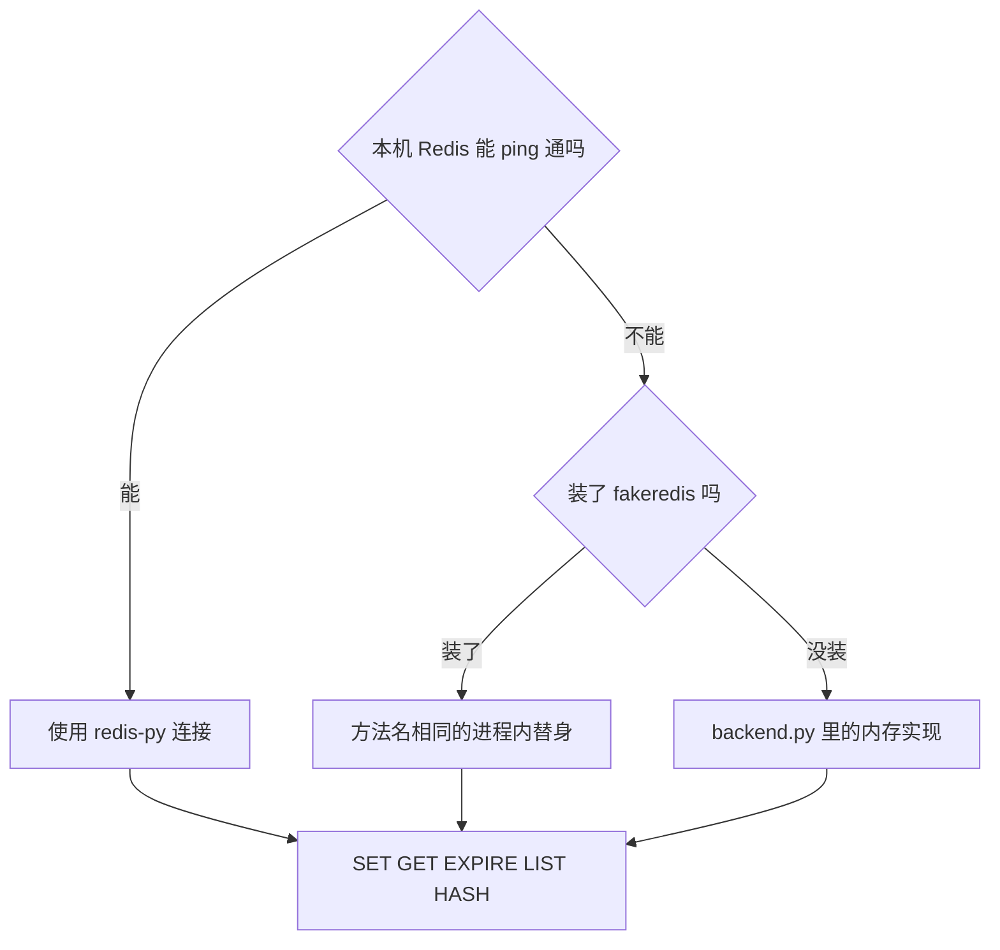

# 顺着 Redis 入门逐行读

这一课要先会的基础课：

- 👉 不懂连接对象？先看 [基础课 · 连接对象](../../00_python_basics/43_connection.md)
- 👉 不懂环境变量的默认值？先看 [基础课 · 环境变量的默认值](../../00_python_basics/45_env_defaults.md)
- 👉 不懂秒数？先看 [基础课 · time](../../00_python_basics/44_time.md)

先运行：

```bash
python stage3_memory/04_redis_basics.py
```

本机 6379 没开时，开头会写「没有使用本机 Redis，改用 fakeredis」，原因里常见 `ConnectionError`，原文会提到 connection refused。后面的 SET、LIST、HASH 仍会打印结果。你若已经按 [阶段说明](../README.md) 启动了 Redis，开头则是「已连接 Redis」，地址是 `redis://localhost:6379/0`（地址里有密码时不打印地址）。

没有 Redis 时，`redis-cli` 看不到这些键。屏幕最后一句会说明。



## Redis 是什么

Redis 是一个单独的进程，里面放键和值。你的 Python 程序通过客户端连上去，命令在那个进程里执行。程序退出，那个进程还在，键就还在。可以给键设过期时间，空闲或到点之后由 Redis 删掉，不用自己写一个定时扫表。

这就是短期记忆放这里的原因：跨进程、重启不丢、到点会过期。工单仍放 SQLite。SQLite 是账本，要留到人来处理。会话是最近几分钟的上下文，顾客离开半小时，就不必再占着。

长期记忆不是「把 Redis 的 TTL 调成一年」。一年不过期的对话原文又会变成无限增长的历史。跨很多天还要找回来的偏好，留给阶段 5。

## 为什么会落到替身

`open_client` 先按 `REDIS_URL` 连接，默认 `redis://localhost:6379/0`。👉 不懂这个默认值为什么不直接写在 `get` 的第二个参数里？先看 [基础课 · 环境变量的默认值](../../00_python_basics/45_env_defaults.md)。`.env` 里若写成 `REDIS_URL=`，空字符串不能拿去连接，所以空白也退回默认地址。

`ping` 失败，或根本没安装 `redis` 这个库，就改用 fakeredis。fakeredis 也没安装，就用 `InMemoryRedis`。两种替身的方法名和后面用到的命令一致，示例 4 的 `set` / `rpush` / `hset` 不用写两套。

替身的数据在这个进程里。👉 不懂为什么 `close` 之后进程一退出键就没了？先看 [基础课 · 连接对象](../../00_python_basics/43_connection.md)。内存实现的过期用 `time.time()` 自己算，因为没有 Redis 服务端替它倒计时。👉 不懂这行减法？先看 [基础课 · time](../../00_python_basics/44_time.md)。离线演示会真的等过期，这一课只把 TTL 的数字印出来。

`decode_responses=True` 让 `GET` 得到字符串。不加的话，redis-py 交回的是另一套二进制类型，后面的 JSON 文本对不上。本阶段的代码都打开它，练习里不再展开那一套类型。

## 四组命令

SET / GET 存一条字符串。不存在的键，`GET` 得到 `None`，不会 `KeyError`。这和字典的方括号不同。复习 [列表和字典](../../00_python_basics/13_lists_dicts.md) 里取缺失的键会怎样。Redis 这里用 `GET`，缺失是正常结果。

EXPIRE / TTL 给键一个秒数。`SET` 时也可以直接写 `ex=30`。没设过期时 TTL 是 `-1`，表示会一直留着。键已经不在时 TTL 是 `-2`。短期记忆不能用 `-1`，否则会话永远占着内存。示例不干等 30 秒，数字在 1 到 30 之间即可。

LIST 用 RPUSH 从右边追加，越新的越靠近末尾。LRANGE 的两端都包含，`0` 到 `-1` 是全部，`-2` 到 `-1` 是最近两条。LTRIM 只留下这一段，更旧的从列表里删掉。负数下标和切片一样从末尾数，但 LRANGE 的右端是包含的，Python 切片的右端不包含。内存实现里先换算，再切。

HASH 是一个键下面的好几格。`HGET order_id` 只取订单号，不用把整段对话读出来。`HGETALL` 取出全部栏目。值在我们的用法里都是字符串。

演示键以 `stage3:demo:` 开头，结束时把过期设成大约 120 秒。不要对整台 Redis 执行 `FLUSHDB`。那会删掉这台机器上其他程序的键。

## 常见坑

- Redis 没启动，却用 `redis-cli` 找示例 4 的键。屏幕若写了 fakeredis，键不在本机 6379 上。
- 用 LPUSH 再按「越后面越新」去读。LPUSH 加在左边，顺序是反的。本阶段固定 RPUSH。
- 把 API 密钥写进 `REDIS_URL` 那一行。那是 Redis 的地址。模型密钥仍是 `DEEPSEEK_API_KEY`。两把钥匙不要放进同一个名字。

## 改一行会看见什么

1. 把 `client.get("stage3:demo:missing")` 改成一个你刚 `set` 过的键。打印从 `None` 变成那条文字。看完改回不存在的键。
2. 启动 Redis 后再运行一次。开头变成「已连接 Redis」。`docker stop stage3-redis` 之后再运行，又回到 fakeredis，并打印连接失败的原因。

命令还是散的。下一课把它们收成按 `session_id` 读写的一个类：[会话记忆](05_session_store.md)。
