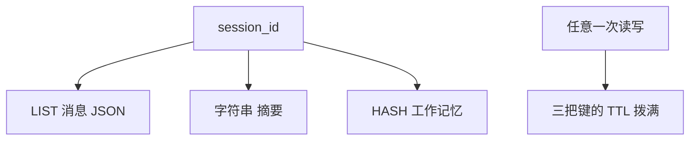

# 顺着会话记忆逐行读

这一课要先会的基础课：

- 👉 不懂 JSON 来回？先看 [基础课 · JSON 来回](../../00_python_basics/42_json_roundtrip.md)
- 👉 不懂类？先看 [基础课 · 类和方法](../../00_python_basics/33_class_methods.md)

先运行：

```bash
python stage3_memory/05_session_store.py
```

和示例 4 一样，没有 Redis 就用 fakeredis，并说明原因。然后你会看到最近 2 条是客服的追问和「订单号 10086」，全部仍是 3 条。摘要和工作记忆能打印出来。换一个 `SessionStore` 对象之后，订单号仍是 `10086`。另一个 session 的订单号是 `None`。等 1 秒再读一次，TTL 从 29 回到 30 附近。

课堂把 TTL 设成 30 秒，是为了看见数字变化。命令行客服的默认是 1800 秒，也就是 30 分钟。



## 三把键为什么形状不同

消息是一串会从右边变长的句子。LIST 可以 RPUSH 一条，也可以 LTRIM 成最近几十条，不用每次把整段历史读出来改完再写回去。每一条是一份 JSON 文本，因为列表成员是字符串，不是 Python 字典。👉 不懂为什么要 `dumps` 再 `loads`？先看 [基础课 · JSON 来回](../../00_python_basics/42_json_roundtrip.md)。`ensure_ascii=False` 让你在 Redis 里能直接看见中文。

一条坏掉的 JSON 会被跳过，其余消息还要能读。这是第 27 课的 `JSONDecodeError`。人手用 redis-cli 改错一行时，不应该让整个会话打不开。

摘要是一整段文字，用 SET 存一个字符串就够。工作记忆是固定的几格，用 HASH。改订单号时只换栏目，不用重写消息列表。HASH 的值只能是字符串，所以 `to_fields` 把 `None` 写成空字符串，槽位键加上 `slot.` 前缀，避免和 `intent` 这种栏目撞名。读回来时，空字符串再变回 `None`。

`save_working` 先删掉旧 HASH 再写入。若只覆盖新字段，上一轮的 `slot.order_id` 会在你清空槽位之后还留着。

## 续期

`touch` 在每次读写之后，把 `messages`、`summary`、`working` 三把键都 `EXPIRE` 到满。只给其中一把续期，另外两把会先过期：消息还在，订单号没了，或者相反。会话就残了。

键不存在时不调用 `EXPIRE`。对不存在的键设过期，没有东西可续。

TTL 从写入开始倒计时，不是从「会话创建的那一天」起固定 30 分钟后死亡。顾客每隔几分钟说一句，倒计时就重新拨满。这叫空闲过期。人离开超过这段时间，短期记忆可以丢。工单在 SQLite 里，不受这 30 分钟影响。

示例里「换一个 SessionStore」仍能读到订单号，是因为两个对象拿着同一个客户端，键在客户端对面。新的 Python 对象不是新的记忆。另一个 `session_id` 是另一组键，所以订单号是 `None`：那个 HASH 不存在，`slots` 是空字典，`.get` 取不到键。

## 键的名字

前缀是 `stage3:session:`，后面接会话编号和 `messages`、`summary` 或 `working`。固定前缀是为了不和这台 Redis 里别人的键混在一起。`clear_session` 只删这三把。不要 `FLUSHDB`。

会话编号不能是空的，也不能换行。空编号会让所有没起名字的顾客共用一把键。

## 常见坑

- 用 fakeredis 跑完示例 5，退出后再运行，以为订单号还在。屏幕已经说明这个替身随进程结束。要跨进程，先启动 Redis。
- 只 `append_message`，忘记 `touch` 里的另外两把键。本课的 `append_message` 已经调用 `touch`。你自己加命令时要沿用这个顺序。
- 把整个 `WorkingMemory` 对象 `RPUSH` 进列表。列表要的是 JSON 文本。对象会在 `dumps` 时失败。先 `to_fields` 进 HASH，或 `to_dict` 再 `dumps`。

## 改一行会看见什么

1. 把 `recent_messages(SESSION_ID, limit=2)` 改成 `limit=3`。三条都会打印，第一条是「我要退款」。看完改回 2。
2. 把 `OTHER_ID` 改成和 `SESSION_ID` 相同。另一边的订单号也会变成 `10086`。会话编号相同，就是同一组键。看完改回 `stage3-lesson-other`。

下一课把这个类接到阶段 2 的客服上：[命令行](06_cli.md)。
