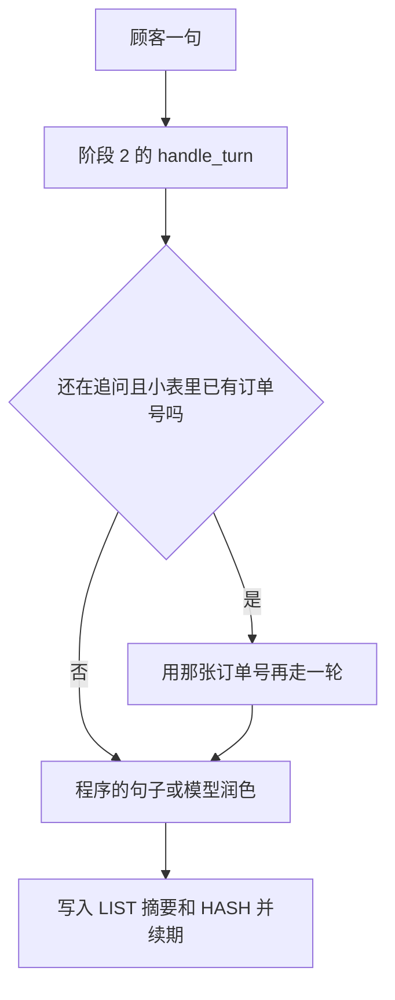

# 顺着带记忆的客服逐行读

这一课没有新的语法课。`sys.argv` 是一个列表，第 0 项是脚本路径，第 1 项是你在命令后面写的会话编号。列表在 [基础课 · 列表和字典](../../00_python_basics/13_lists_dicts.md)。没写这一项时，会话编号来自环境变量 `STAGE3_SESSION_ID`，再没有就用 `local`。👉 不懂空白的环境变量为什么不采用？先看 [基础课 · 环境变量的默认值](../../00_python_basics/45_env_defaults.md)。

先在没有密钥时运行：

```bash
python stage3_memory/06_cli_with_memory.py demo-1
```

按这个顺序输入：

1. `我要退款`  
   来源是规则。小星追问订单号。此时还没有新工单。
2. `10086`  
   来源变成 `slots`。回复里有工单编号，并写明钱还没有退。
3. `退出`

再用同一条命令启动。开头应出现「记得的订单号：10086」。输入 `我要退款`。若这一次连的是真正的 Redis，来源是 `memory`，回复以「沿用你之前提供的订单号 10086」开头，并再写一张工单。

若开头写的是 fakeredis，第二次启动不会记得订单号。替身的数据没有活过上一个进程。先按 [阶段说明](../README.md) 启动 Redis，再做「退出后再启动」。



## 和阶段 2 的客服差在哪

阶段 2 的 `session = {"pending": None}` 是这个进程里的一个字典。退出就没了。工单文件还在，正在追问的那一句不在。

这一课每次启动按 `session_id` 读回工作记忆和消息。`bridge.run_turn` 把小表翻译成阶段 2 认识的 `pending`，调用原来的 `handle_turn`，再把结果写回小表。阶段 2 的文件没有改。阶段 1 的路由器也没有改。

这句话里若能抽出订单号，小表改成这个号。抽不到、而阶段 2 又在追问订单号、小表里已经有号，就用那张号再走一轮，来源记为 `memory`。这样重启之后不用说第二遍号码。你若要办另一张订单，直接把新号码说出来，新号码会覆盖旧的。只说「我要退款」，会沿用旧号码。这是短期记忆的行为，不是阶段 2 原来的行为。

追问进行到一半就退出时，`pending_text` 还在 HASH 里。下次把号码说完，工单描述仍用上一句「我要退款」，而不是只用数字。这和阶段 2 同一进程里的补槽一样，只是字典换到了 Redis。

## 模型只负责说话

没有密钥时，回复是阶段 2 的 `render` 拼出来的。有密钥时，工具仍先执行。`speak.phrase` 把结果说明放进一份副本，请模型说成客服的话。这份副本不写回 Redis。写回的是顾客看见的那句回复。否则「只根据结果说话」的内部说明会一条条堆进短期记忆。

文件名 `06_cli_with_tools.py` 以数字开头，`import` 不能把它当成模块名，所以请求的那几行写在 `speak.py`，形状和阶段 2 相同。复习 [从别的文件夹导入](../../00_python_basics/26_import_other_folder.md)：`stage3_link.enable()` 要写在 `import config`、`import db` 之前。`06_cli_with_memory.py` 开头就是这样。

历史超过 6 轮时，`record_exchange` 把更早的收成摘要，手头留 4 轮，并打印来源。没有密钥时摘要是假摘要。短短三句不会触发，避免一开口就把对话换成摘要。阈值在 `session_flow.py` 顶部。

工单仍在 `stage2_tools_tickets/data/shop.db`。这一课不重建数据库。阶段 2 的示例 1、3、5 会把这个文件清掉，工单编号会从 1 再开始。会话里的 `ticket_id` 不会跟着自动改。

## 常见坑

- 用 fakeredis 练习「退出后再启动」。第二次是空的。看开头那几行有没有「已连接 Redis」。
- 两个终端用了两个会话编号。`demo-1` 和 `local` 是两把键，订单号不会共用。
- 输入 `我要退款` 却期待它不要沿用旧订单。沿用是这一课加上的。要换号，把新的数字说出来。
- 在写入 Redis 之前按 Ctrl+C。这一句可能还没进键。正常的 `退出` 会在每一句之后已经保存。

## 改一行会看见什么

1. 第一次启动后不要退出，直接再输入 `我要退款`。同一进程里也会沿用刚才的 `10086`，来源是 `memory`。短期记忆不只有「重启」才生效。
2. 启动命令改成不带 `demo-1`。会话编号变成 `local`，除非 `.env` 里写了 `STAGE3_SESSION_ID`。刚才 `demo-1` 的订单号不会出现。

把这些断言锁住、并且不依赖本机 Redis 的脚本是：[示例 7](07_offline.md)。
