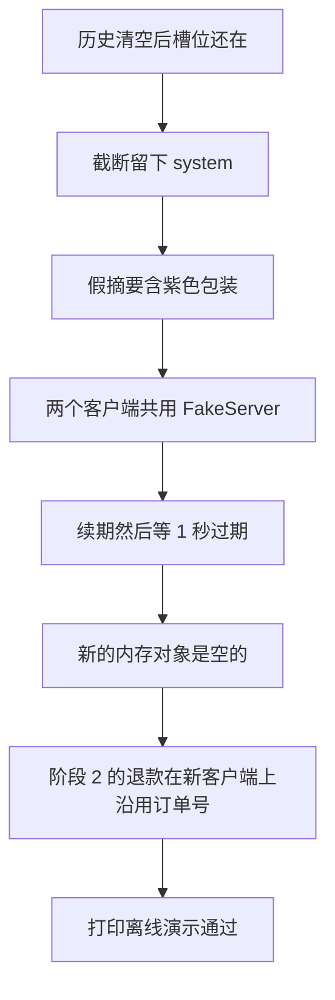

# 顺着离线演示逐行读

这一课要先会的基础课，只有以前学过的断言，以及替身过期用到的秒数：

- 👉 不懂 assert？先看 [基础课 · assert](../../00_python_basics/30_assert.md)
- 👉 不懂 time.sleep？先看 [基础课 · time](../../00_python_basics/44_time.md)

不要用 `python -O` 运行，否则断言会被拿掉，脚本会在错误时仍打印通过。

先运行：

```bash
python stage3_memory/07_offline_demo.py
```

不需要密钥，也不连接本机 6379。最后一行必须是：

```text
离线演示通过
```

前面任何一条 `assert` 失败，程序停在 `AssertionError`，你看不到这句。数据库用的是 `stage3_memory/data/offline_demo.db`，不是阶段 2 的 `shop.db`。



## 为什么不用本机 Redis

示例 4 会碰 6379，连不上再替身。那适合人看着跑。这一课要每次结果一样：不能因为你正好开着 Redis，就把练习键写进那台真的服务器，也不能因为没开就跳过断言。

`open_fake_server` 做出一台 fakeredis 的假服务器，两个 `FakeRedis` 客户端共用它。第一个客户端写入，第二个客户端读到订单号。这是在一个进程里模拟「重新连上」。它不是第二个操作系统进程。导读开头那句就是在说这个界限。真正的退出再启动，仍要一台还在跑的 Redis，用示例 6 做。

`InMemoryRedis` 再跑一遍 SET、LIST、HASH 和 1 秒过期。同一个对象上新建一个 `SessionStore`，槽位还在。`InMemoryRedis()` 再造一个全新的对象，槽位是空的。所以这份内存实现可以让命令跑完，不能代替重启后的 Redis。原因是数据放在对象里面，没有另一个进程帮你留着。

## 各段在锁什么

`check_working_memory` 把小表变成 JSON 再变回来，订单号还在。然后把消息列表清空。历史没了，订单号仍在。这是示例 1 的差别，用断言固定住。

`check_truncate` 只留 1 轮时，开头仍是「你是客服」，「第一句很旧」不在，「第三句要留下」在。原列表长度仍是 7。`0` 轮必须抛 `ValueError`。字符上限很小的时候，最新一轮仍留下，更旧的一轮不在。

`check_summary` 在轮数没有超过阈值时来源是 `none`。超过之后来源是 `fake`，摘要里有「紫色包装」和「10086」，最近一轮「还在吗」还在消息里，旧句子不再作为独立的用户消息出现。

`check_shared_server` 把 TTL 设成 30 秒，先停 2 秒，读一次之前 TTL 不大于 28，读一次之后不小于 29。读会续期。另一把键设成 1 秒，停 1.3 秒，摘要读回来是空字符串。过期不是把值变成 `"None"` 这四个字符，而是键没了，`load_summary` 交回空字符串。

`check_stage2_resume` 换了数据库文件再重建。第一句「我要退款」只追问，工单张数是 0，`pending_text` 写进假服务器。新的客户端读回这份等待，下一句「订单号 10086」建成工单，描述仍是「我要退款」。再一个新客户端读到槽位里的 `10086`，第三句「耳机坏了，我要退款」来源是 `memory`，第二张工单仍挂这个订单号。摘要被写进库，最近一条的角色是 `assistant`。

工单编号和插入次数绑在一起。你若在这些断言中间又调用一次 `create_ticket`，张数会对不上。

## 常见坑

- 用 `python -O` 跑。断言消失，最后仍可能打印通过。
- 以为这个脚本会调用 DeepSeek 或本机 Redis。它不读密钥。打印里的 FakeServer 是 fakeredis 在本进程里做的。
- 把 `offline_demo.db` 提交进 Git。`*.db` 已经在 `.gitignore` 里。
- 把「两个客户端读到同一份数据」说成「我已经用操作系统重启验证过了」。这一课验证的是存储类和新连接。跨进程那一步在示例 6，而且要求 Redis 真的在跑。

## 改一行会看见什么

1. 把 `assert loaded.slots["order_id"] == "10086"` 改成 `"99999"`，再运行。应停在这一条断言，看不到「离线演示通过」。看完改回 `10086`。
2. 把过期等待从 `1.3` 改成 `0`。1 秒的键可能还在，后面的 `assert ... == ""` 会失败。这表示「设了 TTL」和「已经到期」不是同一瞬间。看完改回 `1.3`。

阶段里这些脚本串起来之后，读 [阶段小结](stage_summary.md)。
