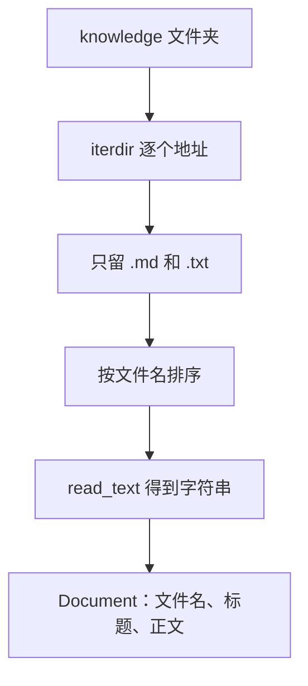

# 顺着加载逐行读

## 本阶段需要的基础课

- 👉 不懂列出文件夹？先看 [基础课 · pathlib 列出文件](../../00_python_basics/46_path_iterdir.md)
- 👉 不懂读文件内容？先看 [基础课 · 读文本文件](../../00_python_basics/29_read_text.md)
- 👉 不懂 sorted 的 key？先看 [基础课 · sorted 和 lambda](../../00_python_basics/50_sorted_key.md)

先运行，不需要密钥：

```bash
python stage4_rag/01_load_documents.py
```

屏幕上是 8 份说明。`08_营业时间.txt` 的标题是「营业时间」，字数是 117。其余是 Markdown。最后一行是「加载完成」。此时还没有切块，也没有分数。



## 为什么先整篇读进来

文件躺在磁盘上时，程序看不见「退货是七天」。`read_text` 把一篇变成一个字符串。标题和正文先放在一起，下一课再切。如果一读进来就按句号拆散，你还没看见原文长什么样。

知识库是虚构的星河数码。天数、运费、积分都写在 `stage4_rag/knowledge/` 里。模型不允许用这些文件以外的数字。

## `documents.py`

👉 不懂 `iterdir`？先看 [基础课 · pathlib 列出文件](../../00_python_basics/46_path_iterdir.md)。

第 10 行 `TEXT_SUFFIXES` 只有 `.md` 和 `.txt`。别的文件即使放进文件夹，也不会变成政策。

第 13 到 26 行是 `Document`。三个栏：`source` 是文件名，`title` 是标题，`text` 是全文。不把完整路径放进来，是因为后面引用时给人看的是文件名，不是你电脑上的绝对路径。

第 29 到 31 行 `knowledge_dir` 用这个文件自己的位置去找 `knowledge`。你在哪个目录执行命令，都能找到。

第 34 到 44 行 `title_of`。第一行若以 `#` 开头，标题是去掉井号之后的字。`lstrip("#")` 会去掉连续的井号，所以 `#` 和 `##` 都不会留在标题里。纯文本没有井号，标题就是第一行。`08_营业时间.txt` 的第一行就是「营业时间」。空文件才会退回文件名本身，我们的八份都不是空的。

第 47 到 71 行 `load_documents`。先确认文件夹在。`iterdir` 的顺序不作数，所以第 64 行按 `path.name` 排序。每一份用 UTF-8 读入。一份都没有时抛出 `RuntimeError`，免得后面的检索对着空列表假装自己算过了。

👉 不懂 `key=lambda`？先看 [基础课 · sorted 和 lambda](../../00_python_basics/50_sorted_key.md)。这里比较的是文件名，不是分数。

## 示例脚本

`01_load_documents.py` 的 `main` 只打印份数、标题和字数。它不调用 `chunk_documents`，是为了让你先相信「读进来的是一整篇」。

八份的主题是：退换货、运费与配送、会员积分、售后保修、支付方式、发票、常见问题、营业时间。售价、门店地址、招聘不写成一条可以背的规定。常见问题里写了「不写售价」，所以问价格时，检索应该找到这句，而不是编一个价。

## 常见坑

- 在 `stage4_rag` 里面用相对路径 `"knowledge"`，又忘了自己是从别的目录启动的。本课用 `__file__`，不要改成跟当前目录走。
- 读完就 `for` 那个字符串。那是一个字一个字。一篇文档是 `documents` 列表里的一项。
- 把 `#` 留在标题里。井号是 Markdown 的标记，引用时不应该带着标记。
- 漏了 `encoding="utf-8"`。换一台默认编码不同的电脑，中文会 `UnicodeDecodeError`。

## 练习

1. 运行示例 1。`08` 的标题为什么不是文件名 `08_营业时间`？
2. 若把某一份改成空文件再运行，标题会从哪来？看完把内容改回去。
3. `source` 里有没有你的用户目录？

## 答案

1. 标题来自文件第一行「营业时间」。文件名只放在 `source`。
2. `title_of` 走完空行之后没有字，会用 `path.stem`，也就是去掉后缀的文件名。
3. 没有。`source` 只是 `01_退换货政策.md` 这样的文件名。

下一课把长文切开：[切块](02_chunk.md)。
