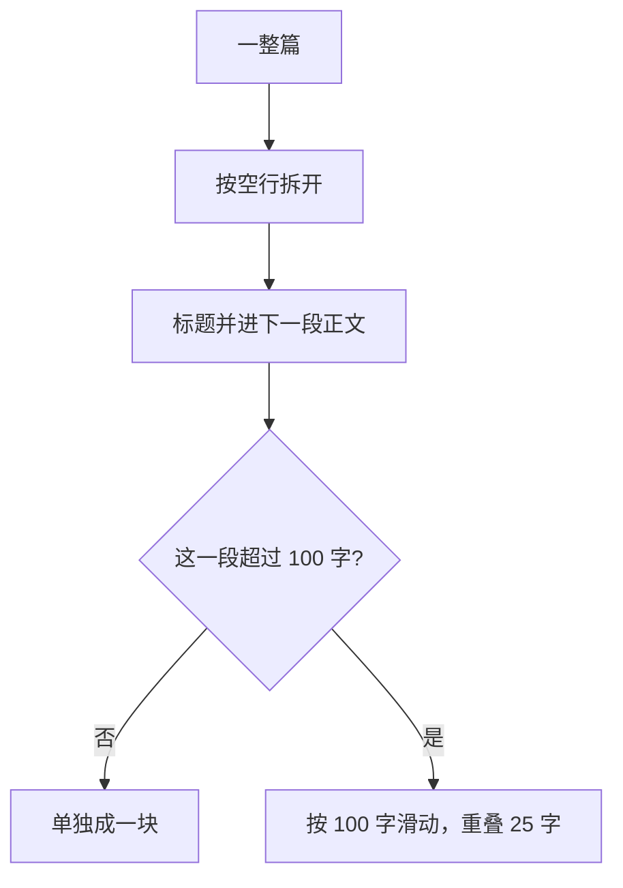

# 顺着切块逐行读

## 本阶段需要的基础课

- 👉 不懂 split / join？先看 [基础课 · split 和 join](../../00_python_basics/47_split_join.md)
- 👉 不懂切片？先看 [基础课 · 切片](../../00_python_basics/39_slice.md)
- 👉 不懂 strip？先看 [基础课 · strip](../../00_python_basics/19_input.md)

先运行：

```bash
python stage4_rag/02_chunk_text.py
```

前半是十个字。「块长 6，重叠 0」得到「一二三四五六」和「七八九十」。「重叠 2」得到「一二三四五六」和「五六七八九十」。重叠等于块长时会打印拒绝的原因。

后半是知识库：切块长度 100，重叠 25，合计 27 块。`02_运费与配送.md` 有一块被切开。第 4 块末尾和第 5 块开头都是「当面看外包装，外包装严重破损可以拒收，并在对话里提」。最后一行是「切块完成」。



## 为什么要切，为什么要重叠

整篇当一块时，问发票也会把退货、运费一起送进提示。模型要在一长串里自己找，也更贵。切得只剩三五个字时，「七天」和「未拆封」会落到两块里，每一块都答不全。

100 字大约是一个小标题加一条规定。配送范围那一节更长，所以会被切开。重叠 25 字是块长的四分之一。切痕若正好落在「可以拒收」上，前一块的末尾和后一块的开头都还看得见这几个字。

重叠设得和块长一样大，窗口不往前走，会永远切同一段。所以 `overlap >= size` 直接拒绝。

这些数字是为了在屏幕上看见切痕。真正上线时块往往更长，按 token 计。道理一样：一块里最好是一条说得完的规定，切痕两边要有一点重复。

## `chunking.py`

👉 不懂 `split("\n\n")`？先看 [基础课 · split 和 join](../../00_python_basics/47_split_join.md)。

第 9 到 25 行 `Chunk`。`index` 从 1 起，是「第几段」，不是列表下标。拿它去写 `chunks[index]` 会拿错下一块，因为列表从 0 开始。

第 28 到 50 行 `split_paragraphs`。先把 `\r\n` 收成 `\n`，再按空行切开，并 `strip`。以 `#` 开头的标题先攒着，等到下一段正文再贴到正文上面。文件最后若只剩标题，不再单独成段。

单独成段的标题很短，检索时余弦会很高：问「退货政策」，一个只有四个字的标题会胜过真正写着天数的那一段。标题已经放在 `Document.title` 里，检索用正文。

第 53 到 63 行 `_is_heading`：这一小段的每一行都是标题，才叫标题段。标题下面如果没有空行、正文紧跟着，整段就不是「纯标题」，会和正文留在一起。

第 66 到 92 行 `split_by_length`。👉 不懂 `text[start:end]`？先看 [基础课 · 切片](../../00_python_basics/39_slice.md)。下一段的起点是 `end - overlap`。没超过块长的段原样返回，不硬切。

第 95 到 110 行 `chunk_document` 先按段，超长的段再按字数。段号在这一篇内部递增。第 123 到 124 行是全课共用的 100 和 25。

## 示例脚本在证明什么

`show_toy` 用十个字，是因为 100 字的重叠你不容易在两行里对上。十个字里，「五六」同时出现在第一段末尾和第二段开头。

`show_knowledge` 只在「前一块刚好写满 100 字，后一块又以那 25 字开头」时，认定这是按字数切开的，并打印第一处。短段不会写满 100 字，不会被当成这种重叠。

## 常见坑

- 重叠写成 100。函数会拒绝。若你自己改成不检查，循环不会结束。
- 块长改成 20。一条规定被切成很多截，top-k 里都是半句。
- 把标题单独留成一块。短标题会在检索里抢走第一名，复述出来的只有标题，没有天数。
- 以为重叠会让同一句话被回答两遍就算错。两块都召回是切痕的代价。重叠太大，提示里的重复就多。25/100 是课堂上的比例。

## 练习

1. 十个字、块长 6、重叠 0，第二段的第一个字是什么？重叠 2 时呢？
2. 为什么「五六」出现两次不算把原文写错了？
3. 把 `CHUNK_OVERLAP` 改成 `100` 再运行示例 2。看完改回 `25`。

## 答案

1. 重叠 0 时第二段从「七」开始。重叠 2 时从「五」开始。
2. 原文里「五六」只写了一次。第二段开头再抄一次，是为了切痕两边都留着这几个字。
3. 程序停在 `ValueError`，并说明重叠必须小于切块长度。知识库不会被切完。

下一课给每块算一个分数：[检索](03_retrieve.md)。
