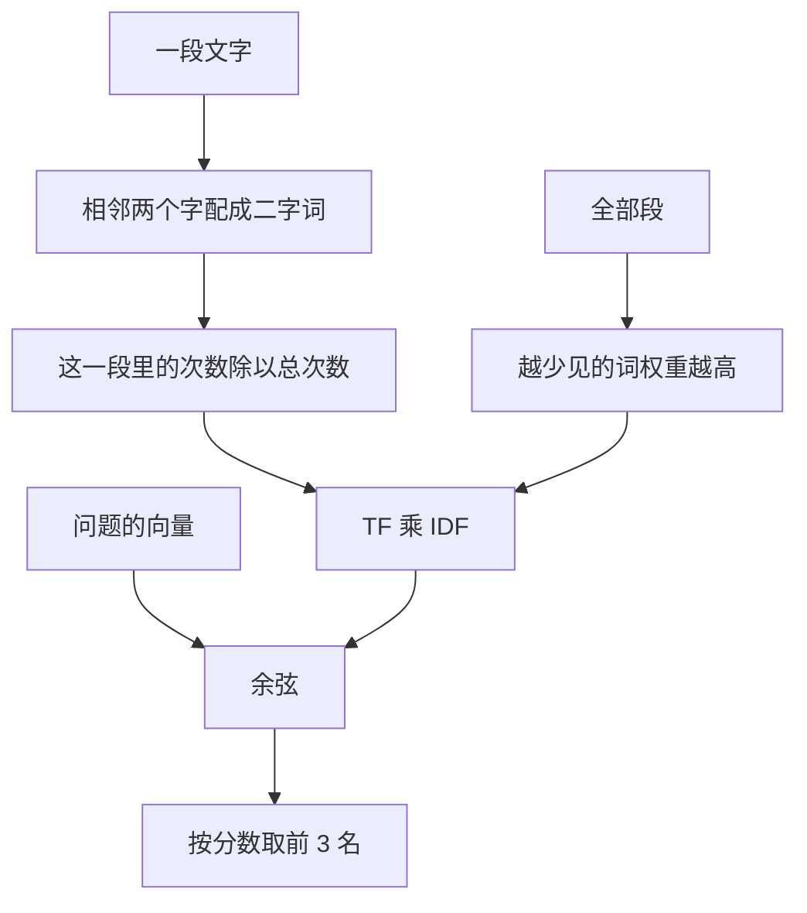

# 顺着检索逐行读

## 本阶段需要的基础课

- 👉 不懂 Counter？先看 [基础课 · Counter](../../00_python_basics/48_counter.md)
- 👉 不懂集合的交和差？先看 [基础课 · 集合运算](../../00_python_basics/49_set_ops.md)
- 👉 不懂按分数排序？先看 [基础课 · sorted 和 lambda](../../00_python_basics/50_sorted_key.md)
- 👉 不懂 zip？先看 [基础课 · zip](../../00_python_basics/51_zip.md)
- 👉 不懂余弦？先看 [基础课 · 余弦相似度](../../00_python_basics/52_cosine.md)

先运行：

```bash
python stage4_rag/03_search_chunks.py
```

索引大约 27 块、一千个左右的二字词。没有网络请求。「退货政策是几天」的第一名是 `01_退换货政策.md`，分数大约 0.44，对上的词里有「退货」「政策」「几天」。「你们今年招实习生吗」的第一名大约 0.14，低于 0.15，只因为「实习」两个字在常见问题里出现过。「今天月球冷不冷」的分数是 0，对上的词是「（没有）」。最后一行是「检索完成」。你机器上的第四位小数应和这次运行一致；若你改过知识库，分数会变。



## 为什么不用向量接口

本课的 DeepSeek 只提供对话补全，环境变量仍是 `DEEPSEEK_BASE_URL=https://api.deepseek.com`。没有 embeddings 这种「把一句中文变成一串小数」的接口，不要自己猜一个 `/embeddings` 路径去请求。

没有那串小数，就用字面上的关键词。中文没有空格，又不想为这一课安装分词库，所以关键词是二字词：去掉标点和空白之后，相邻两个字配成一对。「退货政策」会得到「退货」「货政」「政策」。

这看的是字一样不一样，不是意思一样不一样。「7 天」和「几天」对不上，「保修」和「能修吗」也可能对不上。阶段 5 的向量才会把相近的说法拉到附近。这一阶段把乘法留在眼前，就是为了看见这个局限。

## `retrieve.py` 在算什么

第 19 到 24 行 `_SKIP` 是不参加组词的符号。去掉之后，前后的字会接上，标点才不会变成「词」。引号分成两段相加，是为了这一行自己的引号不会把字符串提前截断。

第 50 到 61 行 `character_bigrams`。👉 不懂 `zip(chars, chars[1:])`？先看 [基础课 · zip](../../00_python_basics/51_zip.md)。

第 64 到 66 行 `term_counts` 把这些二字词交给 `Counter`。👉 不懂计数器？先看 [基础课 · Counter](../../00_python_basics/48_counter.md)。这是词频 TF 的原料：这一段里，这个词占全部词的多少。`tf = 次数 / 这段的词总数`。

第 69 到 71 行 `shared_terms` 是交集，只看有没有，不看次数。👉 不懂 `&`？先看 [基础课 · 集合运算](../../00_python_basics/49_set_ops.md)。

第 74 到 89 行 `build_idf`。一个词在多少段里出现过，记一次，段内重复出现不加。越少见，`math.log((总段数 + 1) / (出现段数 + 1)) + 1` 越大。几乎每段都有的「的一」这类搭配分不开「在问发票」还是「在问运费」。👉 不懂 `log` 和开平方？先看 [基础课 · 余弦相似度](../../00_python_basics/52_cosine.md)。

第 92 到 104 行把 TF 乘上 IDF。问题里的词若知识库从没出现，`idf` 里没有它，它的权重就是没有，不能靠一个知识库外的词得分。

第 107 到 122 行 `cosine`。点积只加公共词。再除以两根长度。空向量分数是 0。

第 125 到 165 行 `TfidfIndex`。建索引时把每段的向量先算好。IDF 要用全部段，所以不能每问一次只看一段。`search` 对每段算余弦，👉 用 `sorted(..., key=lambda hit: hit.score, reverse=True)` 从高到低取前 `top_k` 段。`shared` 用交集再排序，是为了打印「对上的词」时顺序稳定。

第 162 到 165 行 `missing_terms` 是差集：问题有、词表没有。这些词对分数没有贡献。屏幕上能看见「月球」整句的二字词都在这张名单里。

第 168 到 172 行 `build_index` 把读文件、切块、建索引接成一步。示例 3 往后都从这里进入。

## 分数不是概率

`prompting.py` 里的 `SCORE_THRESHOLD` 是 `0.15`。示例 3 用它标「达到阈值 / 低于阈值」，门本身下一课才用来决定要不要请模型。

`0.44` 比 `0.14` 更同向。它不是 44% 的正确率。阈值是对着这 8 份文档试出来的：政策原词通常更高，知识库没写的话题通常更低。「实习」能对上一个词，所以不是 0，但整句仍不够像一条规定。

「进液还保修吗」的第一名往往是保修期限，第二名才是写着「进液」的保修范围。因为「保修」在好几段里都有，期限段又含「耳机」。所以要取前几名，不要只看第一名就以为另一段不存在。送进提示时，下一课只保留达到阈值的段。

「100积分抵多少元」的第二名可能是营业时间。两边都有数字「00」「10」。这也是字面检索的错。问订单、办退款要先分流，不能只看分数。那是示例 6。

## 常见坑

- 去调用一个不存在的 embeddings 接口。这一课的分数必须在本地算完。
- 把整篇当成一个词袋，不做 TF，长文会只因为词多而排前面。余弦除的就是这个长度。
- `top_k` 设成 1。进液那条范围就看不见了。
- 改了知识库却以为分数还是文档里写的 0.44。词表变了，IDF 会跟着变。以你屏幕上的数为准，离线演示锁的是「哪一份文件第一」和「过不过 0.15」，不是某一位小数。

## 练习

1. 「今天月球冷不冷」的对上的词为什么是「（没有）」？
2. 「退货政策是几天」若改成知识库里没有的说法，第一名还一定是退换货文件吗？把问题改成「几天内能退」看一次分数，看完改回示例里的问句。
3. 第二名的分数高于 0.15 时，下一课会不会把它也放进提示？

## 答案

1. 这些问题的二字词在 27 块里都没出现过，交集是空的，余弦是 0。
2. 不一定。二字词对不上「七天」「退货政策」这些原词时，分数会掉，甚至低于阈值。这就是这一课的局限。
3. 会。`hits_for_prompt` 保留每一个达到阈值的段，不只留第一名。

下一课决定哪些段可以进提示：[拼提示](04_prompt.md)。
