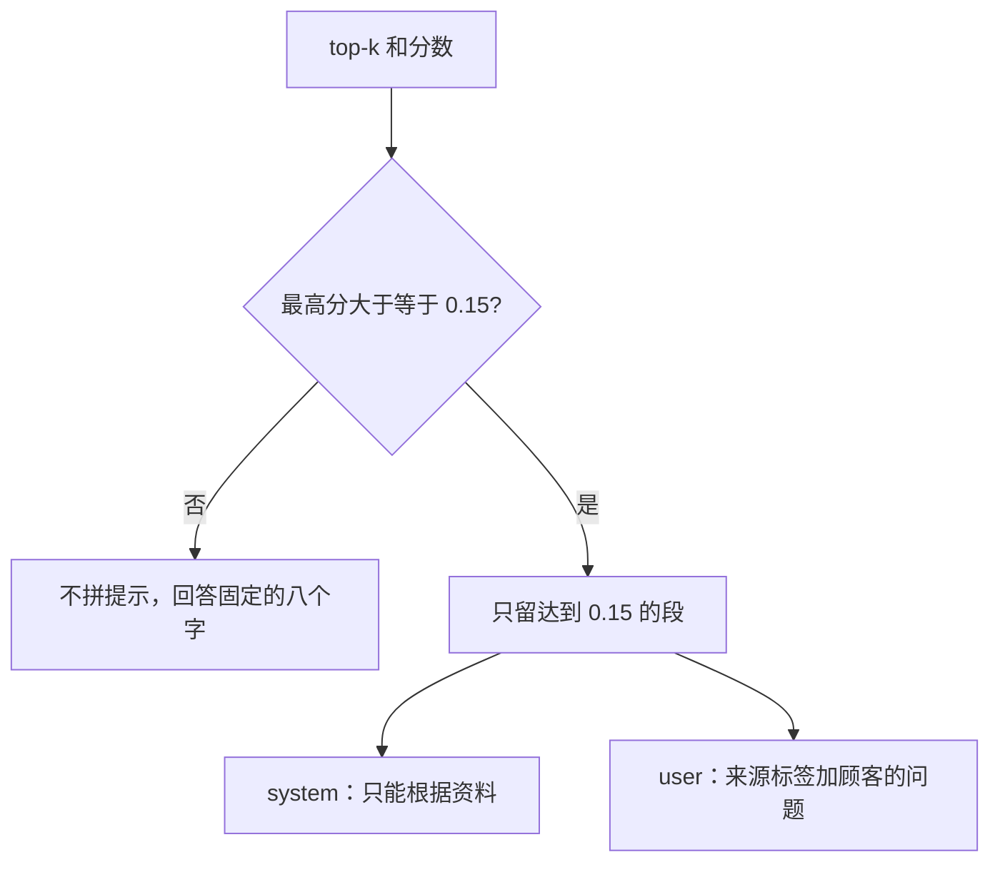

# 顺着拼提示逐行读

## 本阶段需要的基础课

- 👉 不懂 join？先看 [基础课 · split 和 join](../../00_python_basics/47_split_join.md)
- 👉 不懂余弦为什么不是概率？先看 [基础课 · 余弦相似度](../../00_python_basics/52_cosine.md)

先运行：

```bash
python stage4_rag/04_build_prompt.py
```

第一问「耳机保修多久」会打印 `role=system` 和 `role=user`。user 里有 `[来源：04_售后保修.md 第1段]`，正文里有「365」。达到阈值的下一段若仍是保修范围，也会出现。低于 0.15 的段不会出现。

第二问「你们今年招实习生吗」不打印 messages。直接回答「知识库里没有找到」。最后一行是「提示拼装完成」。



## 为什么不够分就不要请模型

模型会把没写过的天数说圆。实习生、月球这种句子，最高分不够，就用固定的八个字结束。八个字写在 `NOT_FOUND`，system 和 user 里都要求模型在资料不够时只说这一句。

够分时也不是把 top-k 全塞进去。第 3 名可能是从长段中间切出来的半句，分数只有 0.07。`hits_for_prompt` 把它留下的话，模型会看见一句没头没尾的话。屏幕上示例 3 和示例 6 仍会列出前 3 名，让你看见被丢掉的是谁。

## `prompting.py`

第 8 行 `NOT_FOUND` 就是「知识库里没有找到」。不要改成「我不知道」之类的近义句，离线演示按这八个字断言。

第 10 到 13 行说明阈值。0.15 是对着这批二字词余弦试出来的。它不是概率。

第 15 到 18 行是岗位规则，放在 system。规则每问都一样：只能根据资料，不要补充天数、金额、地址或价格，最后一行用来源标出文件名。

第 21 到 27 行 `format_context`。👉 不懂 `join`？先看 [基础课 · split 和 join](../../00_python_basics/47_split_join.md)。每段前面一行是 `[来源：文件名 第N段]`。N 是切块时的段号，从 1 起。

第 30 到 41 行 `build_messages`。资料和问题放在 user，因为每问一次资料都不同，岗位规则不变。调用方要先确认最高分过了阈值。

第 50 到 61 行 `covered` 只看最高分。`hits_for_prompt` 再把没过线的段拿掉。

## `answering.py` 里和提示有关的两段

这一课的示例不调用模型，但它已经用了 `prepare`。第 43 到 62 行：不够分时 `messages` 是 `None`，`answer` 是那八个字，`call_model` 是假。够分时 `messages` 只用过线的段，`answer` 仍是 `None`，等下一课或假模型去填。

假模型 `echo_retrieved` 在第 18 到 40 行。它不联网。把 user 里每一个 `[来源：` 块的正文和标签复述出来，并在开头写「没有调用模型」。示例 7 用它证明检索到的字真的进了回答。示例 4 本身不复述，它让你看见提示原文。

## 常见坑

- 把全部 27 块都放进 system。那不叫检索，费用和干扰都会上去，模型也会把两份文档的天数捏在一起。
- 不够分仍调用模型，只在提示里写「请不要编」。模型仍然可能编。门要挡在调用之前。
- 来源只写「资料 1」。顾客和你都看不出是哪一个文件。标签里要有文件名。
- 改了 `NOT_FOUND` 的文字，却没改 system 里的那一句。两处会不一致。代码里 system 写的是同一句中文，改常量时要一起看提示。

## 练习

1. 第二问为什么没有 `role=user` 那一节？
2. 「耳机保修多久」的 user 消息里，为什么看得到 365，却不一定看得到「怎么申请」那一整段？
3. 来源标签是模型自己想出来的，还是程序先写上的？

## 答案

1. 最高分低于 0.15，`prepare` 不拼 messages。
2. 365 在达到阈值的那一段里。更靠后的段若低于 0.15，`hits_for_prompt` 不会把它放进 user。
3. 程序在 `format_context` 里写的。模型被要求在回答末尾再抄一次文件名。假模型则直接复述这些标签。

下一课才真正调用 DeepSeek：[调用模型](05_ask.md)。
