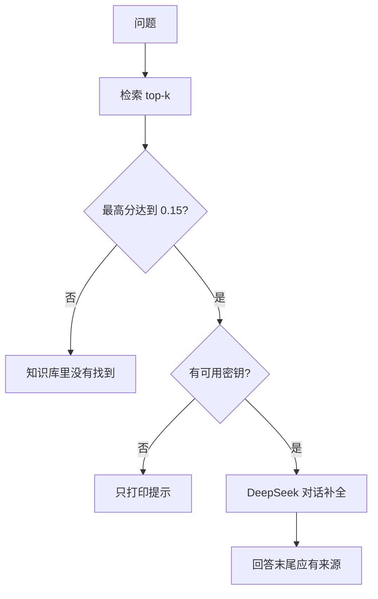

# 顺着调用模型逐行读

## 本阶段需要的基础课

这一课没有新的语法。调用客户端仍是阶段 0 的对象和关键字参数。

- 👉 不懂密钥怎么读？先看 [基础课 · 环境变量](../../00_python_basics/20_env.md)
- 👉 不懂点号调用？先看 [基础课 · 对象和方法](../../00_python_basics/21_objects.md)

先运行：

```bash
python stage4_rag/05_ask_with_rag.py
```

没有密钥时，三问都会打印最高分。前两问接着打印将要发送的 user 正文，并写明跳过生成。第三问「你们今年招实习生吗」的回答是「知识库里没有找到」。最后一行是「问答结束」。全程不联网。

有密钥时，前两问才会请求 `chat.completions`。程序仍不打印密钥。第三问即使有密钥也不请求，因为分数不够。



## 模型只能说资料里有的

`complete_with_client` 在 `answering.py` 第 65 到 76 行。温度 `0.1`，是为了少改资料里的数字。`max_tokens` 是 400，够写一条规定加一行来源。空回复改成那八个字，免得屏幕上什么都没有。

这一步用的仍是阶段 0 的 OpenAI SDK，`base_url` 指向 DeepSeek。没有第二次请求去取向量。向量若要算，已经在本地算完了。

「星河耳机卖多少钱」若过了阈值，资料里写的是「不写售价」，不是一个数字。模型应说出不写售价，并标 `07_常见问题.md`。它不应该给一个商品页面上才会有的价格。售价根本不在这 8 份文件里。

## 示例 5 和示例 4 的差别

示例 4 固定两问，把 messages 的角色名也打印出来。示例 5 的三问是：保修、售价、实习生。有密钥才把过线的那两问交给 `complete_with_client`。

没密钥时不要调用 `require_settings()`。那个函数会打印说明并结束整个程序，第三问就看不到了。示例 5 先用阶段 1 的 `api_key_ready()`。它只回答有没有可用密钥，失败时不退出。

接口失败时 `print_api_error` 把常见原因说成中文，这一问改成「知识库里没有找到」，循环继续。不要因为一问超时就让后面的问也不出现。

## 常见坑

- 没过阈值也调用模型，「再让模型判断一下」。判断本身就会编。
- 温度调到 0.7 以上。政策里的 365 和 99 容易被说成别的数。
- 把 `base_url` 写成带 `/chat/completions` 的完整路径。SDK 会自己接路径。阶段 0 的配置说明里写过。
- 有密钥时把屏幕上的回答当成知识库原文。回答应当贴近资料，仍要以资料里的句子为准。假模型的复述在示例 7，不在这一课。

## 练习

1. 没有密钥时，第三问为什么连「跳过生成」那一行都没有，直接就是八个字？
2. 有密钥时，第三问会不会产生费用？
3. 温度为什么是 0.1，而不是阶段 0 聊天用的 0.7？

## 答案

1. 最高分不够，`prepare` 已经给了最终回答，根本没有 messages 可打印。
2. 不会。不够分就 `continue`，不会进入 `complete_with_client`。
3. 这一课要保住资料里的数字。0.7 是为了聊天自然，不适合念规定。

下一课把检索和阶段 2 的工单放进同一次对话：[命令行客服](06_cli.md)。
