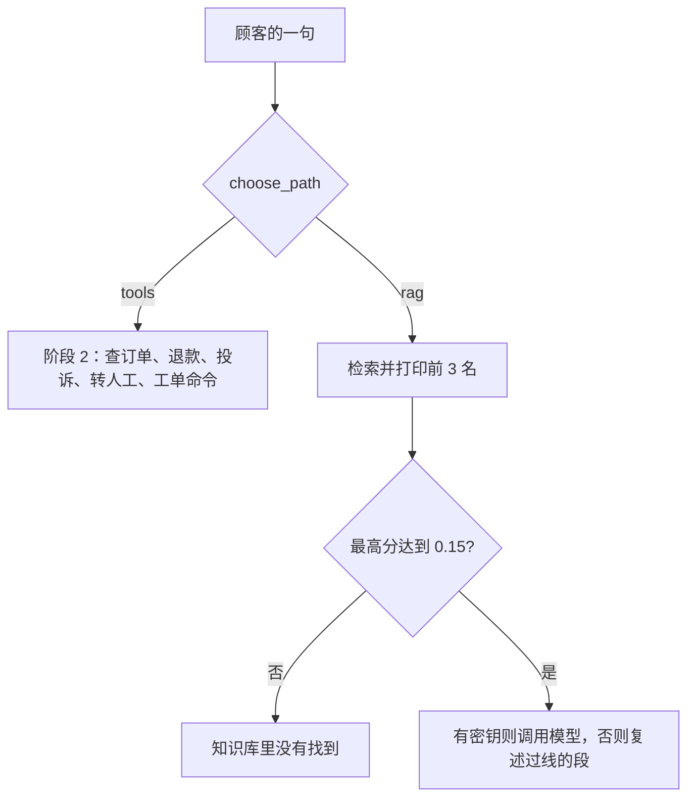

# 顺着命令行客服逐行读

## 本阶段需要的基础课

- 👉 不懂从别的文件夹导入？先看 [基础课 · 从另一个文件夹导入](../../00_python_basics/26_import_other_folder.md)
- 👉 不懂 input？先看 [基础课 · input](../../00_python_basics/19_input.md)

阶段 2 的工具和追问不在这一课重讲。忘了订单号怎么补，回到 [阶段 2 的追问](../../stage2_tools_tickets/docs/05_slots.md)。

先运行：

```bash
python stage4_rag/06_cli_with_rag.py
```

没有密钥也能聊。按屏幕上的句子试：

1. `退货政策是几天`。路径是「检索知识库」。回答里有「七天」，并写着来源文件。开头会写「没有调用模型」。
2. `我要退款`。路径是「阶段 2 工具」。它会问订单号，还没有工单。
3. `订单号 10086`。仍是工具。工单写成待处理，并说明钱还没有退。
4. `你们今年招实习生吗`。回到检索。回答是「知识库里没有找到」。
5. `退出`。

工单写在阶段 2 的 `shop.db`。这一课不会每次启动都清空它。



## 为什么「退货」要再看一眼

阶段 1 的规则里，「退货」属于退款，而且比「怎么」更早被看见。「退货政策是几天」和「我要退货」都会被分成退款。前者要的是规定，后者要的是工单。

`routing.py` 第 54 到 69 行 `choose_path`：

1. 句子里有「工单」加数字，交给阶段 2。查询和改状态的句式在阶段 2 里执行。
2. 意图是查订单、投诉、转人工，交给阶段 2。
3. 意图是退款时，若在问规定（政策、几天、怎么、无理由、运费……）并且不是「我要退 / 帮我退 / 申请退 / 给我退」，走检索。
4. 其余退款走工具。
5. 咨询和其他走检索。答不答得上，由分数再决定。

「我要退货，运费谁出」含有「我要退」，走工具，不改去念政策。人已经在办了。

这张表认的是词，不是语气。「帮我处理一下」不会进退款。阶段 1 的规则就是这样，这一课不把规则重写一遍。

## 示例 6 的循环

`stage4_link.enable()` 必须写在 `import service` 之前。阶段 2 的文件不在阶段 4 旁边，查找清单里没有那一层时，`service` 会找不到。

索引在进入循环前建好。27 块的 IDF 不需要每问一次重读磁盘。

`reply_with_rag`：没有客户端就 `answer_question`，里面会走假模型。有客户端就交给 DeepSeek。接口失败时改复述，不另编一条政策。工具路径不调用模型。工单事实以 `service.render` 的句子为准，避免模型把「已记工单」说成「已经打款」。

`session` 只有一个键 `pending`。阶段 2 用它记住还在等订单号。问政策不会清掉这个等待：你先说「我要退款」，再问一句保修，下一句仍可以只报订单号。保修那一句走的是检索，没有调用 `handle_turn`。

退出词和空行的处理与前面的命令行客服相同。`strip` 去掉首尾空格，免得 `退出 ` 对不上。

## 常见坑

- 所有句子都先检索。`我要退款` 的分数也可能摸到「退款」两个字。不先分流，就会念一段退款去向，却不建工单。
- 所有句子都进工具。`耳机保修多久` 会被当成咨询以外的闲聊，或者因为没有订单号而追问。规定题不应写工单。
- 有密钥时让模型决定要不要建单。建单仍由阶段 2 的函数执行。模型只负责把已经检索到的政策说出来。
- 把 `shop.db` 提交进 Git。`*.db` 已经忽略。离线演示用的是另一个文件。

## 练习

1. `发票怎么开` 走哪一条路径？`查询工单 1` 呢？
2. 没有密钥时，政策回答的第一行为什么不是模型写的？
3. 先输入 `我要退款`，再输入 `耳机保修多久`，再输入 `订单号 10086`。工单描述是哪一句？

## 答案

1. 发票走 `rag`。查询工单走 `tools`，因为句式里有工单编号。
2. 没有客户端时，`echo_retrieved` 把资料原文贴出来，并写明没有调用模型。
3. 描述仍是「我要退款」。保修那一句没有进入 `handle_turn`，`pending` 还在。这是阶段 2 的槽位在起作用。若你看到的描述不同，看你是不是在中间又说了别的办理句。

下一课把这些断言锁住，并且不联网：[离线演示](07_offline.md)。
