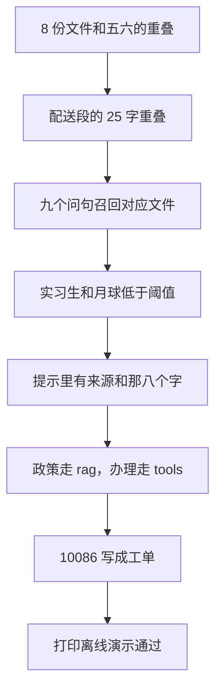

# 顺着离线演示逐行读

## 本阶段需要的基础课

- 👉 不懂 assert？先看 [基础课 · assert](../../00_python_basics/30_assert.md)

不要用 `python -O` 运行，否则断言会被拿掉，脚本会在错误时仍打印通过。

先运行：

```bash
python stage4_rag/07_offline_demo.py
```

不需要密钥，也不联网。最后一行必须是：

```text
离线演示通过
```

前面任何一条 `assert` 失败，程序停在 `AssertionError`，你看不到这句。数据库用的是 `stage4_rag/data/offline_demo.db`，不是阶段 2 的 `shop.db`。



## 为什么要一个假模型

示例 5 在有密钥时才会生成。这一课要每次结果一样：不能因为你正好写了密钥，就去请求 DeepSeek，也不能因为没写密钥就跳过「回答里有没有七天」。

`echo_retrieved` 把提示里的资料原样贴回。回答里若有「七天」，那是检索放进提示的，不是模型记得的。回答开头的「没有调用模型」用来挡住误会。

低于阈值时 `messages` 是 `None`，回答正好是 `NOT_FOUND`。假模型不会被叫到。

## 各段在锁什么

`check_load_and_chunk` 确认 8 份都在，后缀只是 `.md` 或 `.txt`。十个字切出来必须是「一二三四五六」和「五六七八九十」。重叠等于块长必须 `ValueError`。

`check_overlap_in_knowledge` 在真实文档里找一对写满 100 字、下一块又从末尾 25 字接上的块。现在是运费文件的配送范围。你若把那一节改短到不超过 100 字，这一条会失败。那是在锁「长段确实重叠了」，不是锁那 25 个字的文案永远不变。文案变了，只要仍有一对这样的块，打印的句子会跟着变，断言仍过。

`check_retrieval` 先用两个小向量确认同向接近 1、没有公共词是 0。然后九个问句：第一名的文件名要对，回答里要有那句原文里的关键词，并且含有文件名。分数从高到低。`echo_retrieved` 的结果必须和 `answer_question` 交回的回答相同，证明走的是假模型。

「进液还保修吗」不要求第一名的正文里就有「进液」。前三名拼起来要有。保修期限段会因为「保修」排得很靠前。

两个没写过的问题必须是那八个字，且分数低于 0.15。

`check_prompt_labels` 确认 system 里有那八个字，user 里有 `[来源：06_发票.md` 和顾客的问题。

`check_routing_and_tools` 确认路径，再用单独的数据库走完「我要退款」和「订单号 10086」。工单从 0 变成 1，订单号是 10086。`查订单 10086` 的回复里有「星河蓝牙耳机」。那是阶段 2 的种子数据，不是知识库编的。

## 常见坑

- 用 `python -O` 跑。断言消失，最后仍可能打印通过。
- 以为这个脚本会调用 DeepSeek。它不读密钥。
- 把 `offline_demo.db` 提交进 Git。`*.db` 已经在 `.gitignore` 里。
- 改了知识库里的「七天」或文件名，却没改 `COVERED` 里的期望。演示是锁行为的，不是永远不许改文档。改了文档，就要让期望和原文一起改。
- 把「假模型复述了七天」说成「模型学会了退货政策」。复述不理解句子。换一种知识库里没有的说法，分数会掉。

## 练习

1. 把 `COVERED` 里「七天」改成「七十天」再运行。应停在哪一种错误？看完改回「七天」。
2. 为什么实习生那一问不允许出现「没有调用模型」那一行？
3. 离线库和 `shop.db` 为什么要分开？

## 答案

1. `AssertionError`。回答里没有「七十天」。你看不到「离线演示通过」。
2. 那一问不够分，不会去复述资料。回答只能是八个字。若假模型被叫到，就说明阈值没有挡住。
3. 示例 6 的工单要留在 `shop.db` 里给人接着查。离线演示每次 `reset_database`，若用同一个文件，会把你已经记下的工单删掉。

这一阶段的脚本串起来之后，读 [阶段小结](stage_summary.md)。
