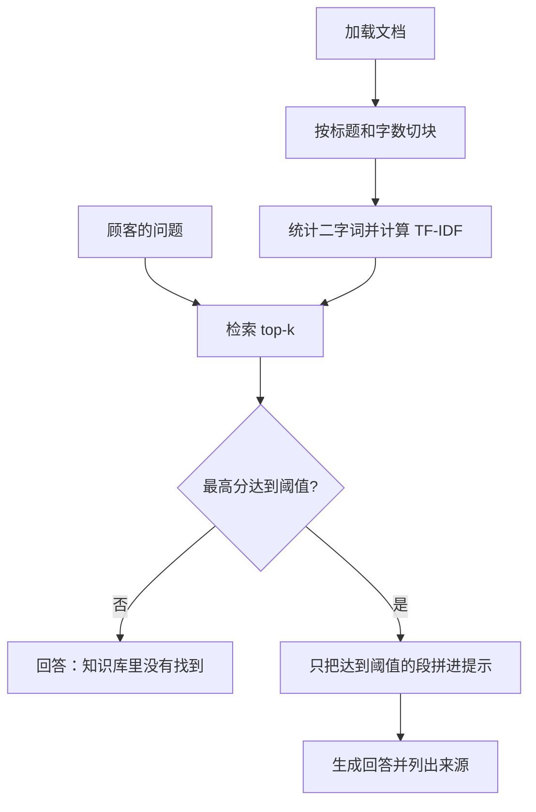

# 阶段 4 导读目录

## 本阶段需要的基础课

新的，等导读叫停再读，不要先通读：

- 👉 不懂列出文件夹？先看 [基础课 · pathlib 列出文件](../../00_python_basics/46_path_iterdir.md)
- 👉 不懂 split / join？先看 [基础课 · split 和 join](../../00_python_basics/47_split_join.md)
- 👉 不懂 Counter？先看 [基础课 · Counter](../../00_python_basics/48_counter.md)
- 👉 不懂集合的交和差？先看 [基础课 · 集合运算](../../00_python_basics/49_set_ops.md)
- 👉 不懂 sorted 和 lambda？先看 [基础课 · sorted 和 lambda](../../00_python_basics/50_sorted_key.md)
- 👉 不懂 zip？先看 [基础课 · zip](../../00_python_basics/51_zip.md)
- 👉 不懂余弦相似度？先看 [基础课 · 余弦相似度](../../00_python_basics/52_cosine.md)

还会用到、这一阶段第一次靠它们把检索跑起来的旧课：

- [14 for 和 enumerate](../../00_python_basics/14_for.md)
- [19 strip](../../00_python_basics/19_input.md)
- [26 从别的文件夹导入](../../00_python_basics/26_import_other_folder.md)
- [29 读文本文件](../../00_python_basics/29_read_text.md)
- [30 assert](../../00_python_basics/30_assert.md)
- [39 切片](../../00_python_basics/39_slice.md)

## 这一阶段在做什么

先做完阶段 3 的 [导读](../../stage3_memory/docs/README.md)。这一阶段不再重讲 Redis。新语法出现时，导读会停下来，去 `00_python_basics/` 第 46 课往后。

顾客问的是本店的规定。模型自己记得的是网上的「一般退货规则」，天数和运费可能和星河数码写的不一样。RAG 是：先从店铺文档里找出相关的几段，再让模型只根据这几段说话。找不到，就说「知识库里没有找到」。

DeepSeek 这一课用的接口只有对话补全，没有 embeddings。检索用标准库算二字词的余弦，不发网络请求。阶段 5 才用向量和 FAISS。

## 阅读顺序

示例 1 到 4、示例 5 在没有密钥时、以及示例 7，都不需要 API 密钥。示例 6 没有密钥时仍能对话：政策题复述原文，订单和工单走阶段 2。

1. 运行 `python stage4_rag/01_load_documents.py`，读 [加载](01_load.md)。
2. 运行 `python stage4_rag/02_chunk_text.py`，读 [切块](02_chunk.md)。
3. 运行 `python stage4_rag/03_search_chunks.py`，读 [检索](03_retrieve.md)。
4. 运行 `python stage4_rag/04_build_prompt.py`，读 [拼提示](04_prompt.md)。
5. 运行 `python stage4_rag/05_ask_with_rag.py`，读 [调用模型](05_ask.md)。没有密钥时会跳过生成。
6. 运行 `python stage4_rag/06_cli_with_rag.py`，读 [命令行客服](06_cli.md)。按屏幕上的句子试一轮，输入 `退出`。
7. 运行 `python stage4_rag/07_offline_demo.py`，读 [离线演示](07_offline.md)。最后一行应是「离线演示通过」。
8. 读 [阶段小结](stage_summary.md)。名词忘了查 [名词表](glossary.md)。

示例 6 会把真正要办理的退款写进阶段 2 的 `shop.db`。离线演示用的是 `stage4_rag/data/offline_demo.db`。
