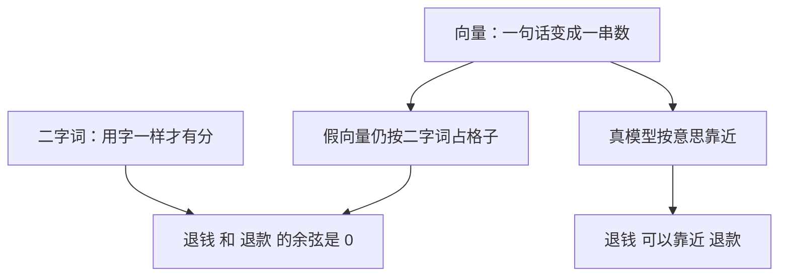

# 顺着「向量是什么」逐行读

## 本阶段需要的基础课

- 👉 不懂余弦？先看 [基础课 · 余弦相似度](../../00_python_basics/52_cosine.md)
- 👉 不懂 numpy 打印出来的形状？先看 [基础课 · numpy 数组](../../00_python_basics/53_numpy_array.md)
- 👉 不懂 zip 把相邻两个字配成一对？先看 [基础课 · zip](../../00_python_basics/51_zip.md)

先运行：

```bash
USE_FAKE_EMBEDDING=1 python stage5_vector_memory/01_what_is_vector.py
```

不下载模型。「退款」只有 1 个不是 0 的格子，形状是 `(1, 256)`，类型是 `float32`。前 8 个数多半全是 0，因为那一格落在更后面。



## 为什么先看假向量

阶段 4 的分数来自「两边有没有相同的二字词」。这一课把同一件事画成一串数：相同的词把同一格加高，两串数的方向就接近。你还没下载模型，也能看见形状、类型和余弦。

真模型 `BAAI/bge-small-zh-v1.5` 是 512 个数，几乎每一格都不是 0，并且会把意思接近的说法放近。那是下一课才去加载的东西。这一课故意只用 `hashed_bigram_matrix`，避免一运行就去下载。

## 屏幕上的四对

「退款」对「退款」：二字词余弦和假向量余弦都是 `1.0000`。同一句话，方向相同。

「退款」对「退钱」：两边都是 `0.0000`。二字词一边只有「退款」，另一边只有「退钱」，没有公共词。假向量把它们放进不同的格子，点积也是 0。这就是阶段 4 对同义词没办法的原因，假向量同样没办法。

「七天无理由退货」对「未拆封可以七天无理由退货」：两边都大约 `0.7385`。公共的字多，方向就接近。这一对上两个余弦碰巧一样，是因为这些二字词没有撞进同一格。换一句，哈希撞车之后，假向量会和纯词频的余弦分开。

「七天无理由退货」对「可以开纸质发票吗」：两边都是 `0.0000`。

## 和阶段 4 的关系

`keyword_score` 调用的是阶段 4 `retrieve.cosine`，权重就是词出现的次数。👉 不懂从阶段 4 那个文件夹导入？先看 [基础课 · 从另一个文件夹导入](../../00_python_basics/26_import_other_folder.md)。`stage5_link.enable()` 把那个文件夹放进查找清单。只导入 `stage5_link` 还不会改清单，必须先调用 `enable()`。

## 常见坑

- 看到余弦 `0` 就说「模型不懂退钱」。这一课还没有模型。0 是用字不同。
- 把 `1.0000` 当成 100% 的正确率。它是方向相同。👉 不懂这一点？先看 [基础课 · 余弦相似度](../../00_python_basics/52_cosine.md)。
- 前 8 个数全是 0，就以为向量是空的。后面还有 248 格，其中一格是 1 或 -1。

## 练习

1. 「退款」和「退钱」的二字词余弦为什么是 0？
2. 假向量为什么大部分格子是 0？
3. 哪一种向量才会把「退钱」和「退款」放近？

## 答案

1. 两个词没有公共的二字词。阶段 4 的余弦只加公共词。
2. 一个二字词只占一格。256 格里只有那一格不是 0。
3. 本机的中文嵌入模型。假向量和二字词都做不到。

下一课去看程序向谁要这串数：[得到向量](02_embedder.md)。
