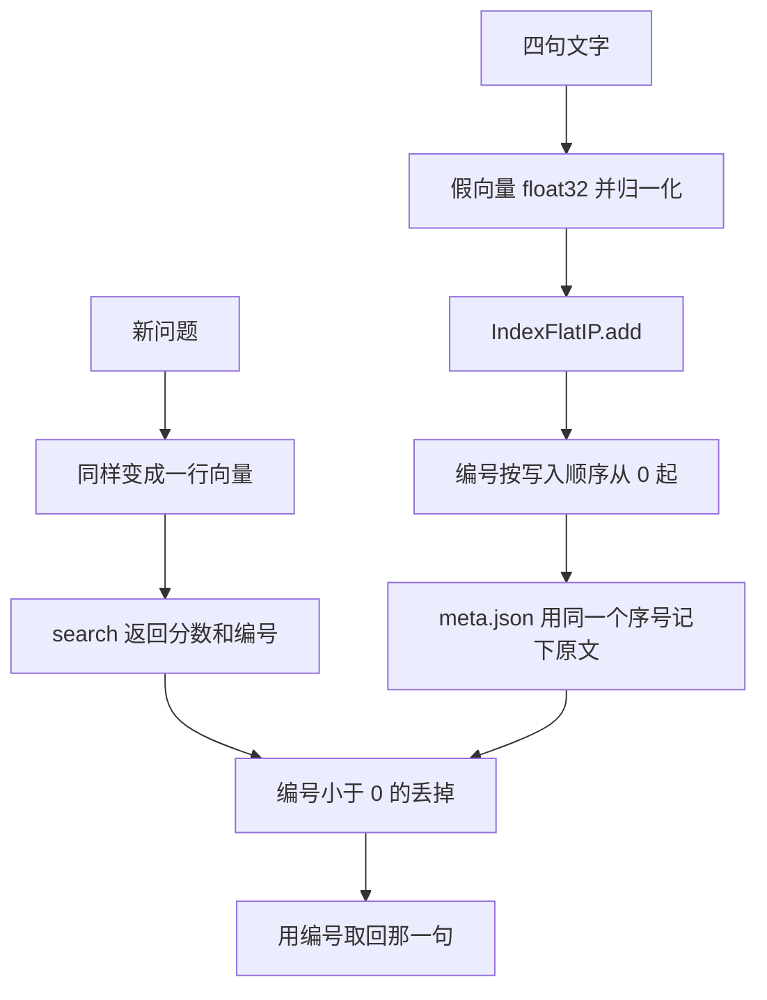

# 顺着 FAISS 逐行读

## 本阶段需要的基础课

- 👉 不懂 float32 和归一化？先看 [基础课 · numpy 数组](../../00_python_basics/53_numpy_array.md)
- 👉 不懂 mkdir 和 unlink？先看 [基础课 · 创建文件夹](../../00_python_basics/56_path_mkdir.md)
- 👉 不懂 JSON 来回？先看 [基础课 · JSON 来回](../../00_python_basics/42_json_roundtrip.md)

先运行：

```bash
python stage5_vector_memory/04_faiss_basics.py
```

不下载模型。四句短文本用假向量。索引写到 `stage5_vector_memory/data/faiss_lesson/`，不要提交。



## 内积要先归一化

`[3, 4]` 和 `[0.6, 0.8]` 是同一个方向，前者更长。不归一化时，查询 `[0.6, 0.8]` 对它们的内积是 `5.0000` 和 `1.0000`，长的那条赢。归一化之后两条都是 `1.0000`。IndexFlatIP 这个名字里的 IP 就是内积。单位向量上的内积才是余弦。

`FaissStore.add` 里会再归一化一次。你自己绕过它、直接 `index.add` 时，长文本仍会占便宜。

## 编号就是行号

`add` 的第 0 行在索引里是 id `0`。`search` 返回的就是这些 id，不是原文。原文在 `records[id]`，保存时写进 `meta.json` 的 `records` 列表，顺序必须和索引一致。

问「可以退货吗」，第一名是 id `0`，「未拆封七天可以退货」，分数大约 `0.5303`。第二名可能是「纸质发票不提供」，分数大约 `0.4082`。发票那句并没有「退货」。256 个格子太少，不同的词撞进了同一格。这是假向量的噪声。真模型不会靠这种撞车拿高分。第一名仍然是退货那句。

库存只有 4 条时，若向原始 FAISS 要 6 条，多出来的 id 是 `-1`。示例里查询「包邮」会看到两个 `-1`。`-1` 不能拿去当 `records` 的下标。`FaissStore.search` 会把它们丢掉，并且不会向索引要超过库存的条数。

## 两个文件要一起在

`save` 写 `index.faiss` 和 `meta.json`。👉 文件夹还不在时？先看 [基础课 · 创建文件夹](../../00_python_basics/56_path_mkdir.md)。`load_store` 检查三件事：条数一致、文件里的维度和 `dim` 字段一致、如果你传入了期望的维度和模型名，还要和当前嵌入一致。

故意用 257 维去读 256 维的索引，会看到「换模型后维度变了」。往 256 维索引里写入 3 维，会在 `add` 时被拒绝。

这一版 FAISS 若收到 float64，读回来仍是 `[1. 2.]`，说明它帮你转了。示例仍要求自己先写成 float32。👉 不懂这两种小数？先看 [基础课 · numpy 数组](../../00_python_basics/53_numpy_array.md)。

## 常见坑

- 忘记归一化。长段落的内积更大，排行不再是方向像不像。
- 只保存 `index.faiss`，没有 `meta.json`。编号对不上原文。
- 在 JSON 里多写一条，或删掉中间一条。`load_store` 会说条数对不上。
- 假向量索引建好之后改用 bge。256 维和 512 维不能续写，也不能拿来搜。删掉这两个文件再重建。模型名碰巧相同维度时也会拒绝，因为格子的含义变了。
- 把 `-1` 当成一条结果。那是「没有这条」的占位。

## 练习

1. 不归一化时，`[3, 4]` 为什么赢过 `[0.6, 0.8]`？
2. `search` 返回的 id 是原文吗？
3. 换了嵌入模型，为什么不能继续用旧的 `index.faiss`？

## 答案

1. 内积没有除以长度。`[3, 4]` 的数字更大，点积是 5，另一条是 1。方向其实相同。
2. 不是。id 是行号。原文在元数据列表的同一位置。
3. 维度可能变了。即使维度相同，每一格的含义也随模型改变。旧编号会取回对的字，但分数不再表示「意思接近」。

下一课用这套索引重做阶段 4 的知识库：[对比检索](05_compare.md)。
