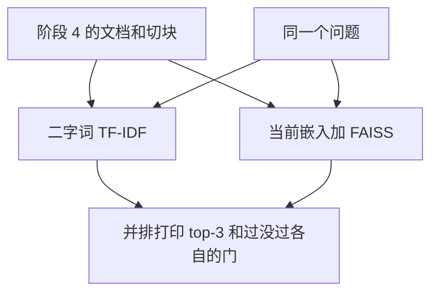

# 顺着和阶段 4 的对比逐行读

## 本阶段需要的基础课

- 👉 不懂阶段 4 的二字词分数？先看 [阶段 4 · 检索](../../stage4_rag/docs/03_retrieve.md)
- 👉 不懂假向量为什么对不上同义词？先看 [得到向量](02_embedder.md)

先运行：

```bash
USE_FAKE_EMBEDDING=1 python stage5_vector_memory/05_compare_retrieval.py
```

切块仍是阶段 4 的 `knowledge/`，块数两边都是 27。二字词的门是 `0.15`。假向量的门是 `0.22`。这两道门不能互相借用。



## 原词问句两边都找得到

下面的第一名在这份知识库、假向量下是稳定的。你改过 `knowledge/` 之后，小数会变。

| 问题 | 二字词 | 假向量 |
| --- | --- | --- |
| 退货政策是几天 | 0.4449，`01_退换货政策.md` 第1段 | 0.3111，同一段 |
| 不满99元运费是多少 | 0.5088，`02_运费与配送.md` 第1段 | 0.4734，同一段 |
| 耳机保修多久 | 0.4516，`04_售后保修.md` 第1段 | 0.3500，同一段 |

用字就在资料里时，两种检索都把对应文件放在第一名。

## 换一种说法

「我想退钱」：二字词第一名分数 `0.0000`。知识库写的是「退款」「退货」，没有「退钱」这个二字词。假向量大约 `0.0772`，落在运费文件上，也低于 `0.22`。两种都拒答。假向量不是这项能力的替代品。

同一套脚本在本机加载 `bge-small-zh-v1.5` 之后（不要设置 `USE_FAKE_EMBEDDING`）测到过这些数，模型版本不同时小数会动，方向应还在：

- 「退款」和「退钱」的余弦大约 `0.92`，「退款」和「发票」大约 `0.59`。
- 「我想退钱」第一名是 `01_退换货政策.md`，大约 `0.51`，过了真模型的门 `0.45`。
- 「耳机进水了还能不能修」第一名是保修文件，大约 `0.60`。假向量这一问过不了门，还偏到积分。
- 「今天月球冷不冷」大约 `0.36`，低于 `0.45`。

「退钱一般是几天」更值得看。二字词大约 `0.1905`，过了 `0.15`，第一名是退换货，因为「几天」在那段里。假向量大约 `0.1029`，第一名却是运费，而且过不了 `0.22`。没有 IDF、又会撞车的哈希，有时比阶段 4 更钝。这是假向量的代价，不是 FAISS 的错。装上 bge 并且不要设置 `USE_FAKE_EMBEDDING`，再跑这一问，看第一名会不会回到退换货。

「进水了还保修吗」两边的第一名都是保修文件。二字词大约 `0.5322`，假向量大约 `0.2739`。这里靠的是「保修」两个字还在，不是因为「进水」对上了「进液」。

「耳机进水了还能不能修」把「保修」拿掉了。二字词大约 `0.1576`，勉强过了 `0.15`，第一名却是会员积分。假向量大约 `0.1508`，同样偏到积分，但低于 `0.22`，不会把积分规则交给模型。门挡住了一次错误的第一名。它也没有把「进水」找回「进液」。

「今天月球冷不冷」：二字词是 `0.0000`，假向量大约 `0.0589`。都低于各自的门。

## 门为什么不同

阶段 4 的 `0.15` 是二字词余弦上试出来的。假向量的 `0.22` 是对着同一批文档试的：原词问句里最低的「人工客服营业到几点」大约 `0.23`，「我住在杭州，收货喜欢放门口」大约 `0.20`。门放在中间，避免把住址当成运费规定来念。bge 的余弦通常更高，`ask.py` 里另有 `0.45` 那一档。换模型后要重新看这道门，不能把 `0.22` 抄到真模型上还以为含义不变。

## 常见坑

- 用 `0.15` 去卡向量分数，或用 `0.22` 去卡二字词。尺子不同。
- 假向量在「退钱一般是几天」上更差，就说 FAISS 不能用。要换成真模型再比这一问。
- 只看第一名的文件名，不看过没过门。「月球」也会有一个第一名，分数很低。
- 改了知识库还对照这张表的小数。以你屏幕上的数为准。离线演示锁的是文件名和过不过门，不是某一位小数永远不变。

## 练习

1. 「我想退钱」为什么两种检索都过不了门？
2. 「退钱一般是几天」为什么二字词过线、假向量不过线？
3. 真模型装好之后，你预期「我想退钱」的第一名更接近哪一份文件？

## 答案

1. 资料里没有「退钱」这两个字。假向量不会因为意思接近就加分。
2. 「几天」这个二字词出现在退换货的第一段里，二字词因此过了 `0.15`。假向量没有 IDF，这几个字的权重被别的格子冲淡，分数停在 `0.10` 附近，而且第一名偏到了运费。
3. `01_退换货政策.md`。这是装上 bge 之后值得再跑一次示例 5 的原因。

下一课把「可以留很久的事实」也放进这种索引：[长期记忆](06_memory.md)。
