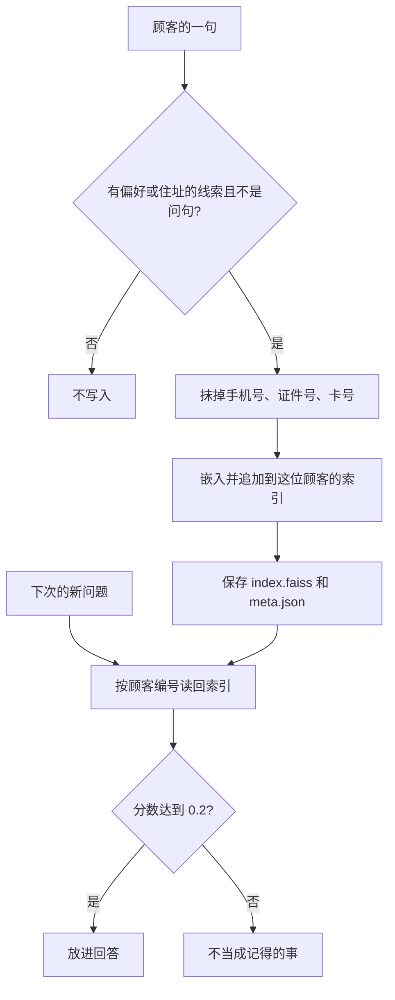

# 顺着长期记忆逐行读

## 本阶段需要的基础课

- 👉 不懂创建顾客文件夹？先看 [基础课 · 创建文件夹](../../00_python_basics/56_path_mkdir.md)
- 👉 不懂正则怎样按形状找号码？先看 [基础课 · 正则](../../00_python_basics/25_regex.md)
- 👉 不懂日期怎么写成文本？先看 [基础课 · 日期时间](../../00_python_basics/36_datetime.md)

阶段 3 的 Redis 不在这一课重讲。忘了短期记忆放哪，回到 [阶段 3 小结](../../stage3_memory/docs/stage_summary.md)。

先运行：

```bash
USE_FAKE_EMBEDDING=1 python stage5_vector_memory/06_long_term_memory.py
```

没有密钥时只用规则。记忆在 `stage5_vector_memory/data/memory/demo_reader/`。每次运行会先清空这一位顾客，再重写。不要把真实号码打进终端。



## 短期和长期

阶段 3 把最近几句、摘要和槽位放在 Redis。空闲大约 30 分钟不过期计时就会清掉，清掉的是这一段对话。阶段 5 写的是可以留很久的事实：住在哪、收货放哪、以前问过哪份资料。文件在磁盘上，进程结束还在。下次用同一个顾客编号打开，就能按向量再找。

示例 7 里还有一个只活在这一次进程中的列表，最多 6 条。那是为了让「刚才说的半句话」进提示，退出就没了。它不是 Redis，也不是长期记忆。导读不再把 Redis 客户端展开。

## 什么值得记

`KEEP_CUES` 里是「我住」「我喜欢」「不要放」「上次」「请记住」这类说法。「今天天气不错」一条都对不上，规则留下 `[]`，不写入。

「我住在哪」里虽有「我住」，但「哪」在 `QUESTION_MARKS` 里。问句不记成事实，否则问题本身会被写成「顾客住在哪」。

「请记住我的手机号13800138000和卡号6222021234567890」有「请记住」，所以留下。留下之前先换成「请记住我的手机号[手机号已省略]和卡号[卡号已省略]」。屏幕上若还看得到那两串数字，就是隐私没挡住。👉 不懂数字串怎么被换掉？先看 [基础课 · 正则](../../00_python_basics/25_regex.md)。先换 11 位手机号，再换 18 位证件号，最后换更宽的卡号，避免 18 位证件被说成卡号。

有密钥时，还会请模型交一个 JSON 数组。模型没按格式写，就退回规则。离线演示不走模型。规则和模型抽出的句子都会再过一遍抹号。

政策问答另外记一条「以前问过「耳机保修多久」，答复来自 04_售后保修.md」。不把资料正文抄进来。抄到 80 个字截断时，可能把「365」切成「3」，看起来像另一条天数。天数仍以知识库为准，记忆只指向文件。

## 召回

重新 `UserMemory("demo_reader")` 是另一个对象。内存里的新列表是空的，磁盘上有 4 条。假向量的回忆门槛是 `0.2`。

「我住在哪」大约 `0.2887`，召回杭州那句。「放门口还是驿站」大约 `0.3062`，同一句。「收货放哪里」大约 `0.1250`，低于门槛。字面换成了「哪里」，假向量对不上「门口」。真模型更吃意思。「我的手机号是多少」大约 `0.3948`，召回的是已经省略号码的那句，不是 `13800138000`。「以前问过保修吗」大约 `0.4082`，召回保修文件那条。

几乎同一句再出现时，余弦达到 `0.92` 就不再写第二遍。

## 常见坑

- 把 Redis 里的最近几句叫成长期记忆。过期之后那几句不在了。长期记忆是 `data/memory/顾客编号/` 里的两个文件。
- 顾客编号里写 `..` 或斜杠。`safe_user_id` 只允许字母、数字、下划线和减号，避免写到别的目录。
- 换了嵌入模型还打开旧文件夹。维度或模型名对不上时，读取会要求你删掉旧索引。示例 6 每次 `reset`，就是为了练习可以重来。
- 索引和 `meta.json` 只改一边。编号会指到别人的事实。
- 把完整手机号、卡号写进仓库。生成目录已忽略。练习也不要使用真实号码。

## 练习

1. 「今天天气不错」为什么不写入？
2. 「收货放哪里」为什么常常低于 `0.2`？
3. 为什么记忆里不复制「保修 365 天」的整段正文？

## 答案

1. 没有任何一条保留线索。规则返回空列表。
2. 记下来的是「放门口」「驿站」。查询用的是「哪里」。假向量只给相同的二字词加分。
3. 截断会把天数切坏。政策数字以知识库为准，记忆只记下问过什么、答复来自哪个文件。

下一课把检索、记忆和工单放进同一次对话：[命令行客服](07_cli.md)。
