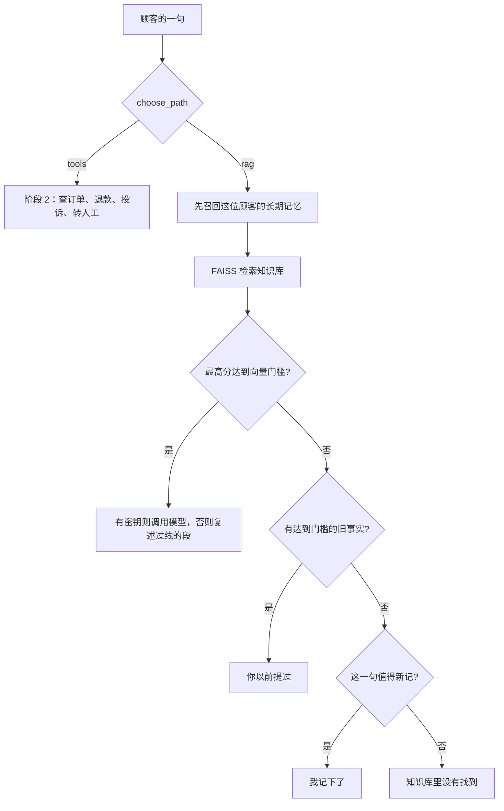

# 顺着命令行客服逐行读

## 本阶段需要的基础课

- 👉 不懂从别的文件夹导入？先看 [基础课 · 从另一个文件夹导入](../../00_python_basics/26_import_other_folder.md)
- 👉 不懂 input？先看 [基础课 · input](../../00_python_basics/19_input.md)
- 👉 不懂列表只留最后几条？先看 [基础课 · 切片](../../00_python_basics/39_slice.md)

阶段 2 的追问不在这一课重讲。忘了订单号怎么补，回到 [阶段 2 的追问](../../stage2_tools_tickets/docs/05_slots.md)。分流规则仍是阶段 4 的 `choose_path`。

先运行：

```bash
USE_FAKE_EMBEDDING=1 python stage5_vector_memory/07_cli_with_vector.py
```

没有密钥也能聊。按这个顺序试：

1. `退货政策是几天`。路径是「向量检索」。第一名大约 `0.3111`，`01_退换货政策.md`。回答里有「七天」，并写着来源。开头是「没有调用模型」。
2. `我住在杭州，收货喜欢放门口`。规则看出这是住址，只记下，不把运费规定念出来。假向量下这一句的知识库分数大约 `0.20`，本来也低于 `0.22`。真模型有时会让它靠近配送段，规则仍然优先。回答是「我记下了：我住在杭州，收货喜欢放门口」。
3. `我住在哪`。这句是问句，不会再记成一条住址。召回大约 `0.35`，回答「你以前提过：我住在杭州，收货喜欢放门口」。
4. `我要退款`，然后 `订单号 10086`。路径是阶段 2 工具。工单写成待处理，并说明钱还没有退。
5. `退出`。

再启动一次，仍用默认顾客 `local`，直接问 `我住在哪`。磁盘上的事实还在。刚才那几句短期对话不在了，除非你还开着上一个进程。

顾客编号用环境变量 `STAGE5_USER_ID`。不写就是 `local`。



## 三样时间不一样的东西

工单在 SQLite，办理退款才写，退出后还在。长期记忆在 `data/memory/顾客编号/`，偏好和「以前问过哪份文件」退出后还在。最近 6 条对话在一个列表里，`del recent[:-6]` 只留尾巴。👉 不懂这种切片？先看 [基础课 · 切片](../../00_python_basics/39_slice.md)。阶段 3 的 Redis 能在进程外面再留大约 30 分钟。这里不连接 Redis，是为了这一课读得完。需要那 30 分钟时，回到阶段 3 的命令行客服。

有密钥时，政策题才调用 DeepSeek，并且系统提示要求天数只能来自资料。记忆放在「顾客的问题」之后。阶段 4 的假复述只抄问题前面的来源块，不会把「我住在杭州」说成退货规定。

「退钱一般是几天」含有「几天」，阶段 4 的分流会走检索，不会建单。假向量下它往往低于 `0.22`，回答「知识库里没有找到」。这是示例 5 里看过的代价。说「我要退款」或「我想退钱」会走工具，因为人是在要求办理，不是在问规定。

带「人工」的句子，例如「人工客服营业到几点」，阶段 1 的规则会先看成转人工。示例 7 因此去建转人工工单，不念营业时间。离线演示直接调用检索函数，所以仍能检查「21:00」那一段。

## 常见坑

- 第一次说「我住在杭州」就期待它从记忆里读出来。写入发生在这一轮的回答之后，下一句才能召回。
- 把 `local` 的文件夹提交进 Git。`stage5_vector_memory/data/` 已忽略。
- 以为没有密钥时工单也不会写。退款仍会写入 `shop.db`。
- 在提示里用记忆编造「七天」。系统提示不允许。没有密钥时，复述函数根本看不到记忆块。

## 练习

1. 退出再启动，`我住在哪` 为什么还记得，而上一句闲聊不在列表里？
2. 「我想退钱」为什么不走向量检索？
3. 手机号那一句的回答里，为什么应出现「已省略」而不是 11 位数字？

## 答案

1. 住址在磁盘上的索引里。列表只属于这一次进程。
2. 规则把它分成退款，而且句子是在要求办理。`choose_path` 交给阶段 2。想看这一句的检索分数，运行示例 5。
3. `redact_secrets` 在写入前替换了号码。召回和「我记下了」用的都是替换之后的句子。

下一课把这些断言锁进一次不联网的运行：[离线演示](08_offline.md)。
