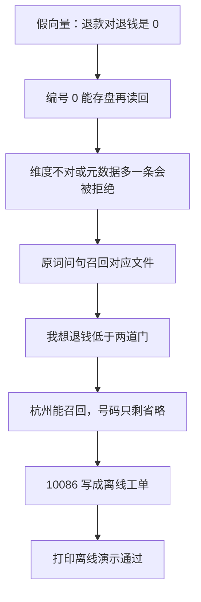

# 顺着离线演示逐行读

## 本阶段需要的基础课

- 👉 不懂 assert？先看 [基础课 · assert](../../00_python_basics/30_assert.md)
- 👉 不懂 unlink 为什么出现在重跑之前？先看 [基础课 · 创建文件夹](../../00_python_basics/56_path_mkdir.md)

不要用 `python -O` 运行，否则断言会被拿掉，脚本会在错误时仍打印通过。

先运行：

```bash
python stage5_vector_memory/08_offline_demo.py
```

不需要密钥，也不下载模型。文件开头就把 `USE_FAKE_EMBEDDING` 设为 `1`，并打开 Hugging Face 的离线开关。最后一行必须是：

```text
离线演示通过
```

前面任何一条 `assert` 失败，程序停在 `AssertionError`，你看不到这句。数据库是 `stage5_vector_memory/data/offline_demo.db`。长期记忆的顾客编号是 `offline_demo`。两者都不会动你在示例 7 里的 `shop.db` 和 `local`。



## 各段在锁什么

`check_vectors` 确认后端是 `fake`，形状是 `(3, 256)`，类型是 `float32`，第一行长度接近 1。「退款」和自己的余弦大于 `0.99`，和「退钱」的绝对值小于 `0.01`。阶段 4 的二字词余弦同样是 0 和接近 1。

`check_faiss_roundtrip` 确认「可以退货吗」的第一名是「未拆封七天可以退货」，id 是 0。保存再读回，句子不变。期望维度加 1 时必须 `ValueError`，并且错误文本里有「维度」。元数据多塞一条之后必须说「对不上」。演示完会把 `meta.json` 写回成对的那一版。

`check_knowledge` 锁五句原词：退货、运费、保修、发票、营业时间。第一名的文件要对，假复述里要有资料中的那几个字，并且含有文件名。二字词那边的第一名文件也要相同。「我想退钱」和「今天月球冷不冷」必须是「知识库里没有找到」。假向量门槛是 `0.22`。

`check_memory` 写入杭州和放门口。手机号 `13800138000` 和卡号 `6222021234567890` 不能出现在保存的句子里。「今天天气不错」和「我住在哪」都不记。保修那条记忆指向 `04_售后保修.md`，里面没有「365」，避免把天数抄进记忆。新的空列表是空的；重新打开同一位顾客，`我住在哪` 仍能召回杭州，「放门口还是驿站」能召回门口或驿站，「收货放哪里」召回不到。

`check_routing_and_tools` 确认「退货政策是几天」走检索，「我想退钱」和「我要退款」走工具。然后在离线库里走完退款追问。工单从 0 变成 1，订单号是 `10086`。`查订单 10086` 的回复里有「星河蓝牙耳机」。

## 常见坑

- 用 `python -O` 跑。断言消失，最后仍可能打印通过。
- 以为这个脚本会下载 bge 或调用 DeepSeek。它在导入嵌入模块之前就写死了假向量。
- 把 `data/` 里的 `index.faiss`、`meta.json` 或 `offline_demo.db` 提交进 Git。这些模式已经在 `.gitignore` 里。
- 把「假复述里有七天」说成「向量模型学会了退货政策」。复述的是检索放进提示的原文。
- 离线演示和示例 7 共用 `local`。演示用的是 `offline_demo`，并且每次 `reset`。

## 练习

1. 把「七天」改成「七十天」再运行。应停在哪一种错误？看完改回去。
2. 为什么「收货放哪里」必须召回不到？
3. 离线库和 `shop.db` 为什么要分开？

## 答案

1. `AssertionError`。回答里没有「七十天」。你看不到「离线演示通过」。
2. 这是在锁假向量的边界。字面换成「哪里」之后，分数低于 `0.2`。若这里也召回了，门槛就没挡住换说法。
3. 示例 7 的工单要留在 `shop.db` 里给人接着查。离线演示每次 `reset_database`，用同一个文件会把已经记下的工单删掉。

这一阶段的脚本串起来之后，读 [阶段小结](stage_summary.md)。
