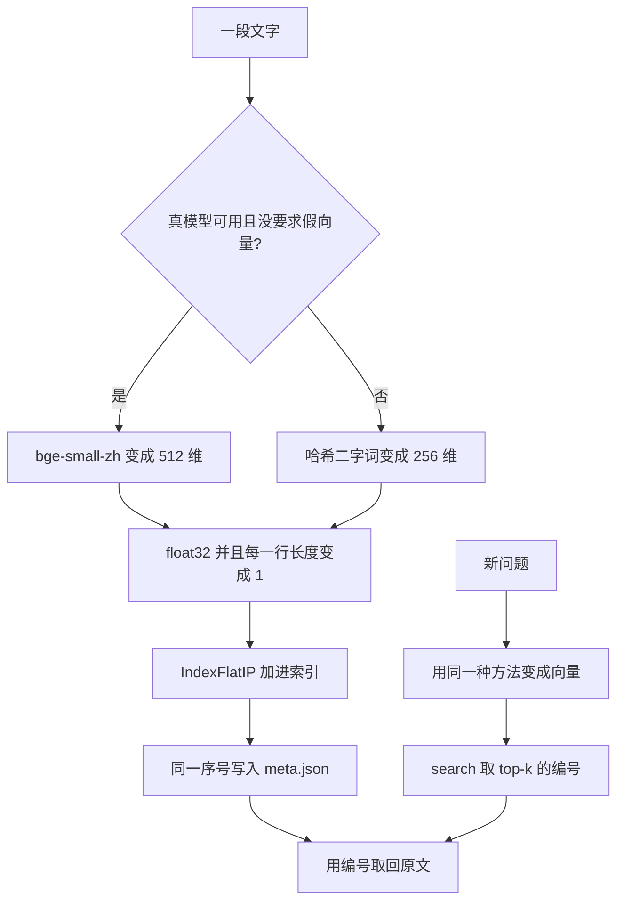

# 阶段 5 导读目录

## 本阶段需要的基础课

新的，等导读叫停再读，不要先通读：

- 👉 不懂 numpy 的形状和 float32？先看 [基础课 · numpy 数组](../../00_python_basics/53_numpy_array.md)
- 👉 不懂没装库时改走备用？先看 [基础课 · 可选依赖](../../00_python_basics/54_optional_import.md)
- 👉 不懂 hashlib？先看 [基础课 · hashlib](../../00_python_basics/55_hashlib.md)
- 👉 不懂创建文件夹？先看 [基础课 · 创建文件夹](../../00_python_basics/56_path_mkdir.md)
- 👉 不懂模块级缓存？先看 [基础课 · 模块级缓存](../../00_python_basics/57_module_cache.md)

还会用到、这一阶段第一次靠它们把向量检索跑起来的旧课：

- [14 for](../../00_python_basics/14_for.md)
- [26 从别的文件夹导入](../../00_python_basics/26_import_other_folder.md)
- [30 assert](../../00_python_basics/30_assert.md)
- [42 JSON 来回](../../00_python_basics/42_json_roundtrip.md)
- [45 环境变量的默认值](../../00_python_basics/45_env_defaults.md)
- [52 余弦相似度](../../00_python_basics/52_cosine.md)

## 这一阶段在做什么

先做完阶段 4 的 [导读](../../stage4_rag/docs/README.md)。二字词检索不在这里重写。新语法出现时，导读会停下来，去 `00_python_basics/` 第 53 课往后。

长期记忆是另一份索引，按顾客编号分文件夹。写之前先问「这句话值不值得留」，并抹掉手机号和卡号。阶段 3 的 Redis 仍只留最近这一段对话。

## 阅读顺序

示例 1 到 6、示例 7 在没有密钥时、以及示例 8，都不需要 API 密钥。想完全不尝试下载模型，在命令前加 `USE_FAKE_EMBEDDING=1`。示例 8 自己会打开这个开关。

1. 运行 `USE_FAKE_EMBEDDING=1 python stage5_vector_memory/01_what_is_vector.py`，读 [向量是什么](01_vector.md)。
2. 运行 `USE_FAKE_EMBEDDING=1 python stage5_vector_memory/02_get_embeddings.py`，读 [怎么得到向量](02_embedder.md)。
3. 运行 `python stage5_vector_memory/03_numpy_vectors.py`，读 [numpy](03_numpy.md)。
4. 运行 `python stage5_vector_memory/04_faiss_basics.py`，读 [FAISS](04_faiss.md)。
5. 运行 `USE_FAKE_EMBEDDING=1 python stage5_vector_memory/05_compare_retrieval.py`，读 [和阶段 4 对比](05_compare.md)。
6. 运行 `USE_FAKE_EMBEDDING=1 python stage5_vector_memory/06_long_term_memory.py`，读 [长期记忆](06_memory.md)。
7. 运行 `USE_FAKE_EMBEDDING=1 python stage5_vector_memory/07_cli_with_vector.py`，读 [命令行客服](07_cli.md)。按屏幕上的句子试一轮，输入 `退出`。
8. 运行 `python stage5_vector_memory/08_offline_demo.py`，读 [离线演示](08_offline.md)。最后一行应是「离线演示通过」。
9. 读 [阶段小结](stage_summary.md)。名词忘了查 [名词表](glossary.md)。

示例 7 会把真正要办理的退款写进阶段 2 的 `shop.db`。离线演示用的是 `stage5_vector_memory/data/offline_demo.db`，长期记忆用顾客编号 `offline_demo`，不会清掉你在示例 7 里用 `local` 记下的事实。
