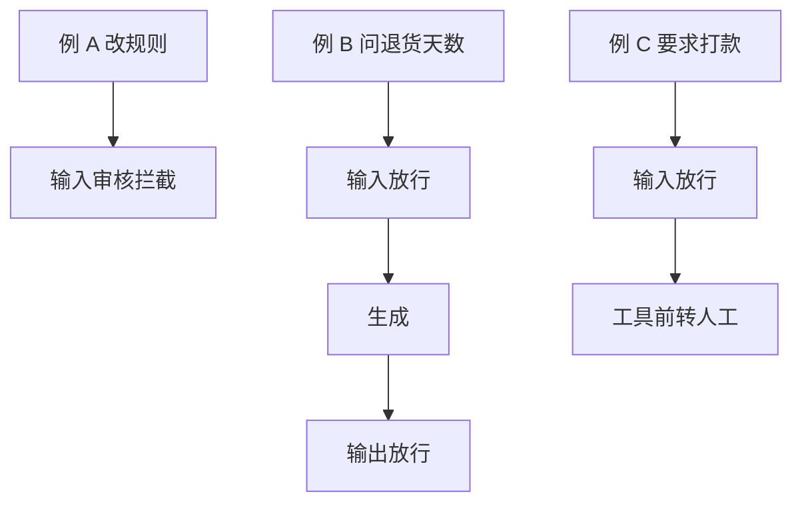

# 顺着「为什么要审核」逐行读

## 本阶段需要的基础课

- 👉 不懂函数先定义再调用？先看 [基础课 · 函数](../../00_python_basics/11_functions.md)
- 👉 不懂 for 走每一项？先看 [基础课 · for](../../00_python_basics/14_for.md)

这一课还没有正则、枚举和日志。那些从下一课起，导读会再叫停。

先运行：

```bash
python stage6_compliance/01_why_compliance.py
```

不读 `rules.json`，也不联网。屏幕上是三则短例。



## 为什么三个座位不能换顺序

阶段 5 的客服会把句子送给模型，也会把工单写进 SQLite。模型一旦读过「忽略之前的指令」，后面的输出审核只能拦住它说出来的那一句，拦不住它已经按那句去想。工具一旦 `INSERT`，输出审核也删不掉那一行。

所以：

- 输入审核在调用模型之前。注入和辱骂在这里停。
- 工具前审核在 `handle_turn` 之前。要求直接打款时不建单。
- 输出审核在顾客看到回复之前。乱承诺、索要密码、背提示词、说出别人的号码，在这里改写或换成模板。
- 审计日志记下结论。放行也要记，否则查不到当时为什么放了。

`seat` 只负责把一行印整齐。`walk` 把一则例子的四个座位走完。判断还没有写进规则，句子是讲义里写死的说明。从示例 2 起，同样的座位会去读 `rules.json`。

## 屏幕上的三则

例 A：输入审核拦截，生成和输出都跳过。日志仍要记。

例 B：问退货天数。三处都放行，生成会走到阶段 5。这一课还没有真的去检索。

例 C：输入放行，因为「我要退款」可以办。工具前看到「直接打款」，转人工，不进入阶段 2。`shop.db` 不会因此多一张单。

## 常见坑

- 先生成，再补一个输入审核。注入句子已经在模型的上下文里。
- 先建工单，再看这句话是不是在要求打款。库里已经有记录。
- 只审输出，不审输入。辱骂仍会被写进长期记忆或最近几句，下一轮又送回去。
- 把这一课的打印当成已经在拦截。它还没有调用 `run_turn`。真的拦住，从示例 4 和示例 9 才能看见「回答函数没有被调用」。

## 练习

1. 例 A 为什么不调用模型？
2. 例 C 为什么输入审核是放行，工具前却是转人工？
3. 放行的那一轮为什么也要写日志？

## 答案

1. 那句话是在改规则，不是在问店铺政策。模型读到之后，输出审核来不及把它「没读过」变成事实。
2. 退款可以登记工单。直接打款超出了这个客服能做的事。两件事可以出现在前后两句里，这一课把它们放在不同的座位上。
3. 出事时要能回答「当时为什么没有拦」。只有拦截记录，就不知道放行的那几轮检查过没有。

下一课把敏感词放进可以修改的文件：[敏感词](02_rules.md)。
