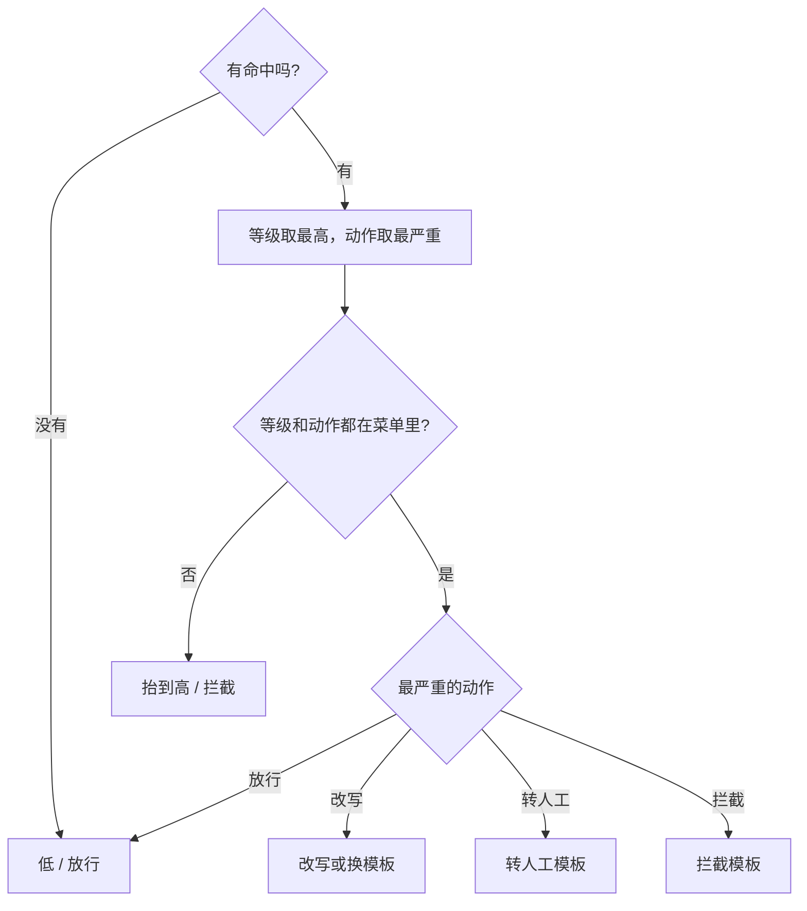

# 顺着等级和审计日志逐行读

## 本阶段需要的基础课

- 👉 不懂枚举？先看 [基础课 · 枚举](../../00_python_basics/60_enum.md)
- 👉 不懂 dataclass？先看 [基础课 · dataclass](../../00_python_basics/41_dataclass.md)
- 👉 不懂追加和一行一条？先看 [基础课 · JSON Lines](../../00_python_basics/61_json_lines.md)
- 👉 不懂 mkdir？先看 [基础课 · 创建文件夹](../../00_python_basics/56_path_mkdir.md)
- 👉 不懂 max 的 key？先看 [基础课 · sorted 和 lambda](../../00_python_basics/50_sorted_key.md)

先运行：

```bash
python stage6_compliance/07_risk_and_audit.py
```

日志写到 `stage6_compliance/data/audit_demo.jsonl`。目录已被忽略。脚本开头若文件已在，会先删掉，避免上次的练习行混进来。



动作的严重程度是：放行，然后改写，然后转人工，然后拦截。拦截比转人工更靠前，因为这句话不该再往下送。

## ComplianceResult 里有什么

五个字段：`level`（低 / 中 / 高）、`hits`（「类别:短语」的列表）、`action`（放行 / 改写 / 拦截 / 转人工）、`text`（审核之后可以显示的那一句）、`reason`（命中拼成的说明）。

等级和动作在决定的时候用枚举。写进这个 dataclass 和日志的是中文 `.value`。不认识的等级或动作会抬到高并且拦截，不能当成放行。👉 不懂为什么 `"放行吧" == ReviewAction.ALLOW` 不会成立？先看 [基础课 · 枚举](../../00_python_basics/60_enum.md)。

没有命中：低 / 放行，原文不动。打印出来的是 `ComplianceResult(level='低', ...)`。

只有「保证100%」：中 / 改写。

中的改写和高的拦截同时在：高 / 拦截。发出去的是拦截模板，不是改写留下的半句。

动作写成「放行吧」：高 / 拦截。

`asdict` 把 dataclass 收成普通字典，才能放进 `json.dumps`。👉 不懂这一步？先看 [基础课 · dataclass](../../00_python_basics/41_dataclass.md)。

## 日志为什么再打一次码

`append_record` 用 `"a"` 追加。每一行是一个 JSON 对象，末尾有换行。目录不存在就创建。

示例故意把 `请记住手机13800138000` 放进记录，备注写着「调用方这一次忘了打码」。读回来的 `text` 是 `请记住手机138****8000`。文件里搜这 11 位数字，结果是 False。第二行是放行的那条，没有被第一行覆盖。

## 常见坑

- 审核失败或动作写错时默认放行。不认识的词必须拦截。
- 用 `"w"` 写日志。每次运行只剩最后一轮，查不到更早的放行。
- 日志里写明文手机号。忽略文件只保证不进 Git，不保证磁盘上没有明文。
- 多条命中时取第一条，而不是最严重的一条。先写上的「改写」会盖住后面的「拦截」。
- 把安全模板再送进同一套词表。模板是按「不含原词」写的，不要在模板里抄「承诺赔偿」。

## 练习

1. 中 / 改写和高 / 转人工同时出现，动作应是哪一个？若再加一条高 / 拦截呢？
2. 为什么示例要在开头 `unlink` 旧日志？
3. 文件里「还有明文手机号吗」这一行应是 True 还是 False？

## 答案

1. 转人工比改写严重。再加上拦截时，动作是拦截，等级仍是高。
2. `"a"` 会留下上次运行的行。这一课要看见的是本次这两行。离线演示同样先删再写。
3. False。写入前 `mask_value` 会走到每一个字符串。

下一课把这些座位套到阶段 5 的客服外面：[命令行](08_cli.md)。
