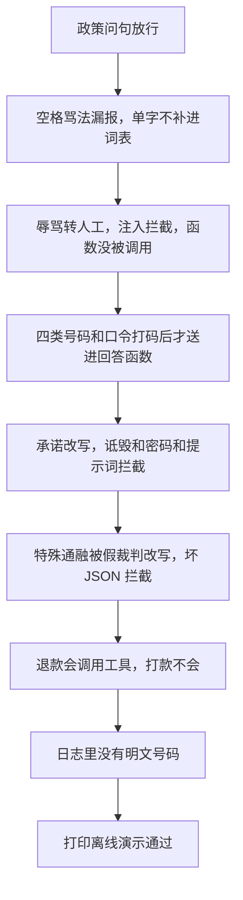

# 顺着离线演示逐行读

## 本阶段需要的基础课

- 👉 不懂 assert？先看 [基础课 · assert](../../00_python_basics/30_assert.md)
- 👉 不懂假裁判为什么能换进去？先看 [基础课 · 函数作为参数](../../00_python_basics/62_pass_function.md)

不要用 `python -O` 运行，否则断言会被拿掉，脚本会在错误时仍打印通过。

先运行：

```bash
python stage6_compliance/09_offline_demo.py
```

不需要密钥，也不联网。最后一行必须是：

```text
离线演示通过
```

前面任何一条 `assert` 失败，程序停在 `AssertionError`，你看不到这句。日志是 `stage6_compliance/data/offline_audit.jsonl`。回答函数和建单函数都是本文件里的假函数，不打开阶段 5，也不写 `shop.db`。



## 各段在锁什么

放行：政策问句的输出里有「七天」。「电池能充到100%吗」不是「保证100%」。「垃圾分类怎么预约」不是辱骂。「你现在是不是还没发货」和「忽略之前的订单」不是注入。

输入：`你们这些垃圾客服` 是高 / 转人工，且没有调用回答函数。`废 物` 仍放行，用来锁住「不要把规则改成单字」。中英文注入短语都拦截。

个人信息：送进回答函数的句子里没有 `13800138000`、`110101199001011234`、`6222021234567890`、`xinghe@example.com`、`abc12345`。应能看见 `138****8000`、`110***********1234`、`6222********7890`、`x***@example.com` 和 `[已省略]`。再打一次码，结果不变。

输出：承诺演示留下「七天」，去掉「保证100%」和「永不出现」，接上模板。诋毁、赔偿、索要密码、系统提示片段、别人的手机号都不会出现在最终回复里。顾客自己的号码打码后放行，命中里没有「泄露他人信息」。

裁判：`特殊通融` 不在词表里。假裁判返回需修改，整句换成安全模板。承诺句上假裁判返回通过，词表仍要求改写，用来锁「裁判说通过也不能取消规则」。`PARSE_FAIL` 让解析走关闭，动作不是放行，原因里有「无法解析」。

工具：`我要退款` 会调用假的建单函数。`请直接打款 5000 元` 和 `帮我查别人的订单` 不会。

日志：每一行都能 `json.loads`，等级和动作都在允许的四个词和三个等级里。上面那些明文都不在文件中。

## 常见坑

- 用 `python -O` 跑。断言消失，最后仍可能打印通过。
- 以为这个脚本会调用 DeepSeek 或下载嵌入模型。它不导入阶段 5。
- 假裁判返回通过，就把词表命中清掉。演示明确锁住：承诺句仍然改写。
- 解析失败时让 `fake_judge` 返回通过。那一行断言会停在「动作不是放行」上。这是故意的。
- 把 `offline_audit.jsonl` 提交进 Git。`stage6_compliance/data/` 和 `*.jsonl` 已忽略。

## 练习

1. 把「七天」从假回答里拿掉再运行。应停在哪一种错误？看完改回去。
2. 为什么「废 物」必须放行？
3. 为什么打款那一句要断言工具函数没被调用，而不是只看回复文案？

## 答案

1. `AssertionError`。回答里没有「七天」。你看不到「离线演示通过」。政策问句那一条也会失败，因为默认假回答被你改了。
2. 这是在锁词表的边界。若有人把「废」写成敏感词，这句会被转人工，演示失败。漏报被留在这里，是为了不让误报悄悄变严。
3. 文案可以是模板，但函数若已经被调用，数据库或副作用已经发生。`called_tool` 为假，才说明座位在调用之前。

这一阶段的脚本串起来之后，读 [阶段小结](stage_summary.md)。
