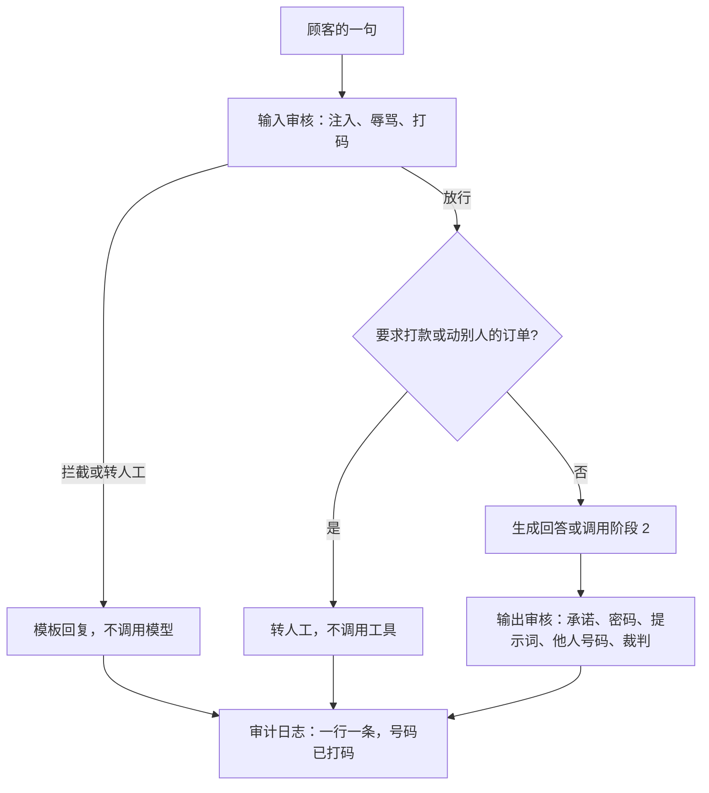

# 阶段 6 导读目录

## 本阶段需要的基础课

新的，等导读叫停再读，不要先通读：

- 👉 不懂 findall 和 sub？先看 [基础课 · 正则替换](../../00_python_basics/58_regex_sub.md)
- 👉 不懂 any / all？先看 [基础课 · any 和 all](../../00_python_basics/59_any_all.md)
- 👉 不懂枚举？先看 [基础课 · 枚举](../../00_python_basics/60_enum.md)
- 👉 不懂追加和 JSON Lines？先看 [基础课 · JSON Lines](../../00_python_basics/61_json_lines.md)
- 👉 不懂把函数交进去？先看 [基础课 · 函数作为参数](../../00_python_basics/62_pass_function.md)

还会用到、这一阶段第一次靠它们把审核跑起来的旧课：

- [16 try / except](../../00_python_basics/16_try_except.md)
- [25 正则](../../00_python_basics/25_regex.md)
- [27 解析 JSON](../../00_python_basics/27_json_parse.md)
- [30 assert](../../00_python_basics/30_assert.md)
- [34 with](../../00_python_basics/34_with.md)
- [41 dataclass](../../00_python_basics/41_dataclass.md)
- [42 JSON 来回](../../00_python_basics/42_json_roundtrip.md)

## 这一阶段在做什么

先做完阶段 5 的 [导读](../../stage5_vector_memory/docs/README.md)。向量和长期记忆不在这里重写。新语法出现时，导读会停下来，去 `00_python_basics/` 第 58 课往后。

顾客的话先过输入审核。通过了，若这句话要求打款或动别人的订单，就在工具前面停下。否则才生成或建工单。回复再过输出审核，然后把打过码的结论追加进日志。

风险怎么收成一个动作，在 [第 7 课](07_risk.md) 的图里。

## 阅读顺序

示例 1 到 7、示例 8 在没有密钥时、以及示例 9，都不需要 API 密钥。示例 8 若不想下载嵌入模型，在命令前加 `USE_FAKE_EMBEDDING=1`。示例 9 自己不会去下载。

1. 运行 `python stage6_compliance/01_why_compliance.py`，读 [三个座位](01_why.md)。
2. 运行 `python stage6_compliance/02_sensitive_words.py`，读 [敏感词](02_rules.md)。
3. 运行 `python stage6_compliance/03_mask_pii.py`，读 [打码](03_pii.md)。
4. 运行 `python stage6_compliance/04_prompt_injection.py`，读 [提示注入](04_injection.md)。
5. 运行 `python stage6_compliance/05_llm_judge.py`，读 [模型裁判](05_judge.md)。没有密钥时会跳过真实调用。
6. 运行 `python stage6_compliance/06_output_policy.py`，读 [输出政策](06_policy.md)。
7. 运行 `python stage6_compliance/07_risk_and_audit.py`，读 [等级和日志](07_risk.md)。
8. 运行 `USE_FAKE_EMBEDDING=1 python stage6_compliance/08_cli_with_compliance.py`，读 [命令行客服](08_cli.md)。按屏幕上的句子试一轮，输入 `退出`。
9. 运行 `python stage6_compliance/09_offline_demo.py`，读 [离线演示](09_offline.md)。最后一行应是「离线演示通过」。
10. 读 [阶段小结](stage_summary.md)。名词忘了查 [名词表](glossary.md)。

示例 8 会把真正要办理的退款写进阶段 2 的 `shop.db`。离线演示的「建单」是假函数，不写数据库。日志都在 `stage6_compliance/data/`，不要提交。
